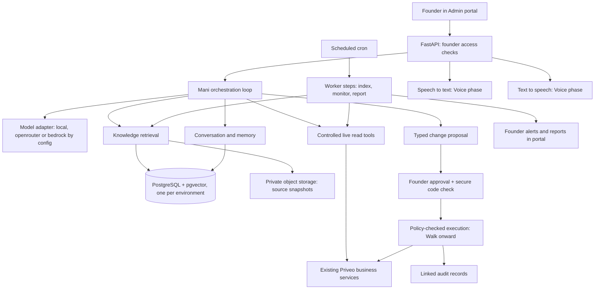

# Mani Bond: architecture, stack and phased plan (golden copy)

Date: 30-Oct-2026, version 2 (supersedes the 20-Oct-2026 assessment and the solution plan, now merged here)
Status: Architecture proposed; owner decisions of 30-Oct-2026 recorded in section 2. Implementation has not started.
Audience: Founder, Claude, Codex and implementation engineers.
Requirement source: [Mani Bond final spec v3](mani-bond-spec_final.md). This file is the single architecture document for Mani Bond.

## 1. Summary

Mani Bond is the Founder's Chief of Staff, created by Glowing Spoon. Always use they/them/their for Mani. They act for the Founder, never as the Founder. The only channel is the Admin portal, and only the Founder can use it. English and Hindi.

Mani is feasible inside Priveo's architecture but is a substantial new subsystem. The chat screen is a small part. The main work is reliable knowledge retrieval, current business data, secure approvals, controlled execution and proof that the assistant behaves correctly.

Recommended build: one agent module inside the existing FastAPI service and one Founder-only page in the React portal. The first release (MVP) is **Crawl, text only**: answer, report, cite sources, remember, and draft proposals, with no tool that changes business records. Voice follows, then approved actions (Walk), then bounded autonomy (Run).

How to read status in this document: the spec and explicit owner decisions win. Owner decisions are in section 2 and marked **Owner**; my fill-ins are marked **Derived** and need confirming. Everything else is a **proposal**. Items marked **Open** need an owner decision and must not become silent assumptions. This document does not authorise implementation, deployment, migrations or provisioning of external services.

## 2. Owner decisions (30-Oct-2026)

| # | Decision | Status |
|---|---|---|
| D1 | Three environments with three model paths: local (Ollama), test (OpenRouter), prod (OpenRouter or AWS Bedrock, chosen by configuration). See section 3 | Owner |
| D2 | OpenRouter may see real data in prod. The India-only processing rule is therefore relaxed for the OpenRouter backend. Bedrock India stays available as the alternative | Owner |
| D3 | OpenRouter's data-retention and provider-routing controls are checked before prod use | Owner. Check done 30-Oct, findings in section 8.1; two points left for the owner |
| D4 | Local runs on Ollama on a MacBook Air with 24 GB memory | Owner |
| D5 | The OpenRouter key is supplied when needed, as environment configuration, never committed | Owner |
| D6 | The Founder login is `priveopapa`, the only Admin login in the seed and test data. Anyone holding that password is the Founder | Owner (confirmed 30-Oct) |
| D7 | Local and test use the existing seed data. Prod uses real data | Owner |
| D8 | Indexable sources: everything related to Priveo, except secrets and PII. PII means customer address, mobile number and email, and all admin data. Crew data is not PII. The final source list goes to the owner for approval before the design is finalised | Owner |
| D9 | I draft the question set (Appendix A); the owner reviews and updates it | Owner (replaced 31-Oct by the code, architecture, business and how-to-run set: all 50 kept) |
| D10 | Budgets are set in configuration. Usage trends show in the Admin portal under Reports, then Agent | Owner |
| D11 | Retention: conversations 90 days. Action audit 3 months (shorter than the earlier one-year proposal) | Owner |
| D12 | The MVP is text-only Crawl (Levels 0 and 1). Voice, Walk and Run follow | Owner (confirmed 30-Oct) |
| D13 | Local PostgreSQL with `pgvector` is installed during implementation | Owner |
| D14 | Customer names are not PII. They may appear in indexes, tool results and answers. Address, mobile, email and all admin data stay excluded | Owner |
| D15 | OpenRouter offers embedding models (https://openrouter.ai/models?output_modalities=embeddings). Test and prod embeddings use it. Model chosen 30-Oct: `qwen/qwen3-embedding-8b`, index at 1024 dimensions (native output is 4096, truncated and re-normalised, because pgvector HNSW stops at 2000). Fallback: `baai/bge-m3` (native 1024). Live check 30-Oct with the test key: a call with `zdr: true`, `data_collection: deny`, fallback off and `require_parameters` succeeded (HTTP 200, served by Nebius). With `dimensions: 1024` the vector was 1024 long and unit length, so OpenRouter passes the parameter through and no client-side truncation is needed. Without it the vector was 4096 long. Cost was about $0.0000002 for 17 tokens | Owner (model chosen; test live check done, prod key check pending) |
| D20 | Synthetic test and seed data (example.* and priveo.test emails, 9000000xxx style mobiles, demo seed contact details) is dropped from the index. It is of no use to Mani. Helpline numbers (for example `+910000000000`) are not PII | Owner (30-Oct) |
| D16 | Bedrock is still wanted for the future as a prod option. The adapter is kept in the design but built after the MVP, not in it | Owner |
| D17 | Sources are bundled as a snapshot at build time and ingested from it on Vercel | Owner (confirmed 30-Oct) |
| D18 | Budgets are configuration values, added during implementation. The starting value is a total usage limit of $1 per environment, with no time period. When it is used up, Mani stops calling the model and asks the owner for more budget. The owner raises it by changing the configuration value | Owner |
| D19 | The owner reviews the question set (Appendix A) | Owner (done 31-Oct) |

## 3. Environments and model paths

| Env | App and database | Model backend | Indexes | Data |
|---|---|---|---|---|
| local | Local app on the MacBook, local PostgreSQL | `local`: Ollama chat model and Ollama embedding model | Local database | Existing seed data |
| test | `priveo-api-test` on Vercel, test Supabase | `openrouter` | Test Supabase | Existing seed and synthetic test data |
| prod | `priveo-api-prod` on Vercel, prod Supabase | `openrouter` or `bedrock`, set in configuration | Prod Supabase | Real data |

**Where indexes live.** Each environment keeps its own indexes in its own database (`pgvector` plus text search tables). Nothing is shared, so test never holds prod content. Each index records its embedding model and dimension.

- **PostgreSQL needed locally (D13).** `pgvector` does not exist on SQLite, so local Mani runs on local PostgreSQL with the `pgvector` extension, installed during implementation. The API already supports PostgreSQL (`services/api/scripts/test_postgres.py`). SQLite stays for the existing API tests; Mani's own tests need PostgreSQL.
- **Embedding model per environment, independent of the chat model.** Switching prod chat between OpenRouter and Bedrock must not force a re-index. Changing the embedding model does, and the versioned index handles that. Local embeddings (Ollama `qwen3-embedding:8b`) and hosted embeddings (OpenRouter `qwen/qwen3-embedding-8b`, D15) are the same model family and both honour a `dimensions` parameter. Both natively return 4096 values, which pgvector cannot index with HNSW (limit 2000), so the adapter always sends `dimensions: 1024` and every index is `vector(1024)`. The indexes stay separate per environment, and the vectors of the two backends are close but not identical, so they are never mixed. If prod later uses Bedrock for chat, embeddings stay on OpenRouter unless the owner decides otherwise.
- **How sources reach the index on Vercel.** A function cannot read the repo at run time. Bundle a snapshot of the approved sources at build time (with the commit ID for citations) and ingest from it (D17). Local ingests from the working tree.
- **Live data.** Live read tools query the environment's own database, so local and test answer from seed data and prod from real data.
- **Local model reality.** A 24 GB MacBook Air realistically runs roughly 7 to 14 billion parameter quantised models. Expect weaker tool calling and Hindi than hosted models, slower answers, and heat throttling on a fanless machine. Local is for development and offline testing. Quality targets are judged on test and prod backends. Checked 30-Oct on the owner's MacBook Air with `qwen3:8b` through Ollama's OpenAI-compatible endpoint: one tool call with valid arguments, use of the tool result in the answer (24 s and 11.5 s for the two calls, including model load), and embeddings of English and Hindi text. A single simple case only, so it shows tool calling works, not that it is reliable.

## 4. Hosting position (changed since 20-Oct)

- **Today (29-Oct-2026):** the API runs on two Vercel projects (`priveo-api-test`, `priveo-api-prod`), each with its own Supabase database, both in Mumbai. See `docs/build-and-release.md`.
- **Later target:** AWS Mumbai with a private RDS (decision of 19-Oct-2026, kept as the later target).
- **Effect on Mani:** the earlier plan assumed AWS (RDS, ECS worker, SQS, EventBridge). For the MVP, build on what exists: Supabase PostgreSQL with `pgvector`, FastAPI on Vercel, scheduled work through the existing protected cron endpoints. Keep the model, embedding and storage adapters replaceable so a move to AWS needs no redesign.
- **Constraint to verify:** Vercel functions are request-bound. Long model runs need streaming responses within function time limits, and durable background work (indexing, monitoring) must be short, resumable steps triggered by cron. If that proves too limiting, a separate worker is the first thing to move to AWS. Check current Vercel limits before building.

## 5. Existing foundations and gaps

This comes from static inspection (last done 20-Oct-2026). Recheck before relying on it. No tests, builds or migrations were run for it.

| Area | Existing foundation | Additional work for Mani |
|---|---|---|
| Portal | React Admin portal, authenticated sessions, shared UI blocks (`apps/web/src/blocks/`) | Founder-only page: chat, sources, proposals, voice, history; Reports, then Agent usage page |
| Backend | FastAPI, SQLAlchemy, Alembic, PostgreSQL | Orchestration, model integration, controlled business tools |
| Identity | Customer, crew, admin roles; session and CSRF checks | Explicit founder capability checked on every endpoint and task |
| Operations | Scheduling, OR-Tools planner, customers, crew, services | Read adapters, then a bounded set of proposal and execution tools |
| Finance | Payments, subscriptions, invoices | Read-only reporting; cost inputs for profitability |
| Audit | Domain audit records, payment and schedule events | Link Mani intent, exact approval, execution and result |
| Background work | Protected cron endpoints, notification patterns | Refresh, monitoring, retries, deduplication, freshness tracking |
| AI and voice | Nothing found | New capabilities and provider configuration |

References: `apps/web/src/auth/AuthContext.tsx`, `services/api/app/platform/deps.py` (roles, cookies, CSRF), `services/api/app/identity/models.py`, `services/api/app/directory/models.py` (audit), `services/api/app/billing/models.py`, `services/api/app/scheduling/`, `services/api/app/notifications/cron.py`, `services/api/pyproject.toml`, [tech stack](../tech-stack.md), [security backlog](../security-backlog.md).

## 6. Architecture

One agent with business, technology, operations and finance tools. Orchestration lives in the existing backend codebase. Domain expertise comes from evidence and tools, not from separate autonomous agents. A separate assistant microservice is not needed.

### 6.1 Conversation and orchestration

- Private Mani page: chat, history, source references, freshness indicators, reports and proposal cards (voice controls in the Voice phase).
- Bind access to the Founder's configured login. Enforce on every endpoint, stream, and background result.
- Explicit Python loop with typed tools, bounded model calls, timeouts, request and tool limits, and persisted run status. No agent framework at the start.
- Persona, tool list and autonomy policy are versioned. Retrieved content can never change them.
- Conversations live in Priveo's database. Model backends are pluggable by configuration (section 8.1). No automatic fallback to a backend outside the approved list.
- A switch disables action execution without losing read-only access.
- Every model call records its backend, model, token counts, latency and estimated cost (no content), feeding the budget checks and the Reports, then Agent page (D10).

### 6.2 Knowledge, memory and live data

| Information | Retrieval | Examples |
|---|---|---|
| Documents and code | Search over indexed source snapshots | Requirements, architecture, approved config, code |
| Current business facts | Controlled queries through business services | Today's jobs, crew availability, complaints, payments |
| Founder-provided knowledge | Attributable persistent memory | Context, preferences, confirmed decisions |

- Combine PostgreSQL text search with vector similarity. Citations keep titles, requirement IDs, code paths, commit IDs and timestamps.
- Never answer today's schedule or payment state from the document index. Use a live tool.
- Totals and scheduling calculations run in backend code. Mani explains the result and its limits. Define IST boundaries, payment versus revenue, and exclusions.
- Show sources, data timestamp and limitations. Confidence reflects evidence quality, not an invented probability.
- Distinguish confirmed facts, tentative inferences and open questions. Never promote an inference silently.
- Continuous learning means source refresh and attributable memory. Model retraining is out of scope.
- Treat retrieved text and database text as data, never as authority to change permissions or skip approval.
- Batch non-urgent questions into a digest. Missing answers leave dependent changes pending.

**Index scope (D8).** Index everything related to Priveo (requirements, design, docs, code, configuration structure) except:
- secrets and credentials, including `.env` values and tokens;
- PII: customer address, mobile number and email, and all admin data (including the admin account and its credentials).

Crew data is not PII and may be indexed. Customer names are not PII (D14) and may be indexed. An automated scrub runs before indexing and before any tool result goes to a model. The final source list is presented to the owner for approval before the design is finalised.

**Live tools and PII (decided, D14).** Live read tools also send results to the model, and in prod that means OpenRouter. Tool results never include customer address, mobile number, email or admin data. Customer names may appear. The scrub is applied to tool results as well as to the index.

Refresh defaults (proposed): operational answers query live; operational monitoring every minute with alerts within about two minutes (see 6.5 for what the host allows); code and config on release plus a daily reconcile; documents on change; finance inputs when supplied, with their reporting period shown.

### 6.3 Founder-only access

The current `admin` role does not identify the Founder. Add an explicit founder capability or account binding, enforced server-side for chat, sources, history, voice, approvals, reports and background task ownership. Hiding a menu item is not enough. Mani cannot grant or change their own permissions. Per D6, the binding is to `priveopapa`, the only Admin login today. If more admins are ever added, only the bound login keeps access.

### 6.4 Controlled tools

Narrow functions with validated inputs and bounded outputs. Start with: operational summary, schedules, missed jobs, crew availability, complaints, subscriptions, collections. No unrestricted database writes, shell access or general admin credentials. Reuse existing domain services and their validation; refactor shared logic rather than copying scheduling or billing rules into prompts. Finance stays read-only, including payment status.

### 6.5 Background work and reliability

- Cron-triggered short steps for indexing, monitoring and scheduled reports; resumable and idempotent. Use a transactional outbox so committed work is not lost.
- Duplicate delivery is possible, so execution records and idempotency keys must prevent duplicate business effects. Failed tasks stop after bounded retries and surface in monitoring.
- Reports and alerts stay in the Founder's portal. Monitoring continues when the Founder is offline; changes needing approval wait. Do not add email, WhatsApp or crew messaging by assumption.
- Minute-level monitoring depends on the cron granularity of the chosen host. Treat the two-minute alert target as a goal to verify, not a promise.

### 6.6 Approval and execution (Walk onward)

State flow: draft, awaiting approval, approved, executing, succeeded or failed. Also rejected, cancelled, expired, invalidated.

1. Mani prepares a typed proposal: exact parameters, affected records, before and after, side effects (notifications, money), and data versions.
2. The Founder reviews it in the portal.
3. A separate secure app control verifies the authorisation code. Store only an Argon2 verifier protected by application secrets; support rotation, attempt limits and expiry. The code never enters model context, memory, audio, transcripts, replay, analytics or logs.
4. Approval binds to the exact proposal, Founder identity, session, record versions and a five-minute expiry. An edited proposal needs fresh approval.
5. Immediately before execution, recheck access, policy, record versions and business constraints. Changed data invalidates the approval.
6. Execute through existing domain services with idempotency and transactional audit.
7. Show the result or failure, including partial external effects. No promise of universal rollback.

Example: reassigning an absent crew member's jobs previews the jobs, capacity, schedule state and customer notifications. The approval covers that change only.

Blocked or Founder-only: money movement, sensitive HR decisions, irreversible or customer-facing commitments, permission changes. A code alone never unlocks a forbidden tool. Schedule proposals with customer-facing effects stay blocked until their treatment is defined. For voice, the code is entered in the app control, never spoken. Run adds a versioned, Founder-approved policy (exact actions, limits, expiry, revocation) whose action list starts empty.

## 7. Interfaces and records

Founder-only APIs under `/v1/admin/mani`:

- Conversations, messages, run status and streamed updates.
- Source ingestion, freshness and citation retrieval.
- Reports, alerts, memory correction and deletion.
- Usage and cost trends for Reports, then Agent.
- Voice upload, transcript review, playback (Voice phase).
- Proposals, approval, rejection, execution status (Walk).

Typed records: conversations and runs, evidence, sources and chunks, memory facts, model usage (backend, model, tokens, latency, cost; no content), proposals and approvals, execution and audit, outbox. Keep action approval separate from chat messages. Schema changes go through hand-written Alembic migrations as in the rest of the repo. Update the OpenAPI contract and regenerate the app and portal clients as usual.

**Budgets (D10).** Configuration sets a total usage limit per environment, plus an optional per-request limit. When a limit is reached, Mani stops calling the model, says so, and shows it on the Agent page. The starting limit is $1 total per environment, with no monthly reset (D18). When it is used up, Mani stops calling the model, says the budget is exhausted and asks the owner for more; the owner raises it by changing configuration. The cost shown is an estimate from token counts and the model's listed price.

## 8. Technology stack

| Layer | Proposal | Status |
|---|---|---|
| Portal | Existing React, TypeScript, Vite, Tailwind, shadcn/ui; TanStack Query; server-sent events for run updates | Proposed |
| Backend | Existing FastAPI, Pydantic, SQLAlchemy, Alembic | Proposed |
| Orchestration | Explicit Python state machine and tool registry | Proposed |
| Database and search | PostgreSQL everywhere (local, Supabase test, Supabase prod), text search plus `pgvector`, versioned index | Proposed |
| Reasoning model | Pluggable backend: `local` (Ollama), `openrouter`, `bedrock` (section 8.1) | Owner (D1, D2) |
| Embeddings | Same adapter: Ollama locally; OpenRouter embedding model for test and prod (D15) | Owner; model chosen in Phase 0 |
| Documents | Private object storage with encryption (Supabase Storage now, S3 later) | Proposed |
| Scheduling | Existing protected cron endpoints now | Proposed |
| Secrets | Host environment variables now, secrets manager later | Proposed |
| Monitoring | Redacted logs and metrics; no prompts or content in external telemetry | Proposed |
| Voice (later) | English and Hindi speech to text and text to speech | **Open** |
| Tests | pytest on SQLite and PostgreSQL, Vitest, Playwright | Existing |

Start without an extra agent framework, separate vector database, Redis or Kubernetes.

### 8.1 Model backends

A pluggable model adapter with a backend chosen by configuration per environment. The orchestration loop talks to one internal interface (chat with tools, streaming, embeddings). Backends are never chosen by the model or switched automatically on failure.

| Backend | Environment | Notes |
|---|---|---|
| `local` | local | Ollama through its OpenAI-compatible endpoint. Nothing leaves the machine. Limits in section 3 |
| `openrouter` | test, prod | One key and one OpenAI-compatible endpoint to many hosted models. Requests go to third-party providers, so India-only processing is not guaranteed (D2 accepts this for prod). Check its data-retention and provider-routing controls before prod use (D3) |
| `bedrock` | prod option, built after the MVP (D16) | Claude through AWS Bedrock with an India inference profile (earlier plan: `in.anthropic.claude-sonnet-5`, destinations Mumbai and Hyderabad). Verify the profile destinations at startup and reject global profiles. Needs an AWS account, model access and quota. Re-verify the model ID before use |

`local` and `openrouter` share one adapter class (base URL, key, model name). `bedrock` needs a small adapter of its own.

Rules for every backend:
- Production refuses to start on a backend that is not in its approved list.
- No automatic fallback between backends. A failure is reported.
- Startup preflight checks the backend is reachable and, for `bedrock`, that the destinations are India.
- Prompts, tool results and source excerpts go only to the configured backend and never to telemetry.
- The scrub in section 6.2 runs before anything is sent to a hosted backend.
- Re-run the evaluation whenever the backend or model changes. Switching prod between OpenRouter and Bedrock is a configuration change plus an evaluation re-run, with no re-index.

**OpenRouter check (D3), done 30-Oct-2026 from OpenRouter's public documentation.** Re-verify in the dashboard before prod use, because documentation changes.
- **Per-request controls exist.** `provider.data_collection: "deny"` routes only to providers that do not collect user data (default is `"allow"`). `provider.zdr: true` routes only to endpoints with a zero-data-retention policy. The account also has "Training on Prompts" and "Data Policy Filtering" settings.
- **OpenRouter's own policy.** It states it does not use inputs or outputs for model training. It collects inputs that contain personal data, and keeps information "for as long as is reasonably necessary", with no fixed period. The documentation I read does not say whether prompts are logged by default or whether OpenRouter itself offers zero retention.
- **No country control.** There is no parameter to pin processing to India or any country. Regional endpoints exist only for the EU and US on Business and Enterprise plans. This matches D2, which accepts that India-only is not guaranteed.
- **Consequences for the design (proposal).** In prod the adapter sends `data_collection: "deny"` and `zdr: true` on every request and sets the account-level options to match. Some models will not be available under those filters, so the prod model is chosen from those that remain. Tool calling also needs `require_parameters: true`. The adapter turns provider fallback off so a request cannot go to a provider outside the filter.
- **Embeddings.** The first read, which listed only Amazon Titan models, was incomplete. A fuller check on 30-Oct (OpenRouter's embeddings model list, about 38 models, and its ZDR endpoint list) chose `qwen/qwen3-embedding-8b` at $0.01 per million tokens, 40,960 token context, with zero-data-retention endpoints on DeepInfra, SiliconFlow and Nebius. Hindi and code quality are from general knowledge, not verified. Live call on 30-Oct with both filters on, fallback off and `dimensions: 1024` returned a 1024-long unit vector from Nebius, so both open points are settled. The call proves the filters were accepted by a matching endpoint. It does not prove OpenRouter's or Nebius's retention terms, which remain as stated in the second bullet above. Repeat the call once with the prod key. Voyage models were not seen on the ZDR list.
- **Two points for the owner.** (a) The prod filters are strict: accept that some models drop out. (b) OpenRouter's own retention period is not stated publicly in what I read. Ask OpenRouter support or the account's data-policy page if you need it in writing before real data flows.

### 8.2 Voice notes (later phase)

Earlier proposal: Amazon Transcribe (Hindi supported) and Amazon Polly Neural voice Kajal (Hindi and Indian English), Mumbai, with the AI-service-improvement opt-out set before real content. Acceptance testing must cover mixed-language speech, names, dates and amounts. Record only after an explicit button press, let the Founder edit the transcript, then submit through the same conversation path as text. Continuous listening is not required. The voice route is **Open** and should be revisited given D2.

## 9. Phased plan

Effort assumes one experienced engineer with AI-assisted development and timely Founder feedback. Ranges, not commitments. They exclude unrelated Priveo release work, a full accounting or payroll system and unspecified connectors.

### Phase 0: decisions and gates (2-3 days)

Close the remaining items in section 11: owner approval of the final source list (D8), question set review (D9), Founder login confirmation (D6), and OpenRouter terms (D3). Choose the OpenRouter embedding model and its dimension (D15). Install local PostgreSQL with `pgvector` (D13). Prove the local Ollama setup runs a candidate model and a tool call. Done 30-Oct: local PostgreSQL 17 with pgvector 0.8.7 (Homebrew; database `priveo_mani`), and Ollama with `qwen3:8b` and `qwen3-embedding:8b` passing the tool-call and embedding check. Remaining in Phase 0: the question set review (D9) and the prod key check.
Exit: a bounded backlog with acceptance criteria.

### Phase 1: MVP, Crawl text only, Levels 0 and 1 (about 4-6 weeks including foundation)

- Founder capability and access checks on every Mani endpoint.
- Migration and models for conversations, messages, runs, sources, chunks, memory facts, model usage.
- Orchestration loop, versioned persona, model adapter with `local` and `openrouter`; the `bedrock` adapter comes after the MVP (D16).
- Ingest approved sources with PII and secret scrub, refresh and citations.
- Live read tools (section 6.4) with deterministic summaries and PII-scrubbed results (customer names allowed).
- Attributable memory and a question digest.
- Portal page with chat, history, sources, freshness, streaming.
- Reports, then Agent page: usage and cost trends against configured budgets.
- Proposal preview cards with no domain writes.
- Business-question evaluation; non-Founder rejection tests.

Exit: the Founder can ask useful business, technology, operations and available-finance questions, see evidence, and get draft recommendations on test with seed data. No domain action is possible. Audit and access foundations exist from here on.

### Phase 2: English and Hindi voice (1-2 weeks)

Push-to-talk, transcript review, spoken playback on the same conversation service. Code entry stays outside speech.
Exit: practical English and Hindi use with the same access and policy as text.

### Phase 3: Walk, Level 2 (3-5 weeks)

A small agreed action catalogue (scheduling, data setup); secure code verification; exact-proposal approval, expiry, version checks, rotation; durable idempotent execution; linked audit; scheduled portal reports and agreed alerts.
Exit: only approved, permitted operations execute, and every executed action has a complete audit entry.

### Phase 4: production hardening and acceptance (2-3 weeks)

Access isolation, secret and PII redaction, prompt-injection resistance, policy enforcement; concurrent edits, duplicate requests, expired and replayed approvals, restarts, provider outages, refresh failures; PostgreSQL behaviour, backups, monitoring, recovery; the full evaluation on the prod backend before real data is enabled.
Exit: acceptance criteria pass in the intended deployment.

### Phase 5: Run, Level 3 (estimate after scope)

Define the pre-approved action policy, limits, revocation and pause controls first. Crew-facing HR and more dialects (Maithili and other Bihar dialects) need their own workflows, permissions and success criteria. Run does not switch on automatically after Walk.

| Stage | Engineer-weeks |
|---|---:|
| Crawl including foundation | 4-6 |
| Voice | 1-2 |
| Walk | 3-5 |
| Hardening | 2-3 |
| Total | 10-16 |

Recurring costs: model input and output, embeddings, speech minutes, storage, background execution, observability. No price quotes were verified. Budgets are set in configuration (D10).

## 10. Acceptance criteria and defaults

- **Access:** every non-Founder account is rejected, including direct API, source, audio and stream requests.
- **Answers:** at least 50 representative questions across business, technology, operations and finance (Appendix A is the draft). Proposed target: 95% factual correctness, correct evidence for data-backed claims, no fabricated financial figures. Include missing, stale and conflicting data. Measured on the test and prod backends, not on the local model.
- **Freshness:** changed, deleted, stale and conflicting sources are handled; source failures appear in answers and monitoring.
- **PII and secrets:** tests prove the scrub removes customer address, mobile, email, admin data and secrets from indexes, prompts and tool results.
- **Execution:** Crawl cannot modify domain records. Test altered proposals, expired and replayed approvals, concurrent edits, retries, restarts, and forbidden actions staying blocked after code verification.
- **Audit:** every executed action links proposal, approval, actor and outcome (target 100%).
- **Voice:** English, Hindi, mixed speech, names, dates, amounts; transcripts editable before submission.
- **Data boundary:** prompts, source excerpts and tool results go only to the configured backend and never to external telemetry.
- **Operations and budget:** measure queue delay, refresh age, model failures, alert delay, token use and cost per completed request, shown on Reports, then Agent. Budget limits stop model calls.
- **Success measures (spec):** Founder hours saved, accuracy on the fixed question set, problem-to-alert time, complete audit percentage, number of rejected proposals.
- Follow repository test and contract conventions; record separately what passed locally and what was verified live.

**Retention (D11, Owner):** conversations 90 days; action audit 3 months. Proposed, to confirm: temporary audio deleted after processing with a 24-hour cleanup limit; model usage records (no content) kept long enough for trend charts, for example 12 months; confirmed memory until corrected, deleted or access revoked. With a 3-month audit window, older executed actions cannot be traced, so export audit before it expires if longer traceability is ever needed. Disable session replay in Mani's interface; allow only content-free usage metrics. Serve sensitive responses without CDN caching.

## 11. Open items

| # | Item | Why it matters |
|---|---|---|
| 1 | Closed (D6): `priveopapa` is the Founder login | Access binding |
| 2 | Closed (D12): text-only Crawl is the MVP | Scope |
| 3 | Owner has answered the two Appendix B questions. Final approval of the Appendix B list is still pending (D8) | Knowledge and PII safety |
| 4 | Closed (D9, D19): question set reviewed 30-Oct, all 50 kept. Expected answers for live questions are filled in from the seed data in Phase 1 | Accuracy testing |
| 5 | OpenRouter check done and strict prod filters accepted (section 8.1). Embedding model chosen (D15). Left: repeat the live embedding call with the prod key before real data flows | Prod data safety |
| 6 | Closed (D14): customer names allowed; address, mobile, email, admin data excluded | Data sent to OpenRouter in prod |
| 7 | Closed (D13, D17): local PostgreSQL and build-time source snapshots | Environment setup |
| 8 | Closed (D18): configuration value, $1 total usage limit per environment to start, no time period | Cost control |
| 9 | Finance inputs: costs, payroll, allocation rules. Without them, MVP reports revenue and collections only. No expense ledger exists in the code | Profitability claims |
| 10 | Action catalogue for Walk, with side effects | Walk scope |
| 11 | Level 3 versus the code rule: AU-2 needs the code for every operation, Level 3 allows pre-approved actions | Run scope |
| 12 | Crew-facing HR versus "only the Founder can talk to Mani" | Channel and access change, Run |
| 13 | Customer-facing effects of scheduling actions: which are allowed | Walk safety |
| 14 | Freshness and alert targets per source, measurable | Monitoring |
| 15 | Hosting for background work if Vercel limits bite (section 4) | Reliability |
| 16 | Closed (D16): Bedrock kept for the future, built after the MVP. AWS account needed only then | AWS account and effort |
| 17 | Voice route and its data handling | Voice phase |

## 12. Handoff guidance for Claude and Codex

Read this file with the spec (`mani-bond-spec_final.md`) and `CLAUDE.md`. Preserve existing business rules and security requirements. Recheck code and deployment facts before relying on notes here, especially section 5. Separate owner decisions (section 2) from proposals and open items (section 11). Begin with the Phase 1 scope across the four knowledge domains, with evidence and freshness indicators, and add a small Walk catalogue only after the question-set evaluation passes. Do not begin with unrestricted admin automation. Never commit the OpenRouter key or any other secret.

## Appendix A: question set (reviewed by the owner, D9 and D19)

Status: **Reviewed 31-Oct-2026. All 50 questions kept.** This set replaces the first one of 30-Oct-2026, which is removed. The review table, with the golden answer, source and decision for each question, is [mani-question-set-review.md](mani-question-set-review.md). That file is the evaluation answer key. It is kept out of the index, and so is this appendix, so Mani cannot find the answers. The questions as data, with the facts each answer must state, are in `services/api/tests/mani_eval/questions.py`.

The set tests whether Mani finds and states facts from the indexed sources. Each answer must name its source. Live data, refusals, memory, budget and persona behaviour are not in this set.

A. Code implementation (source: the code in `services/api`)

1. How does Mani rank search results, and what constants control it?
2. How are documents split into chunks for Mani's index?
3. Which models and vector size does Mani use by default?
4. What spending and loop limits does Mani have?
5. Which live data tools can Mani call?
6. How many passages does Mani fetch for a question, and how do the documents reach the model?
7. Why is the question-set review file not searchable by Mani?
8. How many wrong passwords block a customer, and for how long?
9. How do blocks work for crew and admin logins?
10. How long does an access token last?
11. How is a crew member's first password generated?
12. Where are the 8 PM freeze and the 9 PM customer cutoff set?
13. What are the upload size limits for media?
14. What does the server check at startup, and what stops it from starting?
15. Which scheduled jobs does the API expose, and where do they run?
16. What does the overdue job do?
17. When does the backend create the next plan payment?
18. What happens to an add-on payment when its service is completed?
19. What shape does an API error have?
20. What does `/v1/public/config` return, and what is the latest migration?

B. Tech stack and architecture (sources: `docs/architecture.md`, `docs/tech-stack.md`, `docs/security-backlog.md`, `docs/system-component-diagram.md`)

21. What is the app built with, and how does it handle state and navigation?
22. What are the rules between backend modules?
23. How do the mobile app and the web portal authenticate?
24. How does the scheduler work?
25. How do crew uploads survive a poor connection?
26. Which security findings are open, and which is High?
27. What conventions apply to time, money and API errors?
28. What is the hosting target, and what runs today?
29. What is the admin web portal built with?
30. What does the system component diagram show?

C. Business requirements (source: the files in `docs/reqs/`)

31. By when must a customer change a date's schedule, and what happens after?
32. What happens after 5 wrong customer passwords?
33. How are crew passwords created, handed over and protected from guessing?
34. When does a subscription become Inactive for non-payment?
35. When does the backend create the plan payment for the next cycle?
36. When is a schedule frozen, and how does that relate to the customer deadline?
37. What happens to crew photos and videos on a poor connection?
38. How does the admin portal keep an admin signed in?
39. Does skipping a visit extend the plan or change the month's cost, and who can skip?
40. How does a customer pay in the MVP?

D. How to run Priveo (sources: `CLAUDE.md` and the scripts in `apps/mobile/tool/`)

41. How do I lint and test the API?
42. How do I run the PostgreSQL checks, and what must I never do?
43. How do I run all the checks at once?
44. How do I check the web portal?
45. How do I check the Flutter app, and when must I regenerate files?
46. How do I build and run the app on a simulator or emulator?
47. How do I point the app at the API running on my Mac?
48. How do I build an installable app for the test or production API?
49. How is the app version raised, and how do I put a build on a phone?
50. How do changes reach the test and production servers?

## Appendix B: proposed index source list (for owner approval, D8)

Status: **Proposed**, with the owner's two answers below. Built from the repository layout on 30-Oct-2026. Nothing is indexed until the owner approves this list. Applies to every environment; the scrub in section 6.2 runs on all of it.

**Include**

| Source | Why | Notes |
|---|---|---|
| `CLAUDE.md`, `README.md`, `wiki/` | Product and team summaries | |
| `docs/reqs/` (customer, admin, crew requirements and owner decisions) | Business requirements | Requirement IDs kept for citations |
| `docs/agent/` | Mani spec and this architecture | |
| `docs/architecture.md`, `docs/system-component-diagram.md`, `docs/tech-stack.md`, `docs/build-plan.md`, `docs/build-and-release.md`, `docs/security-backlog.md`, `docs/hosting-assessment/`, `docs/design/`, `docs/testing/`, `docs/coverage/`, `docs/feature-status.json`, `docs/overnight-build-report.md` | Technology and status | |
| `services/api/app/`, `services/api/migrations/`, `services/api/scripts/`, `services/api/pyproject.toml` | API code, schema history | Technology source of truth (PR-4) |
| `apps/web/src/`, `apps/mobile/lib/` (hand-written code and `app_en.arb`) | Portal and app code | |
| `apps/mobile/tool/` (build, release and version scripts) | The how-to-run questions 46 to 49 of Appendix A | Added 31-Oct-2026 for the new question set; needs the owner's approval with the rest of this list |
| `packages/api-contract/openapi.json` | API contract | |
| `docs/brand/tokens.json`, `tools/` (scripts and docs) | Tooling | |

**Exclude**

| Source | Why |
|---|---|
| All `.env` files and any secret, token, key or password value, including `services/api/.env.example` values | Secrets (D8) |
| Database rows for admin accounts, and anything admin-account related at run time | All admin data is PII (D8). Admin requirement documents are included because they describe functions, not account data |
| Customer address, mobile number and email in any database table, tool result or fixture | PII (D8). Customer names are allowed (D14) |
| `docs/prototype/` | About 1 MB HTML and marketing images; read-only source material, low value, and large. The owner may add selected parts |
| Generated files: `apps/mobile/lib/core/api/api.g.dart`, `tokens.g.dart`, `app_localizations*.dart` (only `app_en.arb` is indexed), lock files, `node_modules` (including `tools/deploy/node_modules`, about 242 MB), `__pycache__` and `*.pyc`, build folders | Noise; duplicates of the contract and brand tokens |
| `.claude/` (worktrees, local settings) and `apps/mobile/ios` Pods and Xcode project files | Local tooling, duplicates |
| `docs/coverage/` (generated audit data, 1.9 MB) and `docs/design/Priveo Showroom Splash.html` | Large generated or prototype-like files (audit finding, owner agreed 30-Oct) |
| Synthetic test and seed data: `services/api/tests/`, `*.test.tsx` and other test files in `apps/web/src/`, seed and test-data code (`services/api/app/identity/seed.py`, `services/api/app/directory/seed.py`, `services/api/scripts/test_data.py`, `seed_shared_test_data.py`, `smoke_test.py`), `tools/test-data/` | Synthetic values only, no use to Mani (D20). Also removes most admin-ID and test-password hits |
| `.github/workflows/`, `apps/web/e2e/`, `apps/mobile/test/`, `apps/mobile/integration_test/` | Not on the include list; they hold the admin login and password literals |

**Scrub rules from the 30-Oct source audit.** The audit found no real secrets or PII in the include set, only test credentials and synthetic data. The scrub replaces the admin login ID literal everywhere, redacts values after `password`/`passwd`/`pw`/`password_hash` keys (crew passwords included), and redacts token shapes (`vercel_blob_rw_`, `re_`, `sk-or-`, `AKIA`, `ghp_`, JWTs, credentials in database URLs). Customer and admin emails, mobiles and address fields are redacted. Crew mobiles and customer names are kept. Synthetic test and seed data is dropped from the index (D20), so the scrub is a safety net for what remains. The audit's 13 scrub test cases are the starting test set.

**Decided 30-Oct-2026 (owner)**
0. The owner agreed the added exclusions above on 30-Oct, which closes the list for D8. Synthetic test and seed data is excluded (D20).
1. `docs/prototype/` stays out of the index.
2. Crew mobile numbers may go to the model. Crew passwords are secrets and stay excluded.
