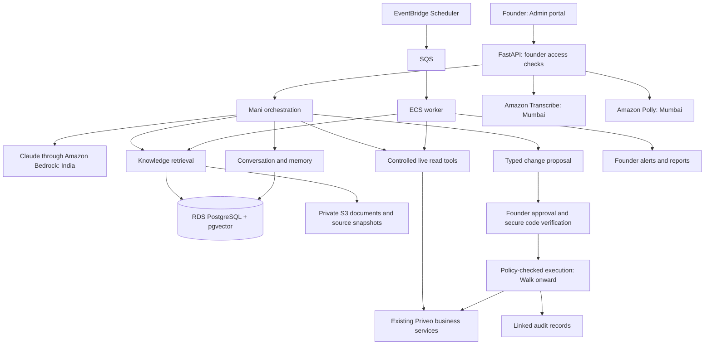

# Mani Bond: solution architecture and technology stack

## 1. Recommended solution

Build Mani as a **Founder-only assistant within Priveo**, using the existing Admin portal and FastAPI business services.

Use **AWS Mumbai for application hosting, storage and background work**, with AI processing restricted to India. Deliver **Crawl with English/Hindi push-to-talk voice first**, followed by approved actions in Walk and bounded autonomy in Run.

The first release will answer questions, produce reports, learn from approved sources and prepare recommendations. It will have no tools that modify Priveo business records.

### Architecture

Implement one agent with business, technology, operations and finance tools. Keep orchestration in the existing backend codebase and run background processing as a separate ECS service. Domain expertise comes from evidence and tools rather than separate autonomous agents.

## 2. Solution architecture details

### Conversation and orchestration

- Add a private Mani page with chat, history, source references, freshness indicators, voice controls, reports and proposal cards.
- Bind access to the Founder's configured login UUID. Enforce this on every endpoint, stream and background result.
- Implement an explicit Python orchestration loop with typed tools, bounded model calls, timeouts and persisted run status.
- Keep the persona, supported tools and autonomy policy versioned. Retrieved content cannot alter those policies.
- Persist conversations in Priveo's database. Keep provider adapters replaceable and prevent automatic fallback outside India.

### Knowledge, memory and current business data

Use three distinct information paths:

| Information | Retrieval method | Examples |
|---|---|---|
| Documents and code | Search indexed source snapshots | Requirements, architecture, approved configuration, implementation |
| Current business facts | Controlled queries through business services | Today's jobs, crew availability, complaints, payments |
| Founder-provided knowledge | Attributable persistent memory | Business context, preferences, confirmed decisions |

Combine PostgreSQL text search with vector similarity search. Preserve document titles, requirement IDs, code paths, commit identifiers and timestamps in citations.

Perform financial totals and scheduling calculations in backend code. Mani explains those results and their limitations.

Initial refresh defaults:

- Operational answers: query live when requested.
- Operational monitoring: check every minute; target alerts within two minutes under normal operating conditions.
- Code/configuration: refresh on release and reconcile daily.
- Documents: refresh on ingestion or change detection.
- Finance inputs: refresh when supplied and disclose their reporting period.

Index only approved sources, excluding credentials, secrets and unnecessary personal data. Continuous learning means source refresh and attributable memory; model retraining is outside this roadmap.

### Approval and execution

The model may create proposals; the backend determines whether execution is permitted.

For Walk:

1. Produce an exact proposal showing affected records, before/after changes and notification or financial consequences.
2. Collect explicit approval and the authorisation code through a separate secure app control.
3. Bind approval to the proposal, Founder session, record versions and a five-minute expiry.
4. Revalidate permissions, source versions and business constraints immediately before execution.
5. Execute through existing domain services with idempotency and transactional audit.
6. Record the outcome and display any failures or partial external effects.

The code never enters model context, audio, transcripts, replay, analytics or logs. Store an Argon2 verifier protected by application secrets; support rotation and attempt limits.

Finance remains read-only. Sensitive HR decisions, money movement and permission changes remain unavailable to the agent. Customer-facing commitments remain blocked; schedule proposals with customer-facing effects cannot execute until their permitted treatment is explicitly defined.

Run adds a versioned, Founder-approved policy listing exact actions, limits, expiry and revocation. Its action list starts empty. No unanswered question or missing approval becomes permission.

### Background work and reliability

Use a transactional outbox to publish committed work to SQS. Workers handle indexing, monitoring, scheduled reports and approved execution.

SQS can deliver messages more than once, so database execution records and idempotency keys must prevent duplicate business effects. Failed tasks go to a dead-letter queue after bounded retries. [AWS SQS delivery behaviour](https://docs.aws.amazon.com/AWSSimpleQueueService/latest/SQSDeveloperGuide/standard-queues.html).

Keep reports and alerts in the Founder's portal. Background monitoring continues when the Founder is offline; business changes requiring approval wait.

## 3. Technology stack recommendations

### Provider comparison

| Option | Assessment for Mani | Recommendation |
|---|---|---|
| OpenAI direct API | Suitable tool and structured-output capabilities, but current documentation distinguishes India storage from India processing | Exclude under the India-only requirement |
| Anthropic direct API | Supports application-executed tools; a verified India-only processing route was not established in this review | Do not select for this deployment |
| Claude through AWS Bedrock | Offers an India inference profile and fits Priveo's AWS architecture | **Primary recommendation** |

OpenAI currently lists India regional storage with processing marked unavailable. That prevents recommending its direct API for this requirement. [OpenAI data controls](https://developers.openai.com/api/docs/guides/your-data).

Recommend **Claude Sonnet 5 through Bedrock Runtime**, using `in.anthropic.claude-sonnet-5`. AWS documents its India destinations as Mumbai and Hyderabad. Application storage remains in Mumbai; inference may use either Indian region. [AWS model card](https://docs.aws.amazon.com/bedrock/latest/userguide/model-card-anthropic-claude-sonnet-5.html).

At deployment and startup, verify the profile's destination regions using `GetInferenceProfile`. Allow only the approved Indian destinations; reject global or other geographic profiles. Account access and quotas must pass a preflight check before enabling Mani. [AWS inference-profile guidance](https://docs.aws.amazon.com/bedrock/latest/userguide/inference-profiles-support.html).

### Selected stack

| Layer | Recommendation | Reason |
|---|---|---|
| Portal | Existing React, TypeScript, Vite, Tailwind and shadcn/ui | Reuses Priveo's interface and authentication |
| Frontend data | TanStack Query; server-sent events for run updates | Fits existing portal patterns |
| Backend | Existing Python/FastAPI, Pydantic, SQLAlchemy and Alembic | Reuses business rules and contracts |
| Agent orchestration | Explicit Python state machine and tool registry | Makes approvals and execution easy to inspect and test |
| Model integration | `boto3`, Bedrock Converse/ConverseStream | AWS identity integration and typed tool exchange |
| Reasoning model | Claude Sonnet 5, India inference profile | Recommended balance for this workload, subject to acceptance testing |
| Database | RDS PostgreSQL | Existing relational foundation |
| Knowledge search | PostgreSQL text search plus `pgvector` | Keeps search, permissions and provenance together |
| Embeddings | Titan Text Embeddings V2 in Mumbai | India-region embedding generation |
| Document storage | Private S3 with KMS encryption | Source snapshots, uploads and reports |
| Speech recognition | Amazon Transcribe in Mumbai, English/Hindi | Regional speech processing |
| Speech generation | Amazon Polly Neural, Kajal, English/Hindi | One bilingual voice across supported languages |
| Background tasks | ECS Fargate worker, SQS and dead-letter queue | Durable asynchronous processing |
| Scheduling | EventBridge Scheduler | Refreshes, checks and reports |
| Secrets | AWS Secrets Manager and ECS task roles | Avoids embedded credentials |
| Monitoring | CloudWatch metrics, alarms and redacted logs | Keeps operational telemetry within the AWS deployment |
| Tests | pytest/PostgreSQL, Vitest, React Testing Library and Playwright | Matches the existing repository |

RDS supports pgvector; select an extension version compatible with the chosen database engine. Titan V2 supports configurable embedding dimensions; use 1,024 initially and version the embedding index. [RDS extensions](https://docs.aws.amazon.com/AmazonRDS/latest/PostgreSQLReleaseNotes/postgresql-extensions.html), [Titan embeddings](https://docs.aws.amazon.com/bedrock/latest/userguide/titan-embedding-models.html).

Transcribe supports Hindi, and Polly Neural provides Kajal for Hindi and Indian English with Mumbai availability. Actual names, amounts and mixed-language speech require acceptance testing. [Transcribe languages](https://docs.aws.amazon.com/transcribe/latest/dg/supported-languages.html), [Polly Neural voices](https://docs.aws.amazon.com/polly/latest/dg/neural-voices.html).

Enable AWS AI-service improvement opt-out before processing real content, including Transcribe and Polly. AWS notes that service-improvement content can otherwise be stored outside the service's operating region. [AWS opt-out policy](https://docs.aws.amazon.com/organizations/latest/userguide/orgs_manage_policies_ai-opt-out.html).

Start without an additional agent framework, separate vector database, Redis or Kubernetes. The selected components cover the initial workload.

## 4. Interfaces and delivery sequence

### New interfaces and records

Add Founder-only APIs under `/v1/admin/mani` for:

- Conversations, messages, run status and streamed updates.
- Source ingestion, freshness and citation retrieval.
- Voice upload, transcript review and speech playback.
- Reports, alerts and memory correction/deletion.
- Walk proposals, approval, rejection and execution status.

Define typed records for conversations/runs, evidence, sources/chunks, memory facts, proposals/approvals, execution/audit and outbox delivery. Keep action approval separate from ordinary chat messages.

For voice, record after an explicit button press, transcribe in Mumbai, let the Founder review/edit the transcript, and submit it through the same conversation path as text. Provide spoken playback of the resulting answer.

### Delivery milestones

| Milestone | Deliverable | Indicative effort |
|---|---|---:|
| Foundation and Crawl | Founder access, knowledge ingestion, live read tools, evidence, memory and draft recommendations | 4-6 engineer-weeks |
| Voice | English/Hindi push-to-talk, transcript review and playback | 1-2 additional weeks |
| Walk | Approved action catalogue, secure approvals, durable execution and scheduled reports | 3-5 additional weeks |
| Production hardening | Security, recovery, deployment and acceptance checks across the releases | 2-3 engineer-weeks |
| Run | Policy-controlled autonomy and separately specified expanded workflows | Estimate after workflow definition |

The first usable release is Crawl plus voice. Security and access controls are required before that release; hardening is not deferred entirely until Walk.

The earlier 10-16 engineer-week estimate remains provisional. It excludes unrelated Priveo fixes, a full accounting/payroll system and unspecified connectors. India-region availability, quotas and quality testing are early delivery gates.

## 5. Acceptance criteria and explicit defaults

- **Access:** all non-Founder accounts are rejected, including direct API, source, audio and stream requests.
- **Answers:** evaluate at least 50 representative questions covering all four domains. Proposed release target: 95% factual correctness, correct evidence for data-backed claims, and no fabricated financial figures.
- **Freshness:** test changed, deleted, stale and conflicting sources; source failures must appear in answers and monitoring.
- **Voice:** test English, Hindi, mixed speech, names, dates and amounts. Transcription mistakes remain editable before submission.
- **Execution:** prove Crawl cannot modify domain records; test altered proposals, expired/replayed approvals, concurrent edits, retries and worker restarts.
- **Audit:** every executed action must link to its proposal, approval, actor and outcome.
- **India boundary:** test endpoint/profile restrictions and confirm that prompts, audio, source excerpts and tool results do not reach external telemetry.
- **Operations:** measure queue delay, refresh age, model failures, alert delay, token/audio consumption and cost per completed request.

Proposed retention defaults are 90 days for conversations, deletion of temporary audio after processing with a 24-hour cleanup limit, and one year for action audits. Confirmed memory remains until corrected, deleted or its access is revoked.

Disable session replay throughout Mani's interface and permit only content-free usage metrics. Serve sensitive API responses through the regional application endpoint without CDN caching.

Profitability answers depend on supplied cost data and agreed accounting definitions. HR in the initial release means Founder-facing facts, drafts and recommendations. Crew-facing communication, additional dialects and Level 3 action policies remain gated extensions.

This document records the proposed architecture and stack plan. No agent implementation or infrastructure changes are included.
