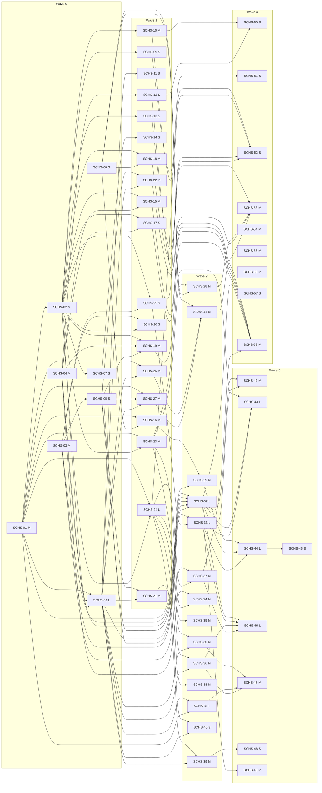

# Scheduler rules v1.2: build stories for parallel work

**Status:** Draft v0.1, 06-Nov-26. Plan only: no code, nothing merged. This file replaces the phase blocks of `docs/design/scheduler-implementation-and-test-plan.md` (that file keeps the principles, the owner gates OG1 to OG11, the kill switch and the test plan; its phases now point here).
**Inputs:** `docs/reqs/scheduler-requirements.md` (133 SCHR- rows), `docs/reqs/scheduler-gap-analysis.md` (G01 to G32), CLAUDE.md merge rules, `tools/dev/check-local.sh`, `docs/build-and-release.md`, and the code in this work tree (migration head 0050).

**What this gives.** 58 stories (SCHS-01 to SCHS-58) in 5 waves. Each story is small, has its own files, its own tests and its own pull request, and can be built by a separate subagent in its own worktree. Building is parallel; merging is serial (project rule).

---

## 1. Rules that keep parallel work from colliding

1. **One story, one worktree, one pull request.** The worktree is made from the latest `origin/main`. A code PR is regular; a docs-only PR is a draft.
2. **Write set.** A story creates or changes only the files in its WRITE SET. Anything it must change in a shared file is a TOUCH POINT, written down as the exact function, section or lines. A story edits nothing else. If it needs to, it stops and reports.
3. **Seams first.** Wave 0 turns the shared files into folders that are found automatically. After that a feature adds a file to a folder and edits no shared file:
   - solver rules: `services/api/app/scheduling/solver/rules/`
   - window rules: `services/api/app/scheduling/window_rules/`
   - demand providers: `services/api/app/scheduling/demand_providers/`
   - existing-job sync: `services/api/app/scheduling/job_sync/`
   - post-solve steps: `services/api/app/scheduling/post_solve/`
   - status-change handlers: `services/api/app/scheduling/hook_handlers/`
   - API routes: `services/api/app/scheduling/routes/`
   - web sections: `apps/web/src/pages/reference/rules/`, `apps/web/src/pages/crew/rules/`, `apps/web/src/pages/schedule/reports/`
   - scenario tests: `services/api/tests/scheduling/rules_v2/`
4. **Migrations.** All new tables and columns are in one migration, SCHS-01 (0051, re-checked at build). No other story adds a migration. Settings keys are defined once in SCHS-02 and written to the database by the seed tool at deploy (the deploy migrates, then seeds, `docs/build-and-release.md`), so a new key never needs a migration. If a builder finds a missing column, it stops and reports; the coordinator makes a small schema-fix story. Any extra migration is additive and renumbered at merge to the next free number with `down_revision` set to the head at that moment (`check-local.sh` stops on a duplicate number or two heads).
5. **Generated files are never merged by hand.** `packages/api-contract/openapi.json` and `apps/mobile/lib/core/api/api.g.dart` change in many stories. On a conflict, take `origin/main`'s version, then run `scripts/export_openapi.py` and `dart run tool/gen_api.dart` and commit the result. `docs/feature-status.json` and the three requirement files are not edited by build stories.
6. **Config, not constants (SCHR-CFG).** A story adds no literal for a time, duration, weekday, weight, threshold or reason list. Values come from the lookup layer (SCHS-02). A story that removes a constant says which.
7. **Kill switch.** Behaviour added by a story runs only when the site's `scheduler.rules_version` is 2. At 1 the planner behaves as today.
8. **Merge order is serial.** Stories are built at the same time, but pull requests merge one at a time in the order of section 3, each after its CI checks (`api-ci`, `web-ci`, `mobile-ci`, `web-e2e`) are green. After a merge, the other open stories rebase.
9. **Checks per story.** While building: only the story's own tests. Before marking ready: rebase on `origin/main`, then `tools/dev/check-local.sh --changed`, with the PostgreSQL stage for any API, database or scheduler change (never `--no-pg`). After a rebase, rerun only the touched tests and say why.
10. **Concurrency cap.** The number of subagents running at once is the owner's choice. The tables show how many stories are independent; they do not say how many to run.
11. **Gates stay.** The owner gates OG1 to OG11 in the plan file are unchanged. No story applies a data change to a live site or releases to production.

---

## 2. Wave 0: seams

Purpose: make the later stories independent. Kept to the minimum. Build order inside the wave follows the dependencies; stories at the same level are independent.

| Level | Stories | Why |
|---|---|---|
| 0 | SCHS-01, SCHS-03, SCHS-04, SCHS-08 | Schema, solver module registry, window seam and web seams touch different files. |
| 1 | SCHS-02, SCHS-05 | Settings store needs the schema; reason codes need the solver package. |
| 2 | SCHS-06, SCHS-07 | The run context edits the planner and needs the window seam and settings; builders need the settings fixtures. |

Seams delivered: site settings store and lookup (SCHS-02); solver rule modules (SCHS-03); window rules and capacity module (SCHS-04); reason codes (SCHS-05); run context, hooks and snapshot (SCHS-06); test builders (SCHS-07); web section folders (SCHS-08); the whole schema (SCHS-01).

---

## 3. Waves, conflict matrices and merge order

### Wave 0: seams (minimal, mostly serial)

Stories: 8. Independent at the widest level: 4.

| Story | Title | Size | Level in wave | Depends on |
|---|---|---|---|---|
| SCHS-01 | Schema for all scheduler rules (one additive migration) | M | 0 | none |
| SCHS-02 | Site settings store, lookup layer, key registry and seeding | M | 1 | SCHS-01 |
| SCHS-03 | Solver as registered modules | M | 0 | none |
| SCHS-04 | Window rules seam (availability, job windows, capacity) | M | 0 | none |
| SCHS-05 | Reason and finding codes | S | 1 | SCHS-03 |
| SCHS-06 | Run context and hooks in the planner | L | 2 | SCHS-01, SCHS-02, SCHS-04 |
| SCHS-07 | Test builders and fixtures | S | 2 | SCHS-02 |
| SCHS-08 | Web seams (sections found by folder) | S | 0 | none |

**Conflict matrix.** Files that more than one story of this wave writes or touches. W is a file the story owns, T a touch point with the hunk it edits. No file has two writers in a wave and no two stories at the same level edit the same hunk.

| Shared file | Story: edit |
|---|---|
| `services/api/app/scheduling/solver/core.py` | SCHS-03 (W); SCHS-05 (T: `SolverResult.unplaced`: value becomes (code, text); text unchanged) |
| `services/api/app/scheduling/service.py` | SCHS-04 (T: `availability()` (line 296), `service_windows()` (line 575) and `capacity()` (line 360): bodies move to the new modules; names stay as thin delegates); SCHS-06 (T: `run_schedule` (lines 582-765): wrap in the run context; existing-job branch (652-653) calls job_sync; demand providers after `build_demand`; post-solve hook after `solve_day` (720); snapshot and findings written at the end. `set_job_status` (967): call the hook) |

**Merge order:** SCHS-01 , SCHS-02 , SCHS-03 , SCHS-04 , SCHS-05 , SCHS-06 , SCHS-07 , SCHS-08.

### Wave 1: independent stories behind the seams

Stories: 19. Independent at the widest level: 19.

| Story | Title | Size | Level in wave | Depends on |
|---|---|---|---|---|
| SCHS-09 | Freeze hour, customer hour, unfreeze code and retry minutes from settings | S | 0 | SCHS-02 |
| SCHS-10 | Durations 30/30 from configuration; Deep Spa 120 | M | 0 | SCHS-02 |
| SCHS-11 | Re-run refreshes the duration of unfrozen jobs | S | 0 | SCHS-06 |
| SCHS-12 | Weekly off honoured in availability and capacity | S | 0 | SCHS-04 |
| SCHS-13 | Default slots seeded without the weekly-off weekday | S | 0 | SCHS-02 |
| SCHS-14 | Pin the existing hard rules with tests | S | 0 | SCHS-07 |
| SCHS-15 | First-job floor and reporting time (site default, crew override) | M | 0 | SCHS-02, SCHS-04 |
| SCHS-16 | Crew detail: reporting and first-job fields | M | 0 | SCHS-01, SCHS-08 |
| SCHS-17 | Interior earliest start | S | 0 | SCHS-02, SCHS-04 |
| SCHS-18 | Scheduling rules panel (site settings API and screen) | M | 0 | SCHS-02, SCHS-08 |
| SCHS-19 | Hard weekday cutoff | M | 0 | SCHS-02, SCHS-04, SCHS-05 |
| SCHS-20 | Weekend cutoff stays soft | S | 0 | SCHS-03, SCHS-02 |
| SCHS-21 | Structured unassigned reasons and shortfall | M | 0 | SCHS-05, SCHS-06 |
| SCHS-22 | Hand placement warns and flags | M | 0 | SCHS-05, SCHS-06 |
| SCHS-23 | Break rules store, lookup and API | M | 0 | SCHS-01, SCHS-02 |
| SCHS-24 | Entitlement ledger service (not yet used for demand) | L | 0 | SCHS-01, SCHS-02 |
| SCHS-25 | Solver parameters from settings | S | 0 | SCHS-02, SCHS-03 |
| SCHS-26 | Daily cleaner view endpoint | M | 0 | SCHS-01, SCHS-06 |
| SCHS-27 | Exception report endpoint | M | 0 | SCHS-01, SCHS-05, SCHS-06 |

**Conflict matrix.** Files that more than one story of this wave writes or touches. W is a file the story owns, T a touch point with the hunk it edits. No file has two writers in a wave and no two stories at the same level edit the same hunk.

| Shared file | Story: edit |
|---|---|
| `services/api/app/directory/defaults.py` | SCHS-10 (T: `DURATIONS` (line 9) and the two extra add-on durations (lines 92 and 102) only); SCHS-13 (T: `DEFAULT_SLOT_WINDOWS` (lines 14-19) only) |
| `services/api/app/scheduling/service.py` | SCHS-10 (T: import at line 26 and `Demand.duration` (line 56)); SCHS-22 (T: `move_job` (line 811-891): refusals become warnings with an override flag; breach written to findings) |
| `services/api/app/directory/seed.py` | SCHS-10 (T: `DirectoryService` seeding block, new sites only); SCHS-13 (T: `add_default_slots` (lines 25-30) only) |
| `services/api/app/scheduling/schemas.py` | SCHS-21 (T: `AdminJob` and `RunResponse`: add `reason_code` and shortfall fields); SCHS-22 (T: `MoveRequest`: `override` flag) |

**Merge order:** SCHS-09 , SCHS-10 , SCHS-11 , SCHS-12 , SCHS-13 , SCHS-14 , SCHS-15 , SCHS-16 , SCHS-17 , SCHS-18 , SCHS-19 , SCHS-20 , SCHS-21 , SCHS-22 , SCHS-23 , SCHS-24 , SCHS-25 , SCHS-26 , SCHS-27.

### Wave 2: stories that need Wave 1 pieces

Stories: 14. Independent at the widest level: 14.

| Story | Title | Size | Level in wave | Depends on |
|---|---|---|---|---|
| SCHS-28 | Break dialog (site and crew; Today, Tomorrow, Date range) | M | 0 | SCHS-23, SCHS-08 |
| SCHS-29 | Home zone field and picker | M | 0 | SCHS-16, SCHS-01 |
| SCHS-30 | Ledger follows job outcomes | M | 0 | SCHS-24, SCHS-06 |
| SCHS-31 | Deferred state for key or car unavailable | L | 0 | SCHS-06, SCHS-01 |
| SCHS-32 | Two-pass planning (Exterior then Interior) | L | 0 | SCHS-03, SCHS-04, SCHS-05, SCHS-06, SCHS-07 |
| SCHS-33 | Ordered objectives and weights from configuration | L | 0 | SCHS-03, SCHS-25 |
| SCHS-34 | Capacity page: break, free early band, 30-minute jobs | M | 0 | SCHS-04, SCHS-23 |
| SCHS-35 | Break shown on the Board and the crew day | M | 0 | SCHS-23 |
| SCHS-36 | Ledger-driven Interior demand | M | 0 | SCHS-24, SCHS-06 |
| SCHS-37 | One Interior per week and per car per day | M | 0 | SCHS-03, SCHS-24 |
| SCHS-38 | Customer calendar shows the planned Interior | M | 0 | SCHS-24 |
| SCHS-39 | Weekly summary endpoint | M | 0 | SCHS-24, SCHS-06 |
| SCHS-40 | Run summary and schedule history | S | 0 | SCHS-21, SCHS-06 |
| SCHS-41 | Reports tab in the Schedule page | M | 0 | SCHS-08, SCHS-26, SCHS-27 |

**Conflict matrix.** Files that more than one story of this wave writes or touches. W is a file the story owns, T a touch point with the hunk it edits. No file has two writers in a wave and no two stories at the same level edit the same hunk.

| Shared file | Story: edit |
|---|---|
| `services/api/app/scheduling/service.py` | SCHS-32 (T: `run_schedule` the per-day `solve_day` call (line 720): call `passes.solve_two_pass` at version 2); SCHS-35 (T: `crew_day` (line 1216): add the break); SCHS-40 (T: `RunSummary` creation (lines 748-755) and the history `record` call) |

**Merge order:** SCHS-28 , SCHS-29 , SCHS-30 , SCHS-31 , SCHS-32 , SCHS-33 , SCHS-34 , SCHS-35 , SCHS-36 , SCHS-37 , SCHS-38 , SCHS-39 , SCHS-40 , SCHS-41.

### Wave 3: solver integration

Stories: 8. Independent at the widest level: 7.

| Story | Title | Size | Level in wave | Depends on |
|---|---|---|---|---|
| SCHS-42 | Usable early capacity objective | M | 0 | SCHS-32, SCHS-33 |
| SCHS-43 | Break in the solver | L | 0 | SCHS-23, SCHS-32, SCHS-33 |
| SCHS-44 | Home zone and spill in the solver | L | 0 | SCHS-29, SCHS-32, SCHS-33 |
| SCHS-45 | Cross-zone reason recorded and shown | S | 1 | SCHS-44 |
| SCHS-46 | FIFO, weekday-first and carry priority in the Interior pass | L | 0 | SCHS-32, SCHS-33, SCHS-36, SCHS-37 |
| SCHS-47 | Deferral replanning | M | 0 | SCHS-30, SCHS-31, SCHS-36 |
| SCHS-48 | Export of the weekly summary | S | 0 | SCHS-39 |
| SCHS-49 | Performance harness | M | 0 | SCHS-32 |

**Conflict matrix.** Files that more than one story of this wave writes or touches. W is a file the story owns, T a touch point with the hunk it edits. No file has two writers in a wave and no two stories at the same level edit the same hunk.

| Shared file | Story: edit |
|---|---|
| none | |

**Merge order:** SCHS-42 , SCHS-43 , SCHS-44 , SCHS-45 , SCHS-46 , SCHS-47 , SCHS-48 , SCHS-49.

### Wave 4: guards, scripts, browser tests, documents

Stories: 9. Independent at the widest level: 9.

| Story | Title | Size | Level in wave | Depends on |
|---|---|---|---|---|
| SCHS-50 | Data script for live sites (weekly off, durations) | S | 0 | SCHS-10, SCHS-12 |
| SCHS-51 | Entitlement backfill script | S | 0 | SCHS-24 |
| SCHS-52 | Configuration guard test | S | 0 | SCHS-09, SCHS-10, SCHS-25, SCHS-13 |
| SCHS-53 | Browser tests for the rules flows | M | 0 | SCHS-18, SCHS-28, SCHS-22, SCHS-41 |
| SCHS-54 | Docs: admin requirement rows | M | 0 | none |
| SCHS-55 | Docs: customer and crew requirement rows | M | 0 | none |
| SCHS-56 | Docs: coverage files, wiki, README | M | 0 | none |
| SCHS-57 | Tooling: track the scheduler file | S | 0 | none |
| SCHS-58 | Property tests | M | 0 | SCHS-12, SCHS-15, SCHS-17, SCHS-19, SCHS-32, SCHS-37 |

**Conflict matrix.** Files that more than one story of this wave writes or touches. W is a file the story owns, T a touch point with the hunk it edits. No file has two writers in a wave and no two stories at the same level edit the same hunk.

| Shared file | Story: edit |
|---|---|
| none | |

**Merge order:** SCHS-50 , SCHS-51 , SCHS-52 , SCHS-53 , SCHS-54 , SCHS-55 , SCHS-56 , SCHS-57 , SCHS-58.

Unavoidable serial points: SCHS-01 first (schema), SCHS-02 before anything that reads settings, SCHS-04 before SCHS-06 (both edit `scheduling/service.py`), SCHS-03 before SCHS-05, the crew-rules endpoint (SCHS-17 before the home-zone story), and the guard test and documents at the end. Everything else inside a wave is independent.

---

## 4. Dependency graph, critical path and summary



**Critical path** (sizes S=1, M=2, L=3): SCHS-01 -> SCHS-02 -> SCHS-06 -> SCHS-32 -> SCHS-44 -> SCHS-45, weight 14. It runs through the schema, the settings store, the run context, the objective order and the two Interior-pass stories. Reducing it means shrinking those stories, not adding more builders.

| Story | Wave | Size | Depends on | SCHR rows | Story status |
|---|---|---|---|---|---|
| SCHS-01 Schema for all scheduler rules (one additive migration) | 0 | M | none | 0 | Draft |
| SCHS-02 Site settings store, lookup layer, key registry and seeding | 0 | M | SCHS-01 | 6 | Draft |
| SCHS-03 Solver as registered modules | 0 | M | none | 0 | Draft |
| SCHS-04 Window rules seam (availability, job windows, capacity) | 0 | M | none | 0 | Draft |
| SCHS-05 Reason and finding codes | 0 | S | SCHS-03 | 0 | Draft |
| SCHS-06 Run context and hooks in the planner | 0 | L | SCHS-01, SCHS-02, SCHS-04 | 2 | Draft |
| SCHS-07 Test builders and fixtures | 0 | S | SCHS-02 | 0 | Draft |
| SCHS-08 Web seams (sections found by folder) | 0 | S | none | 0 | Draft |
| SCHS-09 Freeze hour, customer hour, unfreeze code and retry minutes from settings | 1 | S | SCHS-02 | 0 | Draft |
| SCHS-10 Durations 30/30 from configuration; Deep Spa 120 | 1 | M | SCHS-02 | 6 | Draft |
| SCHS-11 Re-run refreshes the duration of unfrozen jobs | 1 | S | SCHS-06 | 0 | Draft |
| SCHS-12 Weekly off honoured in availability and capacity | 1 | S | SCHS-04 | 3 | Draft |
| SCHS-13 Default slots seeded without the weekly-off weekday | 1 | S | SCHS-02 | 1 | Draft |
| SCHS-14 Pin the existing hard rules with tests | 1 | S | SCHS-07 | 5 | Draft |
| SCHS-15 First-job floor and reporting time (site default, crew override) | 1 | M | SCHS-02, SCHS-04 | 3 | Draft |
| SCHS-16 Crew detail: reporting and first-job fields | 1 | M | SCHS-01, SCHS-08 | 0 | Draft |
| SCHS-17 Interior earliest start | 1 | S | SCHS-02, SCHS-04 | 4 | Draft |
| SCHS-18 Scheduling rules panel (site settings API and screen) | 1 | M | SCHS-02, SCHS-08 | 3 | Draft |
| SCHS-19 Hard weekday cutoff | 1 | M | SCHS-02, SCHS-04, SCHS-05 | 9 | Draft |
| SCHS-20 Weekend cutoff stays soft | 1 | S | SCHS-03, SCHS-02 | 3 | Draft |
| SCHS-21 Structured unassigned reasons and shortfall | 1 | M | SCHS-05, SCHS-06 | 5 | Draft |
| SCHS-22 Hand placement warns and flags | 1 | M | SCHS-05, SCHS-06 | 2 | Draft |
| SCHS-23 Break rules store, lookup and API | 1 | M | SCHS-01, SCHS-02 | 4 | Draft |
| SCHS-24 Entitlement ledger service (not yet used for demand) | 1 | L | SCHS-01, SCHS-02 | 10 | Draft |
| SCHS-25 Solver parameters from settings | 1 | S | SCHS-02, SCHS-03 | 0 | Draft |
| SCHS-26 Daily cleaner view endpoint | 1 | M | SCHS-01, SCHS-06 | 1 | Draft |
| SCHS-27 Exception report endpoint | 1 | M | SCHS-01, SCHS-05, SCHS-06 | 2 | Draft |
| SCHS-28 Break dialog (site and crew; Today, Tomorrow, Date range) | 2 | M | SCHS-23, SCHS-08 | 1 | Draft |
| SCHS-29 Home zone field and picker | 2 | M | SCHS-16, SCHS-01 | 3 | Draft |
| SCHS-30 Ledger follows job outcomes | 2 | M | SCHS-24, SCHS-06 | 5 | Draft |
| SCHS-31 Deferred state for key or car unavailable | 2 | L | SCHS-06, SCHS-01 | 3 | Draft |
| SCHS-32 Two-pass planning (Exterior then Interior) | 2 | L | SCHS-03, SCHS-04, SCHS-05, SCHS-06, SCHS-07 | 8 | Draft |
| SCHS-33 Ordered objectives and weights from configuration | 2 | L | SCHS-03, SCHS-25 | 5 | Draft |
| SCHS-34 Capacity page: break, free early band, 30-minute jobs | 2 | M | SCHS-04, SCHS-23 | 2 | Draft |
| SCHS-35 Break shown on the Board and the crew day | 2 | M | SCHS-23 | 1 | Draft |
| SCHS-36 Ledger-driven Interior demand | 2 | M | SCHS-24, SCHS-06 | 4 | Draft |
| SCHS-37 One Interior per week and per car per day | 2 | M | SCHS-03, SCHS-24 | 3 | Draft |
| SCHS-38 Customer calendar shows the planned Interior | 2 | M | SCHS-24 | 0 | Draft |
| SCHS-39 Weekly summary endpoint | 2 | M | SCHS-24, SCHS-06 | 2 | Draft |
| SCHS-40 Run summary and schedule history | 2 | S | SCHS-21, SCHS-06 | 1 | Draft |
| SCHS-41 Reports tab in the Schedule page | 2 | M | SCHS-08, SCHS-26, SCHS-27 | 1 | Draft |
| SCHS-42 Usable early capacity objective | 3 | M | SCHS-32, SCHS-33 | 3 | Draft |
| SCHS-43 Break in the solver | 3 | L | SCHS-23, SCHS-32, SCHS-33 | 4 | Draft |
| SCHS-44 Home zone and spill in the solver | 3 | L | SCHS-29, SCHS-32, SCHS-33 | 8 | Draft |
| SCHS-45 Cross-zone reason recorded and shown | 3 | S | SCHS-44 | 1 | Draft |
| SCHS-46 FIFO, weekday-first and carry priority in the Interior pass | 3 | L | SCHS-32, SCHS-33, SCHS-36, SCHS-37 | 4 | Draft |
| SCHS-47 Deferral replanning | 3 | M | SCHS-30, SCHS-31, SCHS-36 | 2 | Draft |
| SCHS-48 Export of the weekly summary | 3 | S | SCHS-39 | 1 | Draft |
| SCHS-49 Performance harness | 3 | M | SCHS-32 | 0 | Draft |
| SCHS-50 Data script for live sites (weekly off, durations) | 4 | S | SCHS-10, SCHS-12 | 0 | Draft |
| SCHS-51 Entitlement backfill script | 4 | S | SCHS-24 | 0 | Draft |
| SCHS-52 Configuration guard test | 4 | S | SCHS-09, SCHS-10, SCHS-25, SCHS-13 | 2 | Draft |
| SCHS-53 Browser tests for the rules flows | 4 | M | SCHS-18, SCHS-28, SCHS-22, SCHS-41 | 0 | Draft |
| SCHS-54 Docs: admin requirement rows | 4 | M | none | 0 | Draft |
| SCHS-55 Docs: customer and crew requirement rows | 4 | M | none | 0 | Draft |
| SCHS-56 Docs: coverage files, wiki, README | 4 | M | none | 0 | Draft |
| SCHS-57 Tooling: track the scheduler file | 4 | S | none | 0 | Draft |
| SCHS-58 Property tests | 4 | M | SCHS-12, SCHS-15, SCHS-17, SCHS-19, SCHS-32, SCHS-37 | 0 | Draft |

Story status values: Draft, In Dev, PR, Merged. The coordinator updates this column when a story changes state.

---

## 5. Coverage: every SCHR row lands in exactly one story

| SCHR row | Status in requirements | Story |
|---|---|---|
| SCHR-PAR-01 | Derived | SCHS-02 |
| SCHR-PAR-02 | Owner | SCHS-12 |
| SCHR-PAR-03 | Owner | SCHS-13 |
| SCHR-PAR-04 | Owner | SCHS-15 |
| SCHR-PAR-05 | Derived | SCHS-15 |
| SCHR-PAR-06 | Owner | SCHS-10 |
| SCHR-PAR-07 | Derived | SCHS-10 |
| SCHR-PAR-08 | Owner | SCHS-17 |
| SCHR-PAR-09 | Owner | SCHS-23 |
| SCHR-PAR-10 | Derived | SCHS-19 |
| SCHR-PAR-11 | Owner | SCHS-19 |
| SCHR-PAR-12 | Owner | SCHS-24 |
| SCHR-PAR-13 | Owner | SCHS-24 |
| SCHR-PAR-14 | Derived | SCHS-02 |
| SCHR-PAR-15 | Owner | SCHS-33 |
| SCHR-PAR-16 | Owner | SCHS-12 |
| SCHR-CFG-01 | Owner | SCHS-52 |
| SCHR-CFG-02 | Owner | SCHS-18 |
| SCHR-CFG-03 | Owner | SCHS-02 |
| SCHR-CFG-04 | Owner and Derived | SCHS-02 |
| SCHR-CFG-05 | Owner and Derived | SCHS-02 |
| SCHR-CFG-06 | Owner | SCHS-02 |
| SCHR-CFG-07 | Owner | SCHS-06 |
| SCHR-CFG-08 | Derived | SCHS-06 |
| SCHR-CFG-09 | Owner and Derived | SCHS-52 |
| SCHR-CFG-10 | Derived | SCHS-18 |
| SCHR-HIER-01 | Derived | SCHS-32 |
| SCHR-HIER-02 | Owner | SCHS-32 |
| SCHR-HIER-03 | Derived | SCHS-33 |
| SCHR-HIER-04 | Owner | SCHS-33 |
| SCHR-HIER-05 | Owner and Derived | SCHS-33 |
| SCHR-HIER-06 | Derived | SCHS-33 |
| SCHR-HIER-07 | Owner | SCHS-32 |
| SCHR-HIER-08 | Owner | SCHS-22 |
| SCHR-HARD-01 | Owner | SCHS-14 |
| SCHR-HARD-02 | Owner | SCHS-14 |
| SCHR-HARD-03 | Owner | SCHS-14 |
| SCHR-HARD-04 | Owner | SCHS-15 |
| SCHR-HARD-05 | Owner | SCHS-17 |
| SCHR-HARD-06 | Owner | SCHS-10 |
| SCHR-HARD-07 | Owner | SCHS-12 |
| SCHR-HARD-08 | Owner | SCHS-19 |
| SCHR-HARD-09 | Owner | SCHS-21 |
| SCHR-HARD-10 | Owner | SCHS-37 |
| SCHR-HARD-11 | Owner | SCHS-37 |
| SCHR-HARD-12 | Derived | SCHS-14 |
| SCHR-HARD-13 | Derived | SCHS-21 |
| SCHR-EXT-01 | Owner | SCHS-21 |
| SCHR-EXT-02 | Owner | SCHS-10 |
| SCHR-EXT-03 | Owner | SCHS-32 |
| SCHR-EXT-04 | Owner | SCHS-21 |
| SCHR-EXT-05 | Owner and Derived | SCHS-42 |
| SCHR-EXT-06 | Owner | SCHS-42 |
| SCHR-EXT-07 | Owner | SCHS-42 |
| SCHR-EXT-08 | Owner | SCHS-17 |
| SCHR-EXT-09 | Derived | SCHS-34 |
| SCHR-EXT-10 | Owner | SCHS-44 |
| SCHR-EXT-11 | Owner and Derived | SCHS-36 |
| SCHR-EXT-12 | Derived | SCHS-14 |
| SCHR-INT-01 | Owner and Derived | SCHS-36 |
| SCHR-INT-02 | Owner | SCHS-10 |
| SCHR-INT-03 | Owner | SCHS-17 |
| SCHR-INT-04 | Owner | SCHS-10 |
| SCHR-INT-05 | Owner and Derived | SCHS-36 |
| SCHR-INT-06 | Owner | SCHS-24 |
| SCHR-INT-07 | Owner | SCHS-32 |
| SCHR-INT-08 | Owner | SCHS-32 |
| SCHR-INT-09 | Owner | SCHS-32 |
| SCHR-INT-10 | Owner | SCHS-46 |
| SCHR-INT-11 | Owner | SCHS-24 |
| SCHR-INT-12 | Owner and Derived | SCHS-46 |
| SCHR-INT-13 | Owner | SCHS-46 |
| SCHR-INT-14 | Owner | SCHS-30 |
| SCHR-INT-15 | Owner | SCHS-30 |
| SCHR-INT-16 | Owner | SCHS-30 |
| SCHR-INT-17 | Owner | SCHS-39 |
| SCHR-INT-18 | Owner | SCHS-37 |
| SCHR-INT-19 | Derived | SCHS-24 |
| SCHR-INT-20 | Owner and Derived | SCHS-24 |
| SCHR-INT-21 | Owner | SCHS-24 |
| SCHR-INT-22 | Derived | SCHS-24 |
| SCHR-INT-23 | Derived | SCHS-24 |
| SCHR-INT-24 | Derived | SCHS-30 |
| SCHR-INT-25 | Owner | SCHS-24 |
| SCHR-INT-26 | Derived | SCHS-36 |
| SCHR-CUT-01 | Owner | SCHS-19 |
| SCHR-CUT-02 | Owner | SCHS-19 |
| SCHR-CUT-03 | Owner | SCHS-19 |
| SCHR-CUT-04 | Owner | SCHS-19 |
| SCHR-CUT-05 | Owner | SCHS-22 |
| SCHR-CUT-06 | Owner | SCHS-18 |
| SCHR-CUT-07 | Derived | SCHS-19 |
| SCHR-CUT-08 | Derived | SCHS-19 |
| SCHR-WKE-01 | Owner | SCHS-20 |
| SCHR-WKE-02 | Owner | SCHS-32 |
| SCHR-WKE-03 | Owner | SCHS-20 |
| SCHR-WKE-04 | Derived | SCHS-20 |
| SCHR-WKE-05 | Owner | SCHS-46 |
| SCHR-WKE-06 | Owner | SCHS-27 |
| SCHR-ZONE-01 | Owner | SCHS-29 |
| SCHR-ZONE-02 | Owner | SCHS-44 |
| SCHR-ZONE-03 | Owner | SCHS-44 |
| SCHR-ZONE-04 | Owner and Derived | SCHS-44 |
| SCHR-ZONE-05 | Owner | SCHS-44 |
| SCHR-ZONE-06 | Owner and Derived | SCHS-45 |
| SCHR-ZONE-07 | Owner and Derived | SCHS-29 |
| SCHR-ZONE-08 | Derived | SCHS-44 |
| SCHR-ZONE-09 | Derived | SCHS-29 |
| SCHR-ZONE-10 | Derived | SCHS-44 |
| SCHR-ZONE-11 | Derived | SCHS-44 |
| SCHR-BRK-01 | Owner | SCHS-43 |
| SCHR-BRK-02 | Owner | SCHS-43 |
| SCHR-BRK-03 | Owner | SCHS-43 |
| SCHR-BRK-04 | Owner | SCHS-43 |
| SCHR-BRK-05 | Owner | SCHS-28 |
| SCHR-BRK-06 | Owner | SCHS-23 |
| SCHR-BRK-07 | Derived | SCHS-23 |
| SCHR-BRK-08 | Derived | SCHS-34 |
| SCHR-BRK-09 | Derived | SCHS-35 |
| SCHR-BRK-10 | Derived | SCHS-23 |
| SCHR-OUT-01 | Owner | SCHS-26 |
| SCHR-OUT-02 | Owner | SCHS-39 |
| SCHR-OUT-03 | Owner | SCHS-27 |
| SCHR-OUT-04 | Derived | SCHS-21 |
| SCHR-OUT-05 | Derived | SCHS-41 |
| SCHR-OUT-06 | Derived | SCHS-48 |
| SCHR-OUT-07 | Derived | SCHS-40 |
| SCHR-DEF-01 | Owner | SCHS-31 |
| SCHR-DEF-02 | Owner | SCHS-47 |
| SCHR-DEF-03 | Derived | SCHS-47 |
| SCHR-DEF-04 | Owner | SCHS-31 |
| SCHR-DEF-05 | Owner | SCHS-31 |
| SCHR-DEF-06 | Owner | SCHS-30 |

Check run: 133 rows, each in exactly one story, none unknown.

---

## 6. Story cards

### SCHS-01. Schema for all scheduler rules (one additive migration)

- **Outcome:** Every table and column later stories need exists, unused and nullable, so no later story needs a migration.
- **Wave and size:** 0, M.
- **SCHR rows (0):** none (enabling story).
- **Gaps:** G25, G09, G06, G16, G19, G24.
- **In scope:** the outcome above. **Out of scope:** No logic. No seeds.
- **Depends on (hard):** none.
- **Conflicts with (shared files in the same wave):** none.
- **Write set:** `services/api/migrations/versions/20261106_0051_scheduler_rules_schema.py` (new); `services/api/app/scheduling/models.py`; `services/api/app/directory/models.py`.
- **Touch points:** none.
- **Migration:** Takes 0051 (re-check the head at build time). Adds: society_settings, break_rules, interior_entitlements, schedule_run_config, schedule_findings; columns jobs.service_week_start, jobs.cross_zone_reason, jobs.reason_code, scheduling_crew.reporting_minute, first_job_minute, home_zone_id, cnc_reasons.defers. All nullable or defaulted; downgrade drops them.
- **Config keys and admin UI:** None.
- **API contract:** None (models only).
- **Acceptance criteria:**
  - Migrations upgrade and downgrade on SQLite and PostgreSQL.
  - The migrated tables match the models (existing test).
  - All existing tests pass unchanged.
  - Every new column is nullable or has a default, so version-1 sites behave as before.
- **Tests (trace SCHR rows above):** `services/api/tests/test_migrations.py`; `services/api/tests/scheduling/rules_v2/test_schs_SCHS-01_schema.py` (new).
- **Kill switch:** Not applicable: schema only.
- **Rollback:** Downgrade (hand-written, tested).
- **Parallel-safe:** No. First story; every other story reads these tables.

### SCHS-02. Site settings store, lookup layer, key registry and seeding

- **Outcome:** Per-site values can be read, written, validated and audited, and all new keys exist with seeded defaults.
- **Wave and size:** 0, M.
- **SCHR rows (6):** SCHR-PAR-01, SCHR-PAR-14, SCHR-CFG-03, SCHR-CFG-04, SCHR-CFG-05, SCHR-CFG-06.
- **Gaps:** G25, G32.
- **In scope:** the outcome above. **Out of scope:** anything not in the write set or the touch points.
- **Depends on (hard):** SCHS-01.
- **Conflicts with (shared files in the same wave):** none.
- **Write set:** `services/api/app/directory/site_settings.py` (new); `services/api/app/directory/rule_seed.py` (new); `services/api/app/directory/settings_registry.py`; `services/api/app/directory/lookup.py`.
- **Touch points:** `services/api/app/directory/seed.py`: `seed_defaults`: one call after the settings block that adds missing scheduler keys (never changes an existing value).
- **Migration:** None (schema in the first story). Key defaults are written by the seed tool at deploy, which runs after every migration.
- **Config keys and admin UI:** Defines every new key once, so no later story edits `settings_registry.py`: `scheduler.rules_version`, `scheduler.grid_minutes`, `scheduler.solve_seconds`, `scheduler.seed`, `scheduler.workers`, `scheduler.objective_order`, `scheduler.weight_*`, `scheduler.retry_minutes_*`, `site.reporting_minute`, `site.first_job_minute`, `site.interior_earliest_minute`, `site.break_*`, `site.weekday_cutoff_hard`, `site.weekend_cutoff_flexible`, `site.weekend_weekdays`, `site.cross_zone_help_allowed`, `schedule.interior_entitlement_per_week`, `schedule.service_week_start`. Registry keys appear on the Settings page Schedule tab by themselves; `site.*` keys appear in the panel of SCHS-18.
- **API contract:** None.
- **Acceptance criteria:**
  - A site value overrides the global value; a missing key raises a clear error and no hidden default is used.
  - Out-of-range or malformed values are refused with a message.
  - Each save writes an audit row with admin, time, old value, new value and site.
  - Seeding twice adds nothing the second time and never changes an edited value.
  - `scheduler.rules_version` reads 1 for every existing site.
- **Tests (trace SCHR rows above):** `services/api/tests/scheduling/rules_v2/test_schs_SCHS-02_site_settings.py` (new).
- **Kill switch:** Defines the switch (default 1).
- **Rollback:** Revert; the table stays unused.
- **Parallel-safe:** No. It owns the registry and lookup that every later story reads.

### SCHS-03. Solver as registered modules

- **Outcome:** Each rule is its own module in a folder that is discovered automatically, so a feature adds a file instead of editing one big function.
- **Wave and size:** 0, M.
- **SCHR rows (0):** none (enabling story).
- **Gaps:** G21, G23.
- **In scope:** the outcome above. **Out of scope:** No new rule. The placed, late and early terms move into `rules/base.py` unchanged.
- **Depends on (hard):** none.
- **Conflicts with (shared files in the same wave):** `services/api/app/scheduling/solver/core.py` with SCHS-05.
- **Write set:** `services/api/app/scheduling/solver/__init__.py` (new); `services/api/app/scheduling/solver/core.py` (new); `services/api/app/scheduling/solver/registry.py` (new); `services/api/app/scheduling/solver/rules/__init__.py` (new); `services/api/app/scheduling/solver/rules/base.py` (new); `services/api/app/scheduling/solver.py`.
- **Touch points:** none.
- **Migration:** None.
- **Config keys and admin UI:** None (module order comes from `scheduler.objective_order` once SCHS-33 lands; until then the order is the current one).
- **API contract:** None.
- **Acceptance criteria:**
  - `from app.scheduling.solver import SolverCrew, SolverJob, solve_day` still works.
  - `tests/scheduling/test_solver.py` passes without edits.
  - On a corpus of 50 generated days the plans equal the old plans (golden compare, same seed).
  - A module dropped into `solver/rules/` is used without any other edit.
- **Tests (trace SCHR rows above):** `services/api/tests/scheduling/test_solver.py`; `services/api/tests/scheduling/rules_v2/test_schs_SCHS-03_solver_registry.py` (new).
- **Kill switch:** Behaviour-neutral.
- **Rollback:** Revert.
- **Parallel-safe:** Yes for building; it shares no file with 01, 02, 04.

### SCHS-04. Window rules seam (availability, job windows, capacity)

- **Outcome:** A cleaner's windows and a job's allowed windows are built by small rules found in a folder, so each rule is a new file.
- **Wave and size:** 0, M.
- **SCHR rows (0):** none (enabling story).
- **Gaps:** G13, G29.
- **In scope:** the outcome above. **Out of scope:** anything not in the write set or the touch points.
- **Depends on (hard):** none.
- **Conflicts with (shared files in the same wave):** `services/api/app/scheduling/service.py` with SCHS-06.
- **Write set:** `services/api/app/scheduling/windows.py` (new); `services/api/app/scheduling/window_rules/__init__.py` (new); `services/api/app/scheduling/capacity.py` (new).
- **Touch points:** `services/api/app/scheduling/service.py`: `availability()` (line 296), `service_windows()` (line 575) and `capacity()` (line 360): bodies move to the new modules; names stay as thin delegates.
- **Migration:** None.
- **Config keys and admin UI:** None.
- **API contract:** None.
- **Acceptance criteria:**
  - `tests/scheduling/test_site_off_days.py`, `test_multi_slot_hours.py`, `test_scheduling_api.py` pass without edits.
  - Capacity output is byte-identical to before.
  - A rule file dropped into `window_rules/` can change a cleaner's windows, a job's windows or add a capacity line.
- **Tests (trace SCHR rows above):** `services/api/tests/scheduling/test_site_off_days.py`; `services/api/tests/scheduling/test_multi_slot_hours.py`; `services/api/tests/scheduling/rules_v2/test_schs_SCHS-04_window_seam.py` (new).
- **Kill switch:** Behaviour-neutral.
- **Rollback:** Revert.
- **Parallel-safe:** Partly. Disjoint from 03, 07, 08; it must merge before the run-context story because both edit `service.py`.

### SCHS-05. Reason and finding codes

- **Outcome:** One list of codes for unassigned reasons and report findings, carried by the solver result.
- **Wave and size:** 0, S.
- **SCHR rows (0):** none (enabling story).
- **Gaps:** G14.
- **In scope:** the outcome above. **Out of scope:** anything not in the write set or the touch points.
- **Depends on (hard):** SCHS-03.
- **Conflicts with (shared files in the same wave):** `services/api/app/scheduling/solver/core.py` with SCHS-03.
- **Write set:** `services/api/app/scheduling/codes.py` (new).
- **Touch points:** `services/api/app/scheduling/solver/core.py`: `SolverResult.unplaced`: value becomes (code, text); text unchanged.
- **Migration:** None.
- **Config keys and admin UI:** None.
- **API contract:** None.
- **Acceptance criteria:**
  - Existing unplaced texts are unchanged.
  - Codes cover: no cleaner, shift too short, weekly off, customer cutoff, capacity short, break kept, before Interior-earliest, entitlement used, home-zone full, cross-zone.
- **Tests (trace SCHR rows above):** `services/api/tests/scheduling/rules_v2/test_schs_SCHS-05_codes.py` (new).
- **Kill switch:** Behaviour-neutral.
- **Rollback:** Revert.
- **Parallel-safe:** No. Edits the solver core right after 03.

### SCHS-06. Run context and hooks in the planner

- **Outcome:** `run_schedule` gets named hook points (demand providers, existing-job sync, post-solve, status change, routes) and records the settings snapshot, so later stories plug in without editing it.
- **Wave and size:** 0, L.
- **SCHR rows (2):** SCHR-CFG-07, SCHR-CFG-08.
- **Gaps:** G24, G32.
- **In scope:** the outcome above. **Out of scope:** anything not in the write set or the touch points.
- **Depends on (hard):** SCHS-01, SCHS-02, SCHS-04.
- **Conflicts with (shared files in the same wave):** `services/api/app/scheduling/service.py` with SCHS-04.
- **Write set:** `services/api/app/scheduling/run_context.py` (new); `services/api/app/scheduling/hooks.py` (new); `services/api/app/scheduling/hook_handlers/__init__.py` (new); `services/api/app/scheduling/job_sync/__init__.py` (new); `services/api/app/scheduling/demand_providers/__init__.py` (new); `services/api/app/scheduling/post_solve/__init__.py` (new); `services/api/app/scheduling/routes/__init__.py` (new).
- **Touch points:** `services/api/app/scheduling/service.py`: `run_schedule` (lines 582-765): wrap in the run context; existing-job branch (652-653) calls job_sync; demand providers after `build_demand`; post-solve hook after `solve_day` (720); snapshot and findings written at the end. `set_job_status` (967): call the hook; `services/api/app/scheduling/__init__.py`: `register`: include routers found in `scheduling/routes/`; `services/api/app/visits/operations.py`: line 131, after `job.status = "Skipped"`: call the hook; `services/api/app/changes/sql_gateway.py`: line 59, after the status change: call the hook; `services/api/app/notifications/emit.py`: line 419, after the skip: call the hook.
- **Migration:** None.
- **Config keys and admin UI:** Reads every value once through lookup into the snapshot (SCHR-CFG-07, 08).
- **API contract:** None.
- **Acceptance criteria:**
  - A run stores the values it used (`schedule_run_config`).
  - A change of a setting does not alter a frozen schedule or past runs.
  - Hook points do nothing when no handler is registered; all existing tests pass.
  - Dropping a file into any of the five folders registers it without another edit.
- **Tests (trace SCHR rows above):** `services/api/tests/scheduling/rules_v2/test_schs_SCHS-06_run_context.py` (new); `services/api/tests/scheduling/test_scheduling_api.py`.
- **Kill switch:** Hooks are inert at version 1.
- **Rollback:** Revert.
- **Parallel-safe:** No. It is the only story that edits `run_schedule` structure; the remaining run edits are hook files.

### SCHS-07. Test builders and fixtures

- **Outcome:** One builder creates sites, cleaners, cars, entitlements and settings for scenario tests.
- **Wave and size:** 0, S.
- **SCHR rows (0):** none (enabling story).
- **Gaps:** none.
- **In scope:** the outcome above. **Out of scope:** anything not in the write set or the touch points.
- **Depends on (hard):** SCHS-02.
- **Conflicts with (shared files in the same wave):** none.
- **Write set:** `services/api/tests/scheduling/builders.py` (new); `services/api/tests/scheduling/rules_v2/__init__.py` (new).
- **Touch points:** `services/api/tests/scheduling/conftest.py`: add fixtures only: `site_cfg`, `rules_v2`.
- **Migration:** None.
- **Config keys and admin UI:** None.
- **API contract:** None.
- **Acceptance criteria:**
  - A scenario can be written in under 15 lines.
  - Fixtures set a site's settings and `rules_v2` flips the switch for the test.
  - Existing tests unchanged.
- **Tests (trace SCHR rows above):** `services/api/tests/scheduling/rules_v2/test_schs_SCHS-07_builders.py` (new).
- **Kill switch:** Test only.
- **Rollback:** Revert.
- **Parallel-safe:** Yes. Test files only, disjoint from 03, 04, 08.

### SCHS-08. Web seams (sections found by folder)

- **Outcome:** The Scheduling rules tab, the crew Scheduling panel and the Reports tab load their sections from folders, so each story adds a section file.
- **Wave and size:** 0, S.
- **SCHR rows (0):** none (enabling story).
- **Gaps:** none.
- **In scope:** the outcome above. **Out of scope:** anything not in the write set or the touch points.
- **Depends on (hard):** none.
- **Conflicts with (shared files in the same wave):** none.
- **Write set:** `apps/web/src/pages/reference/rules/index.ts` (new); `apps/web/src/pages/crew/rules/index.ts` (new); `apps/web/src/pages/schedule/reports/index.ts` (new).
- **Touch points:** `apps/web/src/pages/reference/ReferencePage.tsx`: `TABS`: add one tab "Scheduling rules"; `apps/web/src/pages/crew/CrewDetailPage.tsx`: mount the rules sections once; `apps/web/src/pages/schedule/SchedulePage.tsx`: tabs: add "Reports", shown when a report section exists.
- **Migration:** None.
- **Config keys and admin UI:** Reuse of existing pages (SCHR-CFG-02).
- **API contract:** None.
- **Acceptance criteria:**
  - With no section files the tabs show an empty state.
  - A section file added to a folder appears without another edit (Vite glob).
  - Web lint, tests and build pass.
- **Tests (trace SCHR rows above):** `apps/web/src/pages/reference/rules/rules.test.tsx` (new).
- **Kill switch:** UI shell only.
- **Rollback:** Revert.
- **Parallel-safe:** Yes. Web only.

### SCHS-09. Freeze hour, customer hour, unfreeze code and retry minutes from settings

- **Outcome:** The constants in `rules.py` and `automatic.py` are gone; the existing registry keys are used.
- **Wave and size:** 1, S.
- **SCHR rows (0):** none (enabling story).
- **Gaps:** G26.
- **In scope:** the outcome above. **Out of scope:** anything not in the write set or the touch points.
- **Depends on (hard):** SCHS-02.
- **Conflicts with (shared files in the same wave):** none.
- **Write set:** `services/api/app/scheduling/rules.py`; `services/api/app/scheduling/automatic.py`.
- **Touch points:** `services/api/tests/mani_eval/questions.py`: line 130: the gold answer quotes the old constant; check it.
- **Migration:** None.
- **Config keys and admin UI:** Reuse: existing `schedule.freeze_hour`, `customer_change_hour`, `unfreeze_code` (Settings, Schedule tab); new retry-minute keys from SCHS-02.
- **API contract:** None.
- **Acceptance criteria:**
  - No `FREEZE_HOUR`, `CUSTOMER_HOUR`, `UNFREEZE_CODE` constants remain.
  - The retry delays 30 and 5 minutes come from settings.
  - `tests/scheduling/test_rules.py` and `test_automatic_planning.py` pass.
- **Tests (trace SCHR rows above):** `services/api/tests/scheduling/test_rules.py`; `services/api/tests/scheduling/test_automatic_planning.py`; `services/api/tests/scheduling/rules_v2/test_schs_SCHS-09_constants_rules.py` (new).
- **Kill switch:** Behaviour-neutral (seeded values equal the old constants).
- **Rollback:** Revert.
- **Parallel-safe:** Yes. Two files nobody else writes.

### SCHS-10. Durations 30/30 from configuration; Deep Spa 120

- **Outcome:** The duration constants are removed; the service table is the only source; new sites are seeded with 30 and 30.
- **Wave and size:** 1, M.
- **SCHR rows (6):** SCHR-PAR-06, SCHR-PAR-07, SCHR-HARD-06, SCHR-EXT-02, SCHR-INT-02, SCHR-INT-04.
- **Gaps:** G03, G04.
- **In scope:** the outcome above. **Out of scope:** anything not in the write set or the touch points.
- **Depends on (hard):** SCHS-02.
- **Conflicts with (shared files in the same wave):** `services/api/app/directory/defaults.py` with SCHS-13; `services/api/app/scheduling/service.py` with SCHS-22; `services/api/app/directory/seed.py` with SCHS-13.
- **Write set:** none.
- **Touch points:** `services/api/app/directory/defaults.py`: `DURATIONS` (line 9) and the two extra add-on durations (lines 92 and 102) only; `services/api/app/scheduling/models.py`: line 24, the `DURATIONS` constant only; `services/api/app/scheduling/service.py`: import at line 26 and `Demand.duration` (line 56); `services/api/app/directory/seed.py`: `DirectoryService` seeding block, new sites only.
- **Migration:** None. Live sites keep their stored 20; the change for live sites is the data script in SCHS-50 (OG4).
- **Config keys and admin UI:** Reuse: Reference data, Services tab (`ServicesTab.tsx`) and `directory_services.duration_minutes`.
- **API contract:** None.
- **Acceptance criteria:**
  - No `DURATIONS` constant in `app/scheduling` or `app/directory/defaults.py` is read by the planner.
  - A new site gets 30, 30, 120; an existing site is unchanged.
  - A visit with both services needs 60 minutes of work and no travel minutes.
  - The extra add-ons seed with a configured value, not a literal 20.
- **Tests (trace SCHR rows above):** `services/api/tests/scheduling/rules_v2/test_schs_SCHS-10_durations.py` (new); `services/api/tests/directory/test_directory.py`.
- **Kill switch:** Seed values only; existing sites unchanged.
- **Rollback:** Revert.
- **Parallel-safe:** Yes with a soft overlap: `defaults.py` also changes in SCHS-13 (different lines) and `service.py` imports (different lines).

### SCHS-11. Re-run refreshes the duration of unfrozen jobs

- **Outcome:** A re-run updates `duration_minutes` of jobs that are Scheduled and not frozen, so a changed duration reaches them.
- **Wave and size:** 1, S.
- **SCHR rows (0):** none (enabling story).
- **Gaps:** G03.
- **In scope:** the outcome above. **Out of scope:** anything not in the write set or the touch points.
- **Depends on (hard):** SCHS-06.
- **Conflicts with (shared files in the same wave):** none.
- **Write set:** `services/api/app/scheduling/job_sync/duration.py` (new).
- **Touch points:** none.
- **Migration:** None.
- **Config keys and admin UI:** Reads the duration through lookup.
- **API contract:** None.
- **Acceptance criteria:**
  - After a duration change, a Draft re-run gives new jobs and unfrozen jobs the new length.
  - Frozen and started jobs keep their length.
- **Tests (trace SCHR rows above):** `services/api/tests/scheduling/rules_v2/test_schs_SCHS-11_duration_refresh.py` (new).
- **Kill switch:** Runs only at version 2.
- **Rollback:** Revert.
- **Parallel-safe:** Yes. One new file in the job_sync folder.

### SCHS-12. Weekly off honoured in availability and capacity

- **Outcome:** On the site's closed weekday no cleaner has a window and capacity is zero, for Exterior, Interior and Deep Spa.
- **Wave and size:** 1, S.
- **SCHR rows (3):** SCHR-PAR-02, SCHR-PAR-16, SCHR-HARD-07.
- **Gaps:** G01, G13.
- **In scope:** the outcome above. **Out of scope:** anything not in the write set or the touch points.
- **Depends on (hard):** SCHS-04.
- **Conflicts with (shared files in the same wave):** none.
- **Write set:** `services/api/app/scheduling/window_rules/weekly_off.py` (new).
- **Touch points:** none.
- **Migration:** None.
- **Config keys and admin UI:** Reuse: Slots tab (`SlotsTab.tsx`), `working_slots.days`; no new key.
- **API contract:** None.
- **Acceptance criteria:**
  - No job and no capacity on a day with no slot for any service.
  - Crew hours that include the closed day add nothing.
  - Other days unchanged.
- **Tests (trace SCHR rows above):** `services/api/tests/scheduling/rules_v2/test_schs_SCHS-12_weekly_off.py` (new); `services/api/tests/scheduling/test_site_off_days.py`.
- **Kill switch:** Runs only at version 2.
- **Rollback:** Revert.
- **Parallel-safe:** Yes. One new rule file.

### SCHS-13. Default slots seeded without the weekly-off weekday

- **Outcome:** A new site is seeded with Wednesday closed; existing sites are untouched.
- **Wave and size:** 1, S.
- **SCHR rows (1):** SCHR-PAR-03.
- **Gaps:** G01.
- **In scope:** the outcome above. **Out of scope:** anything not in the write set or the touch points.
- **Depends on (hard):** SCHS-02.
- **Conflicts with (shared files in the same wave):** `services/api/app/directory/defaults.py` with SCHS-10; `services/api/app/directory/seed.py` with SCHS-10.
- **Write set:** none.
- **Touch points:** `services/api/app/directory/defaults.py`: `DEFAULT_SLOT_WINDOWS` (lines 14-19) only; `services/api/app/directory/seed.py`: `add_default_slots` (lines 25-30) only.
- **Migration:** None.
- **Config keys and admin UI:** Reuse Slots tab.
- **API contract:** None.
- **Acceptance criteria:**
  - A new site has no slot on Wednesday for the cleaning services.
  - Existing sites' slots are unchanged.
- **Tests (trace SCHR rows above):** `services/api/tests/scheduling/rules_v2/test_schs_SCHS-13_default_slots.py` (new).
- **Kill switch:** New sites only.
- **Rollback:** Revert.
- **Parallel-safe:** Yes with soft overlap in `defaults.py` and `seed.py` (different lines from SCHS-10, SCHS-02).

### SCHS-14. Pin the existing hard rules with tests

- **Outcome:** Characterisation tests lock what already holds: availability, shift end, no overlap, one cleaner per car, Exterior not carried.
- **Wave and size:** 1, S.
- **SCHR rows (5):** SCHR-HARD-01, SCHR-HARD-02, SCHR-HARD-03, SCHR-HARD-12, SCHR-EXT-12.
- **Gaps:** none.
- **In scope:** the outcome above. **Out of scope:** anything not in the write set or the touch points.
- **Depends on (hard):** SCHS-07.
- **Conflicts with (shared files in the same wave):** none.
- **Write set:** `services/api/tests/scheduling/rules_v2/test_schs_SCHS-14_pin_existing.py` (new).
- **Touch points:** none.
- **Migration:** None.
- **Config keys and admin UI:** None.
- **API contract:** None.
- **Acceptance criteria:**
  - Each named rule has a passing test on the current planner.
  - A deliberate break of the rule fails the test (checked by hand once).
- **Tests (trace SCHR rows above):** `services/api/tests/scheduling/rules_v2/test_schs_SCHS-14_pin_existing.py` (new).
- **Kill switch:** Test only.
- **Rollback:** Revert.
- **Parallel-safe:** Yes. Test file only.

### SCHS-15. First-job floor and reporting time (site default, crew override)

- **Outcome:** No job starts before the later of the first-job time and the window start; the crew value falls back to the site value.
- **Wave and size:** 1, M.
- **SCHR rows (3):** SCHR-PAR-04, SCHR-PAR-05, SCHR-HARD-04.
- **Gaps:** G02, G13.
- **In scope:** the outcome above. **Out of scope:** anything not in the write set or the touch points.
- **Depends on (hard):** SCHS-02, SCHS-04.
- **Conflicts with (shared files in the same wave):** none.
- **Write set:** `services/api/app/scheduling/window_rules/first_job.py` (new); `services/api/app/scheduling/crew_rules.py` (new).
- **Touch points:** none.
- **Migration:** None.
- **Config keys and admin UI:** New keys `site.reporting_minute`, `site.first_job_minute` (from SCHS-02); crew columns from SCHS-01. UI in SCHS-16 and SCHS-18.
- **API contract:** None.
- **Acceptance criteria:**
  - No job before 05:30 with the defaults; a crew value overrides the site value; clearing it returns to the site value.
  - Reporting time is recorded, not used as a job floor.
  - A Late start exception still moves the start.
- **Tests (trace SCHR rows above):** `services/api/tests/scheduling/rules_v2/test_schs_SCHS-15_first_job.py` (new).
- **Kill switch:** Runs only at version 2.
- **Rollback:** Revert.
- **Parallel-safe:** Yes. New files only.

### SCHS-16. Crew detail: reporting and first-job fields

- **Outcome:** The admin sees the site defaults on each cleaner and can override them.
- **Wave and size:** 1, M.
- **SCHR rows (0):** none (enabling story).
- **Gaps:** G02, G27.
- **In scope:** the outcome above. **Out of scope:** anything not in the write set or the touch points.
- **Depends on (hard):** SCHS-01, SCHS-08.
- **Conflicts with (shared files in the same wave):** none.
- **Write set:** `services/api/app/scheduling/routes/crew_rules.py` (new); `apps/web/src/pages/crew/rules/TimesSection.tsx` (new).
- **Touch points:** none.
- **Migration:** None.
- **Config keys and admin UI:** Reuse Crew detail; shows `site.*` defaults.
- **API contract:** New endpoint; regenerate OpenAPI and Dart at merge.
- **Acceptance criteria:**
  - Defaults shown in grey; an edit saves an override and an audit row; Clear returns to the default.
  - Validation: first-job not before reporting time.
- **Tests (trace SCHR rows above):** `services/api/tests/scheduling/rules_v2/test_schs_SCHS-16_crew_times_api.py` (new); `apps/web/src/pages/crew/rules/TimesSection.test.tsx` (new).
- **Kill switch:** Edit surface only.
- **Rollback:** Revert.
- **Parallel-safe:** Yes. New files; it owns the crew-rules endpoint that SCHS-29 extends later.

### SCHS-17. Interior earliest start

- **Outcome:** Cleaning-Internal windows start no earlier than the site's Interior-earliest time, every day, including hand moves.
- **Wave and size:** 1, S.
- **SCHR rows (4):** SCHR-PAR-08, SCHR-HARD-05, SCHR-INT-03, SCHR-EXT-08.
- **Gaps:** G05, G28.
- **In scope:** the outcome above. **Out of scope:** anything not in the write set or the touch points.
- **Depends on (hard):** SCHS-02, SCHS-04.
- **Conflicts with (shared files in the same wave):** none.
- **Write set:** `services/api/app/scheduling/window_rules/job_interior_earliest.py` (new).
- **Touch points:** none.
- **Migration:** None.
- **Config keys and admin UI:** New key `site.interior_earliest_minute` (from SCHS-02).
- **API contract:** None.
- **Acceptance criteria:**
  - No Interior starts before 07:00 on a weekday or a weekend.
  - `move_job` refuses nothing new here (warning handled by SCHS-22); the allowed window is shared.
  - Exterior is not affected.
- **Tests (trace SCHR rows above):** `services/api/tests/scheduling/rules_v2/test_schs_SCHS-17_interior_earliest.py` (new).
- **Kill switch:** Runs only at version 2.
- **Rollback:** Revert.
- **Parallel-safe:** Yes. One new rule file.

### SCHS-18. Scheduling rules panel (site settings API and screen)

- **Outcome:** The admin edits the per-site values in Site Setup; labels use the agreed cutoff names.
- **Wave and size:** 1, M.
- **SCHR rows (3):** SCHR-CFG-02, SCHR-CFG-10, SCHR-CUT-06.
- **Gaps:** G27.
- **In scope:** the outcome above. **Out of scope:** anything not in the write set or the touch points.
- **Depends on (hard):** SCHS-02, SCHS-08.
- **Conflicts with (shared files in the same wave):** none.
- **Write set:** `services/api/app/scheduling/routes/site_settings.py` (new); `apps/web/src/pages/reference/rules/GeneralSection.tsx` (new); `apps/web/src/pages/reference/rules/labels.ts` (new).
- **Touch points:** none.
- **Migration:** None.
- **Config keys and admin UI:** Renders any `site.*` key from registry metadata; later stories add keys, not screens.
- **API contract:** New endpoints; regenerate at merge.
- **Acceptance criteria:**
  - Each key shows default, site value and range; an invalid value shows the message.
  - Saving writes an audit row.
  - Labels read Customer cutoff, Freeze, 9 PM rule.
- **Tests (trace SCHR rows above):** `services/api/tests/scheduling/rules_v2/test_schs_SCHS-18_site_settings_api.py` (new); `apps/web/src/pages/reference/rules/GeneralSection.test.tsx` (new).
- **Kill switch:** Edit surface only.
- **Rollback:** Revert.
- **Parallel-safe:** Yes. New files.

### SCHS-19. Hard weekday cutoff

- **Outcome:** On strict days no Exterior or Interior ends after the car's Customer cutoff; the impossible job stays unassigned.
- **Wave and size:** 1, M.
- **SCHR rows (9):** SCHR-HARD-08, SCHR-CUT-01, SCHR-CUT-02, SCHR-CUT-03, SCHR-CUT-04, SCHR-CUT-07, SCHR-CUT-08, SCHR-PAR-10, SCHR-PAR-11.
- **Gaps:** G07.
- **In scope:** the outcome above. **Out of scope:** anything not in the write set or the touch points.
- **Depends on (hard):** SCHS-02, SCHS-04, SCHS-05.
- **Conflicts with (shared files in the same wave):** none.
- **Write set:** `services/api/app/scheduling/window_rules/job_cutoff.py` (new).
- **Touch points:** none.
- **Migration:** None.
- **Config keys and admin UI:** `site.weekday_cutoff_hard`, `site.weekend_weekdays` (from SCHS-02).
- **API contract:** None.
- **Acceptance criteria:**
  - Strict day: no job ends after its cutoff.
  - A car whose cutoff cannot be met is unassigned with code "customer cutoff".
  - Weekend days are not limited here.
  - The after-freeze late assignment still picks the earliest time before the cutoff.
  - Scenario S36 (same Creta on a Thursday: Interior not planned at 08:30-09:00; unassigned with the reason Customer cutoff and reported) passes.
- **Tests (trace SCHR rows above):** `services/api/tests/scheduling/rules_v2/test_schs_SCHS-19_weekday_cutoff.py` (new); `services/api/tests/scheduling/test_solver.py`.
- **Kill switch:** Runs only at version 2.
- **Rollback:** Revert.
- **Parallel-safe:** Yes. Uses the job-window hook; no solver edit.

### SCHS-20. Weekend cutoff stays soft

- **Outcome:** On Saturday and Sunday lateness is allowed, counted and preferred away.
- **Wave and size:** 1, S.
- **SCHR rows (3):** SCHR-WKE-01, SCHR-WKE-03, SCHR-WKE-04.
- **Gaps:** none.
- **In scope:** the outcome above. **Out of scope:** anything not in the write set or the touch points.
- **Depends on (hard):** SCHS-03, SCHS-02.
- **Conflicts with (shared files in the same wave):** none.
- **Write set:** `services/api/app/scheduling/solver/rules/weekend_late.py` (new).
- **Touch points:** none.
- **Migration:** None.
- **Config keys and admin UI:** `site.weekend_cutoff_flexible`.
- **API contract:** None.
- **Acceptance criteria:**
  - A weekend job may end after its cutoff and is marked late.
  - It must still end inside the shift.
  - The car is assumed available at planning time.
  - Scenario S34 (Creta, Saturday, cutoff 08:30: Exterior 08:00-08:30 and Interior 08:30-09:00 allowed) and the Exterior part of S35 (Exterior 09:00-09:30 allowed when 09:00 is the earliest slot) pass.
- **Tests (trace SCHR rows above):** `services/api/tests/scheduling/rules_v2/test_schs_SCHS-20_weekend_soft.py` (new).
- **Kill switch:** Runs only at version 2.
- **Rollback:** Revert.
- **Parallel-safe:** Yes. One new solver module.

### SCHS-21. Structured unassigned reasons and shortfall

- **Outcome:** Every unassigned job carries a code, and the run reports the shortfall in cars and minutes.
- **Wave and size:** 1, M.
- **SCHR rows (5):** SCHR-EXT-01, SCHR-EXT-04, SCHR-HARD-09, SCHR-HARD-13, SCHR-OUT-04.
- **Gaps:** G14.
- **In scope:** the outcome above. **Out of scope:** anything not in the write set or the touch points.
- **Depends on (hard):** SCHS-05, SCHS-06.
- **Conflicts with (shared files in the same wave):** `services/api/app/scheduling/schemas.py` with SCHS-22.
- **Write set:** `services/api/app/scheduling/post_solve/reasons.py` (new).
- **Touch points:** `services/api/app/scheduling/schemas.py`: `AdminJob` and `RunResponse`: add `reason_code` and shortfall fields.
- **Migration:** None.
- **Config keys and admin UI:** Reason list is the code list; texts are labels.
- **API contract:** Changed responses; regenerate at merge.
- **Acceptance criteria:**
  - Unscheduled jobs show a code and a text.
  - The run summary gives unassigned Exteriors and the shortfall in minutes.
- **Tests (trace SCHR rows above):** `services/api/tests/scheduling/rules_v2/test_schs_SCHS-21_reasons.py` (new).
- **Kill switch:** Runs only at version 2.
- **Rollback:** Revert.
- **Parallel-safe:** Yes. One post-solve file; `schemas.py` edit is two classes (SCHS-40 edits a third later).

### SCHS-22. Hand placement warns and flags

- **Outcome:** The admin may place a job against any rule; the screen warns and the breach is recorded.
- **Wave and size:** 1, M.
- **SCHR rows (2):** SCHR-HIER-08, SCHR-CUT-05.
- **Gaps:** G28.
- **In scope:** the outcome above. **Out of scope:** anything not in the write set or the touch points.
- **Depends on (hard):** SCHS-05, SCHS-06.
- **Conflicts with (shared files in the same wave):** `services/api/app/scheduling/service.py` with SCHS-10; `services/api/app/scheduling/schemas.py` with SCHS-21.
- **Write set:** none.
- **Touch points:** `services/api/app/scheduling/service.py`: `move_job` (line 811-891): refusals become warnings with an override flag; breach written to findings; `apps/web/src/pages/schedule/CardBoard.tsx`: drop handler: show the warning and ask to confirm; `services/api/app/scheduling/schemas.py`: `MoveRequest`: `override` flag.
- **Migration:** None.
- **Config keys and admin UI:** None.
- **API contract:** Changed request; regenerate at merge.
- **Acceptance criteria:**
  - A drop against a rule shows what is breached and needs a confirm.
  - After confirm the job moves, is marked Late if applicable and a finding is stored.
  - The planner itself never produces such a placement.
- **Tests (trace SCHR rows above):** `services/api/tests/scheduling/rules_v2/test_schs_SCHS-22_hand_placement.py` (new); `services/api/tests/scheduling/test_admin_job_ops.py`; `apps/web/e2e/schedule.spec.ts`.
- **Kill switch:** Warning flow only at version 2.
- **Rollback:** Revert.
- **Parallel-safe:** Yes, with soft overlap in `service.py` and `schemas.py` (own hunks).

### SCHS-23. Break rules store, lookup and API

- **Outcome:** The effective break for a cleaner and a date is found by the order date and crew, date, crew, site.
- **Wave and size:** 1, M.
- **SCHR rows (4):** SCHR-PAR-09, SCHR-BRK-06, SCHR-BRK-07, SCHR-BRK-10.
- **Gaps:** G06.
- **In scope:** the outcome above. **Out of scope:** anything not in the write set or the touch points.
- **Depends on (hard):** SCHS-01, SCHS-02.
- **Conflicts with (shared files in the same wave):** none.
- **Write set:** `services/api/app/scheduling/breaks.py` (new); `services/api/app/scheduling/routes/breaks.py` (new).
- **Touch points:** none.
- **Migration:** None.
- **Config keys and admin UI:** `site.break_*` keys; override rows in `break_rules`.
- **API contract:** New endpoints; regenerate at merge.
- **Acceptance criteria:**
  - The most specific rule wins in all four orders.
  - A cleaner whose window does not cover the break has none.
  - A change for a frozen date affects only jobs not started; audited.
- **Tests (trace SCHR rows above):** `services/api/tests/scheduling/rules_v2/test_schs_SCHS-23_break_rules.py` (new).
- **Kill switch:** Lookup only; nothing plans around a break yet.
- **Rollback:** Revert.
- **Parallel-safe:** Yes. New files.

### SCHS-24. Entitlement ledger service (not yet used for demand)

- **Outcome:** Entitlements are created for every service week a subscription touches and move through Pending, Planned, Completed, Waived, Cancelled.
- **Wave and size:** 1, L.
- **SCHR rows (10):** SCHR-PAR-12, SCHR-PAR-13, SCHR-INT-06, SCHR-INT-11, SCHR-INT-19, SCHR-INT-20, SCHR-INT-21, SCHR-INT-22, SCHR-INT-23, SCHR-INT-25.
- **Gaps:** G09, G10.
- **In scope:** the outcome above. **Out of scope:** anything not in the write set or the touch points.
- **Depends on (hard):** SCHS-01, SCHS-02.
- **Conflicts with (shared files in the same wave):** none.
- **Write set:** `services/api/app/scheduling/entitlements.py` (new).
- **Touch points:** none.
- **Migration:** None.
- **Config keys and admin UI:** `schedule.interior_entitlement_per_week`, `schedule.service_week_start` (from SCHS-02).
- **API contract:** None.
- **Acceptance criteria:**
  - Creating twice makes no second row.
  - A part first week owes one Interior.
  - A fully paused week is waived; a one-day skip stays pending; an operational miss stays owed.
  - Extras and Deep Spa do not use the entitlement; plans without Interior have none.
  - Custom subscriptions are treated as normal.
- **Tests (trace SCHR rows above):** `services/api/tests/scheduling/rules_v2/test_schs_SCHS-24_ledger_service.py` (new).
- **Kill switch:** Service exists but no planner reads it at version 1.
- **Rollback:** Revert.
- **Parallel-safe:** Yes. One new file (a pure service over tables from SCHS-01).

### SCHS-25. Solver parameters from settings

- **Outcome:** Grid step, time limit, seed and workers are read from settings.
- **Wave and size:** 1, S.
- **SCHR rows (0):** none (enabling story).
- **Gaps:** G21, G23.
- **In scope:** the outcome above. **Out of scope:** anything not in the write set or the touch points.
- **Depends on (hard):** SCHS-02, SCHS-03.
- **Conflicts with (shared files in the same wave):** none.
- **Write set:** `services/api/app/scheduling/solver/core.py`.
- **Touch points:** none.
- **Migration:** None.
- **Config keys and admin UI:** `scheduler.grid_minutes`, `solve_seconds`, `seed`, `workers`.
- **API contract:** None.
- **Acceptance criteria:**
  - No literal 5, 10.0, 7 or 1 for these remain in the solver.
  - Changing the seed changes tie-breaks only.
- **Tests (trace SCHR rows above):** `services/api/tests/scheduling/rules_v2/test_schs_SCHS-25_solver_params.py` (new).
- **Kill switch:** Seeded values equal today's constants.
- **Rollback:** Revert.
- **Parallel-safe:** Yes with SCHS-05 merged first (same file, different lines).

### SCHS-26. Daily cleaner view endpoint

- **Outcome:** One endpoint returns a cleaner's day with the fields of the owner's sheet; fields not yet produced are empty.
- **Wave and size:** 1, M.
- **SCHR rows (1):** SCHR-OUT-01.
- **Gaps:** G24.
- **In scope:** the outcome above. **Out of scope:** anything not in the write set or the touch points.
- **Depends on (hard):** SCHS-01, SCHS-06.
- **Conflicts with (shared files in the same wave):** none.
- **Write set:** `services/api/app/scheduling/routes/reports_daily.py` (new).
- **Touch points:** none.
- **Migration:** None.
- **Config keys and admin UI:** None.
- **API contract:** New endpoint; regenerate at merge.
- **Acceptance criteria:**
  - Returns cleaner, car, zone, type, start, end, cutoff, break, free slots, exceptions, cross-zone reason.
  - Break, free slots and cross-zone are null until their stories land.
- **Tests (trace SCHR rows above):** `services/api/tests/scheduling/rules_v2/test_schs_SCHS-26_daily_view.py` (new).
- **Kill switch:** Read only.
- **Rollback:** Revert.
- **Parallel-safe:** Yes. New file.

### SCHS-27. Exception report endpoint

- **Outcome:** One endpoint lists unassigned Exteriors, deferred Interiors, unavailable keys or cars, cross-zone triggers, infeasibility, weekend lateness, hand-placement breaches and missed breaks.
- **Wave and size:** 1, M.
- **SCHR rows (2):** SCHR-OUT-03, SCHR-WKE-06.
- **Gaps:** G24.
- **In scope:** the outcome above. **Out of scope:** anything not in the write set or the touch points.
- **Depends on (hard):** SCHS-01, SCHS-05, SCHS-06.
- **Conflicts with (shared files in the same wave):** none.
- **Write set:** `services/api/app/scheduling/routes/reports_exceptions.py` (new).
- **Touch points:** none.
- **Migration:** None.
- **Config keys and admin UI:** None.
- **API contract:** New endpoint; regenerate at merge.
- **Acceptance criteria:**
  - Each finding kind appears with date, car, cleaner and code.
  - Empty kinds return an empty list.
- **Tests (trace SCHR rows above):** `services/api/tests/scheduling/rules_v2/test_schs_SCHS-27_exception_report.py` (new).
- **Kill switch:** Read only.
- **Rollback:** Revert.
- **Parallel-safe:** Yes. New file.

### SCHS-28. Break dialog (site and crew; Today, Tomorrow, Date range)

- **Outcome:** The admin sets or removes a break for a date range from the site or the cleaner.
- **Wave and size:** 2, M.
- **SCHR rows (1):** SCHR-BRK-05.
- **Gaps:** G06, G27.
- **In scope:** the outcome above. **Out of scope:** anything not in the write set or the touch points.
- **Depends on (hard):** SCHS-23, SCHS-08.
- **Conflicts with (shared files in the same wave):** none.
- **Write set:** `apps/web/src/pages/breaks/BreakDialog.tsx` (new); `apps/web/src/pages/reference/rules/BreakSection.tsx` (new); `apps/web/src/pages/crew/rules/BreakSection.tsx` (new).
- **Touch points:** none.
- **Migration:** None.
- **Config keys and admin UI:** Uses the API of SCHS-23.
- **API contract:** None beyond SCHS-23.
- **Acceptance criteria:**
  - Cues Today, Tomorrow and Date range fill the dates.
  - The list shows the most specific rule in force.
  - Delete asks to confirm.
- **Tests (trace SCHR rows above):** `apps/web/src/pages/breaks/BreakDialog.test.tsx` (new); `apps/web/e2e/settings.spec.ts`.
- **Kill switch:** Edit surface only.
- **Rollback:** Revert.
- **Parallel-safe:** Yes. New files.

### SCHS-29. Home zone field and picker

- **Outcome:** Each cleaner has one home zone set by the admin; a Trainee follows the Member.
- **Wave and size:** 2, M.
- **SCHR rows (3):** SCHR-ZONE-01, SCHR-ZONE-07, SCHR-ZONE-09.
- **Gaps:** G16, G27.
- **In scope:** the outcome above. **Out of scope:** anything not in the write set or the touch points.
- **Depends on (hard):** SCHS-16, SCHS-01.
- **Conflicts with (shared files in the same wave):** none.
- **Write set:** `apps/web/src/pages/crew/rules/HomeZoneSection.tsx` (new); `services/api/app/scheduling/home_zone.py` (new).
- **Touch points:** `services/api/app/scheduling/routes/crew_rules.py`: add the `home_zone_id` field to the endpoint of SCHS-16.
- **Migration:** None.
- **Config keys and admin UI:** Reuse Zones tab data; new crew field.
- **API contract:** Changed response; regenerate at merge.
- **Acceptance criteria:**
  - Only a zone of the cleaner's society can be chosen.
  - Several cleaners may share a zone.
  - A Trainee shows the Member's zone.
- **Tests (trace SCHR rows above):** `services/api/tests/scheduling/rules_v2/test_schs_SCHS-29_home_zone.py` (new).
- **Kill switch:** Edit surface only.
- **Rollback:** Revert.
- **Parallel-safe:** No for the endpoint file (serial after SCHS-16); yes otherwise.

### SCHS-30. Ledger follows job outcomes

- **Outcome:** Completing an Interior credits the entitlement of its original service week; a miss returns it to Pending; a hand placement counts against the oldest pending week.
- **Wave and size:** 2, M.
- **SCHR rows (5):** SCHR-INT-14, SCHR-INT-15, SCHR-INT-16, SCHR-INT-24, SCHR-DEF-06.
- **Gaps:** G09.
- **In scope:** the outcome above. **Out of scope:** anything not in the write set or the touch points.
- **Depends on (hard):** SCHS-24, SCHS-06.
- **Conflicts with (shared files in the same wave):** none.
- **Write set:** `services/api/app/scheduling/hook_handlers/ledger.py` (new).
- **Touch points:** none.
- **Migration:** None.
- **Config keys and admin UI:** None.
- **API contract:** None.
- **Acceptance criteria:**
  - An overdue week-1 Interior done in week 2 completes week 1 and leaves week 2 pending.
  - Could not complete returns the row to Pending with its week.
  - A pending Interior never expires.
- **Tests (trace SCHR rows above):** `services/api/tests/scheduling/rules_v2/test_schs_SCHS-30_ledger_outcomes.py` (new).
- **Kill switch:** Handler acts only for sites at version 2.
- **Rollback:** Revert.
- **Parallel-safe:** Yes. New handler file.

### SCHS-31. Deferred state for key or car unavailable

- **Outcome:** A reason marked "defers" in configuration sets the new Deferred state; partial completion keeps the ADM-CNC-10 next-day rule.
- **Wave and size:** 2, L.
- **SCHR rows (3):** SCHR-DEF-01, SCHR-DEF-04, SCHR-DEF-05.
- **Gaps:** G19.
- **In scope:** the outcome above. **Out of scope:** anything not in the write set or the touch points.
- **Depends on (hard):** SCHS-06, SCHS-01.
- **Conflicts with (shared files in the same wave):** none.
- **Write set:** none.
- **Touch points:** `services/api/app/scheduling/models.py`: `JOB_STATUSES` (line 25): add Deferred; `services/api/app/scheduling/outcomes.py`: `outcome_of` (line 36); `services/api/app/scheduling/rules.py`: `visit_status` (line 31); `services/api/app/visits/service.py`: the could-not-complete handler (line 451); `apps/web/src/pages/reference/ChecklistsTab.tsx`: reasons list: "defers" switch.
- **Migration:** None (column in SCHS-01).
- **Config keys and admin UI:** Reuse Reference data, Could not complete reasons.
- **API contract:** New status value; regenerate OpenAPI and Dart.
- **Acceptance criteria:**
  - A reason with "defers" gives Deferred, never Completed.
  - A partial completion still offers the next-day decision.
  - Reasons are read from the table, not from code.
- **Tests (trace SCHR rows above):** `services/api/tests/scheduling/rules_v2/test_schs_SCHS-31_deferred_state.py` (new); `services/api/tests/scheduling/test_partial_outcomes.py`.
- **Kill switch:** Mapping applies only at version 2.
- **Rollback:** Revert; Deferred rows are changed back to Could not complete by a script.
- **Parallel-safe:** Yes, but it is the widest edit of the wave; it conflicts with nobody on the same lines.

### SCHS-32. Two-pass planning (Exterior then Interior)

- **Outcome:** Each day is solved twice: Exteriors first, then Interiors in the gaps with the Exteriors fixed.
- **Wave and size:** 2, L.
- **SCHR rows (8):** SCHR-EXT-03, SCHR-HIER-01, SCHR-HIER-02, SCHR-HIER-07, SCHR-INT-07, SCHR-INT-08, SCHR-INT-09, SCHR-WKE-02.
- **Gaps:** G17, G21.
- **In scope:** the outcome above. **Out of scope:** anything not in the write set or the touch points.
- **Depends on (hard):** SCHS-03, SCHS-04, SCHS-05, SCHS-06, SCHS-07.
- **Conflicts with (shared files in the same wave):** `services/api/app/scheduling/service.py` with SCHS-35, SCHS-40.
- **Write set:** `services/api/app/scheduling/passes.py` (new).
- **Touch points:** `services/api/app/scheduling/service.py`: `run_schedule` the per-day `solve_day` call (line 720): call `passes.solve_two_pass` at version 2.
- **Migration:** None.
- **Config keys and admin UI:** `scheduler.solve_seconds` per pass.
- **API contract:** None.
- **Acceptance criteria:**
  - All Exteriors are placed before any Interior, weekdays and weekends.
  - An Interior can go to a cleaner who is free while others still do Exteriors.
  - Hard constraints are never broken.
  - At version 1 the single pass runs.
- **Tests (trace SCHR rows above):** `services/api/tests/scheduling/rules_v2/test_schs_SCHS-32_two_pass.py` (new).
- **Kill switch:** Version 2 only.
- **Rollback:** Version 1.
- **Parallel-safe:** Yes. One new file and one call site.

### SCHS-33. Ordered objectives and weights from configuration

- **Outcome:** Objective order and weights are read from settings; the lexicographic order of the requirements is the seeded default.
- **Wave and size:** 2, L.
- **SCHR rows (5):** SCHR-PAR-15, SCHR-HIER-03, SCHR-HIER-04, SCHR-HIER-05, SCHR-HIER-06.
- **Gaps:** G23.
- **In scope:** the outcome above. **Out of scope:** anything not in the write set or the touch points.
- **Depends on (hard):** SCHS-03, SCHS-25.
- **Conflicts with (shared files in the same wave):** none.
- **Write set:** `services/api/app/scheduling/solver/rules/objective_order.py` (new).
- **Touch points:** none.
- **Migration:** None.
- **Config keys and admin UI:** `scheduler.objective_order`, `scheduler.weight_*`; shown with a confirm on edit in the rules panel.
- **API contract:** None.
- **Acceptance criteria:**
  - Changing the order in settings changes the plan as the new order says.
  - A higher objective is never worsened for a lower one.
  - Same input gives the same plan.
- **Tests (trace SCHR rows above):** `services/api/tests/scheduling/rules_v2/test_schs_SCHS-33_objective_order.py` (new).
- **Kill switch:** Version 2 only.
- **Rollback:** Version 1.
- **Parallel-safe:** Yes. One new solver module.

### SCHS-34. Capacity page: break, free early band, 30-minute jobs

- **Outcome:** Capacity subtracts the break and shows the free 05:30 to 07:00 band for onboarding.
- **Wave and size:** 2, M.
- **SCHR rows (2):** SCHR-EXT-09, SCHR-BRK-08.
- **Gaps:** G29.
- **In scope:** the outcome above. **Out of scope:** anything not in the write set or the touch points.
- **Depends on (hard):** SCHS-04, SCHS-23.
- **Conflicts with (shared files in the same wave):** none.
- **Write set:** `services/api/app/scheduling/window_rules/capacity_break.py` (new); `services/api/app/scheduling/capacity_lines/early_band.py` (new).
- **Touch points:** none.
- **Migration:** None.
- **Config keys and admin UI:** None.
- **API contract:** Changed response; regenerate at merge.
- **Acceptance criteria:**
  - Capacity minus break equals the cleaner's usable minutes.
  - The early band shows free minutes only.
- **Tests (trace SCHR rows above):** `services/api/tests/scheduling/rules_v2/test_schs_SCHS-34_capacity.py` (new).
- **Kill switch:** Version 2 only.
- **Rollback:** Revert.
- **Parallel-safe:** Yes. New files (needs the capacity folder of SCHS-04).

### SCHS-35. Break shown on the Board and the crew day

- **Outcome:** The break appears as a block that holds no job.
- **Wave and size:** 2, M.
- **SCHR rows (1):** SCHR-BRK-09.
- **Gaps:** G06.
- **In scope:** the outcome above. **Out of scope:** anything not in the write set or the touch points.
- **Depends on (hard):** SCHS-23.
- **Conflicts with (shared files in the same wave):** `services/api/app/scheduling/service.py` with SCHS-32, SCHS-40.
- **Write set:** `apps/web/src/pages/schedule/BreakBlock.tsx` (new).
- **Touch points:** `services/api/app/scheduling/service.py`: `crew_day` (line 1216): add the break; `apps/web/src/pages/schedule/CardBoard.tsx`: render the block next to the "Not working" gap (line 287).
- **Migration:** None.
- **Config keys and admin UI:** None.
- **API contract:** Changed response; regenerate OpenAPI and Dart.
- **Acceptance criteria:**
  - The block is drawn at the cleaner's break time.
  - A cleaner without a break shows none.
- **Tests (trace SCHR rows above):** `apps/web/src/pages/schedule/BreakBlock.test.tsx` (new); `services/api/tests/scheduling/rules_v2/test_schs_SCHS-35_crew_day_break.py` (new).
- **Kill switch:** Version 2 only.
- **Rollback:** Revert.
- **Parallel-safe:** Yes with soft overlap in `service.py` and `CardBoard.tsx` (own hunks).

### SCHS-36. Ledger-driven Interior demand

- **Outcome:** At version 2 Interior jobs come from pending entitlements, not from the interior care weekday.
- **Wave and size:** 2, M.
- **SCHR rows (4):** SCHR-INT-01, SCHR-INT-05, SCHR-INT-26, SCHR-EXT-11.
- **Gaps:** G09, G12.
- **In scope:** the outcome above. **Out of scope:** anything not in the write set or the touch points.
- **Depends on (hard):** SCHS-24, SCHS-06.
- **Conflicts with (shared files in the same wave):** none.
- **Write set:** `services/api/app/scheduling/demand_providers/entitlement.py` (new).
- **Touch points:** none.
- **Migration:** None.
- **Config keys and admin UI:** None.
- **API contract:** None.
- **Acceptance criteria:**
  - An Interior is planned only for a car with a pending entitlement up to the day's service week.
  - The preferred day is a tie-break only.
  - Patterns feed the preference; they do not remove the entitlement.
- **Tests (trace SCHR rows above):** `services/api/tests/scheduling/rules_v2/test_schs_SCHS-36_ledger_demand.py` (new).
- **Kill switch:** Version 2 only; version 1 keeps the weekday demand.
- **Rollback:** Version 1.
- **Parallel-safe:** Yes. New provider file.

### SCHS-37. One Interior per week and per car per day

- **Outcome:** The planner never plans a second Interior against a service week or two on a day for a car.
- **Wave and size:** 2, M.
- **SCHR rows (3):** SCHR-HARD-10, SCHR-HARD-11, SCHR-INT-18.
- **Gaps:** G10.
- **In scope:** the outcome above. **Out of scope:** anything not in the write set or the touch points.
- **Depends on (hard):** SCHS-03, SCHS-24.
- **Conflicts with (shared files in the same wave):** none.
- **Write set:** `services/api/app/scheduling/solver/rules/interior_limits.py` (new).
- **Touch points:** none.
- **Migration:** None.
- **Config keys and admin UI:** None.
- **API contract:** None.
- **Acceptance criteria:**
  - No two Interiors against one service week.
  - Two Interiors in one calendar week only on separate days for different weeks.
- **Tests (trace SCHR rows above):** `services/api/tests/scheduling/rules_v2/test_schs_SCHS-37_interior_limits.py` (new).
- **Kill switch:** Version 2 only.
- **Rollback:** Version 1.
- **Parallel-safe:** Yes. New solver module.

### SCHS-38. Customer calendar shows the planned Interior

- **Outcome:** The calendar no longer promises Interior on the preferred weekday.
- **Wave and size:** 2, M.
- **SCHR rows (0):** none (enabling story).
- **Gaps:** G12, G31.
- **In scope:** the outcome above. **Out of scope:** anything not in the write set or the touch points.
- **Depends on (hard):** SCHS-24.
- **Conflicts with (shared files in the same wave):** none.
- **Write set:** none.
- **Touch points:** `services/api/app/changes/projection.py`: `day_services` (lines 18-29).
- **Migration:** None.
- **Config keys and admin UI:** None.
- **API contract:** Changed response; regenerate OpenAPI and Dart.
- **Acceptance criteria:**
  - Before planning the calendar says Interior this week.
  - After planning it shows the planned day.
- **Tests (trace SCHR rows above):** `services/api/tests/customer_reads/test_calendar_projection.py`; `services/api/tests/scheduling/rules_v2/test_schs_SCHS-38_calendar.py` (new).
- **Kill switch:** Version 2 only.
- **Rollback:** Version 1.
- **Parallel-safe:** Yes. One file.

### SCHS-39. Weekly summary endpoint

- **Outcome:** One endpoint gives completions against mandatory Exteriors, Interiors by original service week and completion date, overdue days, weekday and weekend counts, carry-over and missed breaks.
- **Wave and size:** 2, M.
- **SCHR rows (2):** SCHR-OUT-02, SCHR-INT-17.
- **Gaps:** G24.
- **In scope:** the outcome above. **Out of scope:** anything not in the write set or the touch points.
- **Depends on (hard):** SCHS-24, SCHS-06.
- **Conflicts with (shared files in the same wave):** none.
- **Write set:** `services/api/app/scheduling/routes/reports_weekly.py` (new).
- **Touch points:** none.
- **Migration:** None.
- **Config keys and admin UI:** None.
- **API contract:** New endpoint; regenerate at merge.
- **Acceptance criteria:**
  - The catch-up example shows week 1 with 1 overdue day and the completion date.
  - Totals match a hand-computed fixture week.
- **Tests (trace SCHR rows above):** `services/api/tests/scheduling/rules_v2/test_schs_SCHS-39_weekly_summary.py` (new).
- **Kill switch:** Read only.
- **Rollback:** Revert.
- **Parallel-safe:** Yes. New file.

### SCHS-40. Run summary and schedule history

- **Outcome:** The run summary and history carry the new counts.
- **Wave and size:** 2, S.
- **SCHR rows (1):** SCHR-OUT-07.
- **Gaps:** G24.
- **In scope:** the outcome above. **Out of scope:** anything not in the write set or the touch points.
- **Depends on (hard):** SCHS-21, SCHS-06.
- **Conflicts with (shared files in the same wave):** `services/api/app/scheduling/service.py` with SCHS-32, SCHS-35.
- **Write set:** none.
- **Touch points:** `services/api/app/scheduling/service.py`: `RunSummary` creation (lines 748-755) and the history `record` call; `services/api/app/scheduling/schemas.py`: `RunResult`.
- **Migration:** None.
- **Config keys and admin UI:** None.
- **API contract:** Changed response; regenerate at merge.
- **Acceptance criteria:**
  - The summary counts unassigned Exteriors, deferred Interiors, cross-zone and missed breaks.
- **Tests (trace SCHR rows above):** `services/api/tests/scheduling/rules_v2/test_schs_SCHS-40_run_summary.py` (new).
- **Kill switch:** Counts are zero at version 1.
- **Rollback:** Revert.
- **Parallel-safe:** Yes with soft overlap (different hunks of `service.py` and `schemas.py`).

### SCHS-41. Reports tab in the Schedule page

- **Outcome:** Three report sections (daily, weekly, exceptions) for a chosen day or week.
- **Wave and size:** 2, M.
- **SCHR rows (1):** SCHR-OUT-05.
- **Gaps:** G24, G27.
- **In scope:** the outcome above. **Out of scope:** anything not in the write set or the touch points.
- **Depends on (hard):** SCHS-08, SCHS-26, SCHS-27.
- **Conflicts with (shared files in the same wave):** none.
- **Write set:** `apps/web/src/pages/schedule/reports/DailySection.tsx` (new); `apps/web/src/pages/schedule/reports/WeeklySection.tsx` (new); `apps/web/src/pages/schedule/reports/ExceptionsSection.tsx` (new).
- **Touch points:** none.
- **Migration:** None.
- **Config keys and admin UI:** None.
- **API contract:** None beyond the endpoints.
- **Acceptance criteria:**
  - Each section loads from its endpoint and shows empty states.
  - Dates use dd-Mon-yy.
- **Tests (trace SCHR rows above):** `apps/web/src/pages/schedule/reports/Reports.test.tsx` (new); `apps/web/e2e/schedule.spec.ts`.
- **Kill switch:** Read only.
- **Rollback:** Revert.
- **Parallel-safe:** Yes. New files; the weekly section waits for SCHS-39 to show data.

### SCHS-42. Usable early capacity objective

- **Outcome:** Among plans with the same coverage the plan with more usable early capacity wins; no slot is kept idle.
- **Wave and size:** 3, M.
- **SCHR rows (3):** SCHR-EXT-05, SCHR-EXT-06, SCHR-EXT-07.
- **Gaps:** G18.
- **In scope:** the outcome above. **Out of scope:** anything not in the write set or the touch points.
- **Depends on (hard):** SCHS-32, SCHS-33.
- **Conflicts with (shared files in the same wave):** none.
- **Write set:** `services/api/app/scheduling/solver/rules/early_capacity.py` (new).
- **Touch points:** none.
- **Migration:** None.
- **Config keys and admin UI:** A weight key from SCHS-02.
- **API contract:** None.
- **Acceptance criteria:**
  - Two equal-coverage plans: the one with more usable minutes from 07:00 within the cutoff wins.
  - An eligible Interior takes a free slot.
  - No cutoff or coverage is given up for it.
- **Tests (trace SCHR rows above):** `services/api/tests/scheduling/rules_v2/test_schs_SCHS-42_early_capacity.py` (new).
- **Kill switch:** Version 2 only.
- **Rollback:** Version 1.
- **Parallel-safe:** Yes. New solver module.

### SCHS-43. Break in the solver

- **Outcome:** The break is a soft block in the Exterior pass and a hard block in the Interior pass; a missed break is flagged.
- **Wave and size:** 3, L.
- **SCHR rows (4):** SCHR-BRK-01, SCHR-BRK-02, SCHR-BRK-03, SCHR-BRK-04.
- **Gaps:** G06.
- **In scope:** the outcome above. **Out of scope:** anything not in the write set or the touch points.
- **Depends on (hard):** SCHS-23, SCHS-32, SCHS-33.
- **Conflicts with (shared files in the same wave):** none.
- **Write set:** `services/api/app/scheduling/solver/rules/break_block.py` (new); `services/api/app/scheduling/post_solve/missed_break.py` (new).
- **Touch points:** none.
- **Migration:** None.
- **Config keys and admin UI:** Break from SCHS-23.
- **API contract:** None.
- **Acceptance criteria:**
  - An Interior never overlaps a kept break.
  - An Exterior or a weekday cutoff may take the break; the miss is stored as a finding.
  - On a weekend the break beats the cutoff.
  - Scenario S35, Interior part: Interior 09:30-10:00 only when the break is not due; otherwise a later slot.
- **Tests (trace SCHR rows above):** `services/api/tests/scheduling/rules_v2/test_schs_SCHS-43_break_solver.py` (new).
- **Kill switch:** Version 2 only.
- **Rollback:** Version 1.
- **Parallel-safe:** Yes. New files.

### SCHS-44. Home zone and spill in the solver

- **Outcome:** Home zone is filled first, then other zones take spare capacity; zone switches are minimised.
- **Wave and size:** 3, L.
- **SCHR rows (8):** SCHR-ZONE-02, SCHR-ZONE-03, SCHR-ZONE-04, SCHR-ZONE-05, SCHR-ZONE-08, SCHR-ZONE-10, SCHR-ZONE-11, SCHR-EXT-10.
- **Gaps:** G16.
- **In scope:** the outcome above. **Out of scope:** anything not in the write set or the touch points.
- **Depends on (hard):** SCHS-29, SCHS-32, SCHS-33.
- **Conflicts with (shared files in the same wave):** none.
- **Write set:** `services/api/app/scheduling/solver/rules/zones.py` (new).
- **Touch points:** none.
- **Migration:** None.
- **Config keys and admin UI:** `site.cross_zone_help_allowed`.
- **API contract:** None.
- **Acceptance criteria:**
  - Home-zone jobs are placed before spill.
  - Spill never pushes a home job past its cutoff.
  - Cars without a zone and sites without home zones plan as today.
- **Tests (trace SCHR rows above):** `services/api/tests/scheduling/rules_v2/test_schs_SCHS-44_zones_solver.py` (new).
- **Kill switch:** Version 2 only.
- **Rollback:** Version 1.
- **Parallel-safe:** Yes. New solver module.

### SCHS-45. Cross-zone reason recorded and shown

- **Outcome:** Each cross-zone job stores its reason and the Board and daily view show it.
- **Wave and size:** 3, S.
- **SCHR rows (1):** SCHR-ZONE-06.
- **Gaps:** G16.
- **In scope:** the outcome above. **Out of scope:** anything not in the write set or the touch points.
- **Depends on (hard):** SCHS-44.
- **Conflicts with (shared files in the same wave):** none.
- **Write set:** `services/api/app/scheduling/post_solve/zone_reason.py` (new).
- **Touch points:** `apps/web/src/pages/schedule/CardBoard.tsx`: card detail line.
- **Migration:** None.
- **Config keys and admin UI:** None.
- **API contract:** Changed response; regenerate at merge.
- **Acceptance criteria:**
  - Reason is one of: home-zone cleaner absent, home zone full, spare capacity used, needed for a cutoff or weekly Interior.
- **Tests (trace SCHR rows above):** `services/api/tests/scheduling/rules_v2/test_schs_SCHS-45_cross_zone_reason.py` (new).
- **Kill switch:** Version 2 only.
- **Rollback:** Revert.
- **Parallel-safe:** Yes (one hunk of `CardBoard.tsx`).

### SCHS-46. FIFO, weekday-first and carry priority in the Interior pass

- **Outcome:** Oldest service week first, weekdays filled before weekend, overdue work ahead of new work.
- **Wave and size:** 3, L.
- **SCHR rows (4):** SCHR-INT-10, SCHR-INT-12, SCHR-INT-13, SCHR-WKE-05.
- **Gaps:** G11.
- **In scope:** the outcome above. **Out of scope:** anything not in the write set or the touch points.
- **Depends on (hard):** SCHS-32, SCHS-33, SCHS-36, SCHS-37.
- **Conflicts with (shared files in the same wave):** none.
- **Write set:** `services/api/app/scheduling/solver/rules/fifo.py` (new).
- **Touch points:** none.
- **Migration:** None.
- **Config keys and admin UI:** Weight key from SCHS-02.
- **API contract:** None.
- **Acceptance criteria:**
  - With capacity for one, the oldest service week is placed.
  - Weekday capacity is used before the weekend.
  - The catch-up example plans end to end.
- **Tests (trace SCHR rows above):** `services/api/tests/scheduling/rules_v2/test_schs_SCHS-46_fifo.py` (new).
- **Kill switch:** Version 2 only.
- **Rollback:** Version 1.
- **Parallel-safe:** Yes. New solver module.

### SCHS-47. Deferral replanning

- **Outcome:** A Deferred Interior returns to Pending with its week and is planned in the next feasible slot.
- **Wave and size:** 3, M.
- **SCHR rows (2):** SCHR-DEF-02, SCHR-DEF-03.
- **Gaps:** G19.
- **In scope:** the outcome above. **Out of scope:** anything not in the write set or the touch points.
- **Depends on (hard):** SCHS-30, SCHS-31, SCHS-36.
- **Conflicts with (shared files in the same wave):** none.
- **Write set:** `services/api/app/scheduling/hook_handlers/deferral.py` (new).
- **Touch points:** none.
- **Migration:** None.
- **Config keys and admin UI:** None.
- **API contract:** None.
- **Acceptance criteria:**
  - A Deferred job is replanned at the next run, same service week.
  - It is never shown as Completed.
- **Tests (trace SCHR rows above):** `services/api/tests/scheduling/rules_v2/test_schs_SCHS-47_deferral_replan.py` (new).
- **Kill switch:** Version 2 only.
- **Rollback:** Version 1.
- **Parallel-safe:** Yes. New handler.

### SCHS-48. Export of the weekly summary

- **Outcome:** The weekly summary can be downloaded as a file.
- **Wave and size:** 3, S.
- **SCHR rows (1):** SCHR-OUT-06.
- **Gaps:** none.
- **In scope:** the outcome above. **Out of scope:** anything not in the write set or the touch points.
- **Depends on (hard):** SCHS-39.
- **Conflicts with (shared files in the same wave):** none.
- **Write set:** `services/api/app/scheduling/routes/reports_export.py` (new).
- **Touch points:** none.
- **Migration:** None.
- **Config keys and admin UI:** None.
- **API contract:** New endpoint; regenerate at merge.
- **Acceptance criteria:**
  - The file matches the screen.
- **Tests (trace SCHR rows above):** `services/api/tests/scheduling/rules_v2/test_schs_SCHS-48_export.py` (new).
- **Kill switch:** Read only.
- **Rollback:** Revert.
- **Parallel-safe:** Yes. New file.

### SCHS-49. Performance harness

- **Outcome:** A script times two-pass solves for the sizes in the plan and prints the result against the limits.
- **Wave and size:** 3, M.
- **SCHR rows (0):** none (enabling story).
- **Gaps:** G21.
- **In scope:** the outcome above. **Out of scope:** anything not in the write set or the touch points.
- **Depends on (hard):** SCHS-32.
- **Conflicts with (shared files in the same wave):** none.
- **Write set:** `services/api/scripts/bench_scheduler.py` (new).
- **Touch points:** none.
- **Migration:** None.
- **Config keys and admin UI:** Reads limits from settings.
- **API contract:** None.
- **Acceptance criteria:**
  - Prints solve seconds per site-day for 30, 60 and 120 cars and for a 7-day run.
- **Tests (trace SCHR rows above):** `services/api/tests/scheduling/rules_v2/test_schs_SCHS-49_bench_smoke.py` (new).
- **Kill switch:** Tool only.
- **Rollback:** Revert.
- **Parallel-safe:** Yes. New script.

### SCHS-50. Data script for live sites (weekly off, durations)

- **Outcome:** A reviewed script prints old and new values, then applies them to one site at a time.
- **Wave and size:** 4, S.
- **SCHR rows (0):** none (enabling story).
- **Gaps:** none.
- **In scope:** the outcome above. **Out of scope:** anything not in the write set or the touch points.
- **Depends on (hard):** SCHS-10, SCHS-12.
- **Conflicts with (shared files in the same wave):** none.
- **Write set:** `services/api/scripts/rules_v2_site_data.py` (new).
- **Touch points:** none.
- **Migration:** None.
- **Config keys and admin UI:** None.
- **API contract:** None.
- **Acceptance criteria:**
  - Dry run lists every change.
  - Applying twice changes nothing.
  - Reversible from the printout.
- **Tests (trace SCHR rows above):** `services/api/tests/scheduling/rules_v2/test_schs_SCHS-50_site_data_script.py` (new).
- **Kill switch:** Run only on approval (OG3, OG4, OG5).
- **Rollback:** Reverse run from the printout.
- **Parallel-safe:** Yes. New script.

### SCHS-51. Entitlement backfill script

- **Outcome:** Creates the current week's entitlement for Active interior subscriptions; no past debt.
- **Wave and size:** 4, S.
- **SCHR rows (0):** none (enabling story).
- **Gaps:** none.
- **In scope:** the outcome above. **Out of scope:** anything not in the write set or the touch points.
- **Depends on (hard):** SCHS-24.
- **Conflicts with (shared files in the same wave):** none.
- **Write set:** `services/api/scripts/rules_v2_backfill.py` (new).
- **Touch points:** none.
- **Migration:** None.
- **Config keys and admin UI:** None.
- **API contract:** None.
- **Acceptance criteria:**
  - Dry run counts rows.
  - Only the current week is created.
- **Tests (trace SCHR rows above):** `services/api/tests/scheduling/rules_v2/test_schs_SCHS-51_backfill.py` (new).
- **Kill switch:** Run only on approval (OG6).
- **Rollback:** Delete rows created by the run (tagged).
- **Parallel-safe:** Yes. New script.

### SCHS-52. Configuration guard test

- **Outcome:** The build fails if a removed constant comes back.
- **Wave and size:** 4, S.
- **SCHR rows (2):** SCHR-CFG-01, SCHR-CFG-09.
- **Gaps:** none.
- **In scope:** the outcome above. **Out of scope:** anything not in the write set or the touch points.
- **Depends on (hard):** SCHS-09, SCHS-10, SCHS-25, SCHS-13.
- **Conflicts with (shared files in the same wave):** none.
- **Write set:** `services/api/tests/scheduling/rules_v2/test_schs_SCHS-52_config_guard.py` (new).
- **Touch points:** none.
- **Migration:** None.
- **Config keys and admin UI:** None.
- **API contract:** None.
- **Acceptance criteria:**
  - A source scan finds none of the listed constants in the scheduler, crew and directory code.
- **Tests (trace SCHR rows above):** `services/api/tests/scheduling/rules_v2/test_schs_SCHS-52_config_guard.py` (new).
- **Kill switch:** Test only.
- **Rollback:** Revert.
- **Parallel-safe:** Yes. One test file.

### SCHS-53. Browser tests for the rules flows

- **Outcome:** Playwright covers the rules panel, break dialog, hand-placement warning and reports.
- **Wave and size:** 4, M.
- **SCHR rows (0):** none (enabling story).
- **Gaps:** none.
- **In scope:** the outcome above. **Out of scope:** anything not in the write set or the touch points.
- **Depends on (hard):** SCHS-18, SCHS-28, SCHS-22, SCHS-41.
- **Conflicts with (shared files in the same wave):** none.
- **Write set:** `apps/web/e2e/scheduler_rules.spec.ts` (new).
- **Touch points:** none.
- **Migration:** None.
- **Config keys and admin UI:** None.
- **API contract:** None.
- **Acceptance criteria:**
  - Each flow passes against the local API.
- **Tests (trace SCHR rows above):** `apps/web/e2e/scheduler_rules.spec.ts` (new).
- **Kill switch:** Test only.
- **Rollback:** Revert.
- **Parallel-safe:** Yes. New file.

### SCHS-54. Docs: admin requirement rows

- **Outcome:** Edit the admin rows listed in the gap analysis (OG11).
- **Wave and size:** 4, M.
- **SCHR rows (0):** none (enabling story).
- **Gaps:** none.
- **In scope:** the outcome above. **Out of scope:** anything not in the write set or the touch points.
- **Depends on (hard):** none.
- **Conflicts with (shared files in the same wave):** none.
- **Write set:** `docs/reqs/admin-functional-requirements.md`.
- **Touch points:** none.
- **Migration:** None.
- **Config keys and admin UI:** None.
- **API contract:** None.
- **Acceptance criteria:**
  - Every listed row edited; IDs unchanged; version line bumped; `/ids` clean.
- **Tests (trace SCHR rows above):** `tools/priveo-reqs (run `/ids`, `/synccheck`)`.
- **Kill switch:** Docs.
- **Rollback:** Revert.
- **Parallel-safe:** Yes. Own file.

### SCHS-55. Docs: customer and crew requirement rows

- **Outcome:** Edit the customer and crew rows listed in the gap analysis (OG11).
- **Wave and size:** 4, M.
- **SCHR rows (0):** none (enabling story).
- **Gaps:** none.
- **In scope:** the outcome above. **Out of scope:** anything not in the write set or the touch points.
- **Depends on (hard):** none.
- **Conflicts with (shared files in the same wave):** none.
- **Write set:** `docs/reqs/customer-app-functional-requirements.md`; `docs/reqs/crew-functional-requirements.md`.
- **Touch points:** none.
- **Migration:** None.
- **Config keys and admin UI:** None.
- **API contract:** None.
- **Acceptance criteria:**
  - Every listed row edited; IDs unchanged; version lines bumped; `/ids` clean.
- **Tests (trace SCHR rows above):** `tools/priveo-reqs (run `/ids`, `/synccheck`)`.
- **Kill switch:** Docs.
- **Rollback:** Revert.
- **Parallel-safe:** Yes. Own files.

### SCHS-56. Docs: coverage files, wiki, README

- **Outcome:** Update business rules, data entities, the wiki pages and the README table.
- **Wave and size:** 4, M.
- **SCHR rows (0):** none (enabling story).
- **Gaps:** none.
- **In scope:** the outcome above. **Out of scope:** anything not in the write set or the touch points.
- **Depends on (hard):** none.
- **Conflicts with (shared files in the same wave):** none.
- **Write set:** `docs/coverage/business-rules.md`; `docs/coverage/data-entities.md`; `wiki/Scheduling_and_capacity.md`; `wiki/Glossary.md`; `wiki/Site_setup.md`; `wiki/Workforce_management.md`; `README.md`.
- **Touch points:** none.
- **Migration:** None.
- **Config keys and admin UI:** None.
- **API contract:** None.
- **Acceptance criteria:**
  - `wiki/validate.py` passes.
- **Tests (trace SCHR rows above):** `wiki/validate.py`.
- **Kill switch:** Docs.
- **Rollback:** Revert.
- **Parallel-safe:** Yes. Own files.

### SCHS-57. Tooling: track the scheduler file

- **Outcome:** Add the scheduler requirements file to the `REQS` list of the requirements tool.
- **Wave and size:** 4, S.
- **SCHR rows (0):** none (enabling story).
- **Gaps:** none.
- **In scope:** the outcome above. **Out of scope:** anything not in the write set or the touch points.
- **Depends on (hard):** none.
- **Conflicts with (shared files in the same wave):** none.
- **Write set:** `tools/priveo-reqs/hooks/register.ts`.
- **Touch points:** none.
- **Migration:** None.
- **Config keys and admin UI:** None.
- **API contract:** None.
- **Acceptance criteria:**
  - `claude plugin test tools/priveo-reqs` passes; SCHR rows are listed by `/ids`.
- **Tests (trace SCHR rows above):** `tools/priveo-reqs/hooks/register.test.ts`.
- **Kill switch:** Tooling.
- **Rollback:** Revert.
- **Parallel-safe:** Yes. Own file.

### SCHS-58. Property tests

- **Outcome:** Seeded random days check that the hard rules never break and that plans are repeatable.
- **Wave and size:** 4, M.
- **SCHR rows (0):** none (enabling story).
- **Gaps:** none.
- **In scope:** the outcome above. **Out of scope:** anything not in the write set or the touch points.
- **Depends on (hard):** SCHS-12, SCHS-15, SCHS-17, SCHS-19, SCHS-32, SCHS-37.
- **Conflicts with (shared files in the same wave):** none.
- **Write set:** `services/api/tests/scheduling/rules_v2/test_schs_SCHS-58_properties.py` (new).
- **Touch points:** none.
- **Migration:** None.
- **Config keys and admin UI:** None.
- **API contract:** None.
- **Acceptance criteria:**
  - 200 random days per run: no overlap for a cleaner or a car; every job inside a window; nothing before the first-job time; no Interior before the Interior-earliest time; nothing on the weekly off; on strict days nothing ends after its cutoff; at most one Interior per car per service week and per day; same input gives the same plan.
- **Tests (trace SCHR rows above):** `services/api/tests/scheduling/rules_v2/test_schs_SCHS-58_properties.py` (new).
- **Kill switch:** Test only.
- **Rollback:** Revert.
- **Parallel-safe:** Yes. One test file; plain seeded pytest (no new dependency, OG10).

---

## 7. Subagent brief template

Copy, fill the three placeholders, and start one subagent per story.

```
You are building ONE story of the Priveo scheduler rules v1.2: <SCHS-NN>, <title>.

Setup
- Create a new git worktree off the latest origin/main on branch feat/<schs-nn>-<slug>. Work only there.
  Never touch /Users/jasmeetsingh/Projects/priveo (the main checkout).
- Read, in this order: CLAUDE.md; docs/design/scheduler-build-stories.md section 1 (rules) and the card <SCHS-NN>;
  the SCHR rows named in the card in docs/reqs/scheduler-requirements.md; the gap rows named in the card in
  docs/reqs/scheduler-gap-analysis.md; the files of the card's write set and touch points.

Rules
- Edit only the files in the card's WRITE SET and the exact TOUCH POINTS. If you need any other file, stop
  and report why; do not edit it.
- No hardcoded rule, time, duration, weekday, weight, threshold or reason list (SCHR-CFG). Read values through the
  lookup layer. Do not add a migration; if a column is missing, stop and report.
- New behaviour runs only when the site's scheduler.rules_version is 2.
- Do not edit docs/feature-status.json, the three requirements files, or generated files by hand.
- Do not merge. Do not push to main. Do not decide anything for the owner: if a rule is unclear, stop and ask.

Order of work (test first)
1. Write the tests named in the card; each test name starts with the SCHR row id it covers
   (for example test_schr_hard_08_...). Run them; they must fail for the right reason.
2. Implement until they pass. Keep the change small.
3. If the API changed: services/api/.venv/bin/python scripts/export_openapi.py, then
   cd apps/mobile && dart run tool/gen_api.dart. Commit the generated files.
4. Run only your tests while working. Before marking ready: git fetch, merge origin/main, then
   tools/dev/check-local.sh --changed (PostgreSQL stage included for API, database or scheduler changes).
   Do not run the full PostgreSQL stage repeatedly; after a rebase rerun only the touched tests and say why.

Pull request
- Open a draft PR when the card's acceptance criteria pass locally; mark it ready only after the checks above.
- The description ends with this block:
    Story: <SCHS-NN>
    SCHR rows: <ids from the card>
    Gaps: <ids>
    Tests: <file :: test names>
    Files outside the write set touched: none (or list and why)
    Kill switch: <behaviour at rules_version 1 and 2>
    Rollback: <from the card>

Report back (under 200 words)
- PR link; acceptance criteria passed (each one); tests added; anything you could not verify; any file you
  wanted to change outside the write set; follow-up stories you think are needed.
```

---

## 8. Traceability: test, story, requirement

One chain: **test file -> SCHS story -> SCHR rows**. The row-level table (every row whose status contains Owner, with its planned test name) is in the plan file, section 5.3, and now carries the story and story status. The story-level view is below.

| Story | Test files | SCHR rows | Story status |
|---|---|---|---|
| SCHS-01 | `services/api/tests/test_migrations.py`<br>`services/api/tests/scheduling/rules_v2/test_schs_SCHS-01_schema.py` (new) | none | Draft |
| SCHS-02 | `services/api/tests/scheduling/rules_v2/test_schs_SCHS-02_site_settings.py` (new) | SCHR-PAR-01, SCHR-PAR-14, SCHR-CFG-03, SCHR-CFG-04, SCHR-CFG-05, SCHR-CFG-06 | Draft |
| SCHS-03 | `services/api/tests/scheduling/test_solver.py`<br>`services/api/tests/scheduling/rules_v2/test_schs_SCHS-03_solver_registry.py` (new) | none | Draft |
| SCHS-04 | `services/api/tests/scheduling/test_site_off_days.py`<br>`services/api/tests/scheduling/test_multi_slot_hours.py`<br>`services/api/tests/scheduling/rules_v2/test_schs_SCHS-04_window_seam.py` (new) | none | Draft |
| SCHS-05 | `services/api/tests/scheduling/rules_v2/test_schs_SCHS-05_codes.py` (new) | none | Draft |
| SCHS-06 | `services/api/tests/scheduling/rules_v2/test_schs_SCHS-06_run_context.py` (new)<br>`services/api/tests/scheduling/test_scheduling_api.py` | SCHR-CFG-07, SCHR-CFG-08 | Draft |
| SCHS-07 | `services/api/tests/scheduling/rules_v2/test_schs_SCHS-07_builders.py` (new) | none | Draft |
| SCHS-08 | `apps/web/src/pages/reference/rules/rules.test.tsx` (new) | none | Draft |
| SCHS-09 | `services/api/tests/scheduling/test_rules.py`<br>`services/api/tests/scheduling/test_automatic_planning.py`<br>`services/api/tests/scheduling/rules_v2/test_schs_SCHS-09_constants_rules.py` (new) | none | Draft |
| SCHS-10 | `services/api/tests/scheduling/rules_v2/test_schs_SCHS-10_durations.py` (new)<br>`services/api/tests/directory/test_directory.py` | SCHR-PAR-06, SCHR-PAR-07, SCHR-HARD-06, SCHR-EXT-02, SCHR-INT-02, SCHR-INT-04 | Draft |
| SCHS-11 | `services/api/tests/scheduling/rules_v2/test_schs_SCHS-11_duration_refresh.py` (new) | none | Draft |
| SCHS-12 | `services/api/tests/scheduling/rules_v2/test_schs_SCHS-12_weekly_off.py` (new)<br>`services/api/tests/scheduling/test_site_off_days.py` | SCHR-PAR-02, SCHR-PAR-16, SCHR-HARD-07 | Draft |
| SCHS-13 | `services/api/tests/scheduling/rules_v2/test_schs_SCHS-13_default_slots.py` (new) | SCHR-PAR-03 | Draft |
| SCHS-14 | `services/api/tests/scheduling/rules_v2/test_schs_SCHS-14_pin_existing.py` (new) | SCHR-HARD-01, SCHR-HARD-02, SCHR-HARD-03, SCHR-HARD-12, SCHR-EXT-12 | Draft |
| SCHS-15 | `services/api/tests/scheduling/rules_v2/test_schs_SCHS-15_first_job.py` (new) | SCHR-PAR-04, SCHR-PAR-05, SCHR-HARD-04 | Draft |
| SCHS-16 | `services/api/tests/scheduling/rules_v2/test_schs_SCHS-16_crew_times_api.py` (new)<br>`apps/web/src/pages/crew/rules/TimesSection.test.tsx` (new) | none | Draft |
| SCHS-17 | `services/api/tests/scheduling/rules_v2/test_schs_SCHS-17_interior_earliest.py` (new) | SCHR-PAR-08, SCHR-HARD-05, SCHR-INT-03, SCHR-EXT-08 | Draft |
| SCHS-18 | `services/api/tests/scheduling/rules_v2/test_schs_SCHS-18_site_settings_api.py` (new)<br>`apps/web/src/pages/reference/rules/GeneralSection.test.tsx` (new) | SCHR-CFG-02, SCHR-CFG-10, SCHR-CUT-06 | Draft |
| SCHS-19 | `services/api/tests/scheduling/rules_v2/test_schs_SCHS-19_weekday_cutoff.py` (new)<br>`services/api/tests/scheduling/test_solver.py` | SCHR-HARD-08, SCHR-CUT-01, SCHR-CUT-02, SCHR-CUT-03, SCHR-CUT-04, SCHR-CUT-07, SCHR-CUT-08, SCHR-PAR-10, SCHR-PAR-11 | Draft |
| SCHS-20 | `services/api/tests/scheduling/rules_v2/test_schs_SCHS-20_weekend_soft.py` (new) | SCHR-WKE-01, SCHR-WKE-03, SCHR-WKE-04 | Draft |
| SCHS-21 | `services/api/tests/scheduling/rules_v2/test_schs_SCHS-21_reasons.py` (new) | SCHR-EXT-01, SCHR-EXT-04, SCHR-HARD-09, SCHR-HARD-13, SCHR-OUT-04 | Draft |
| SCHS-22 | `services/api/tests/scheduling/rules_v2/test_schs_SCHS-22_hand_placement.py` (new)<br>`services/api/tests/scheduling/test_admin_job_ops.py`<br>`apps/web/e2e/schedule.spec.ts` | SCHR-HIER-08, SCHR-CUT-05 | Draft |
| SCHS-23 | `services/api/tests/scheduling/rules_v2/test_schs_SCHS-23_break_rules.py` (new) | SCHR-PAR-09, SCHR-BRK-06, SCHR-BRK-07, SCHR-BRK-10 | Draft |
| SCHS-24 | `services/api/tests/scheduling/rules_v2/test_schs_SCHS-24_ledger_service.py` (new) | SCHR-PAR-12, SCHR-PAR-13, SCHR-INT-06, SCHR-INT-11, SCHR-INT-19, SCHR-INT-20, SCHR-INT-21, SCHR-INT-22, SCHR-INT-23, SCHR-INT-25 | Draft |
| SCHS-25 | `services/api/tests/scheduling/rules_v2/test_schs_SCHS-25_solver_params.py` (new) | none | Draft |
| SCHS-26 | `services/api/tests/scheduling/rules_v2/test_schs_SCHS-26_daily_view.py` (new) | SCHR-OUT-01 | Draft |
| SCHS-27 | `services/api/tests/scheduling/rules_v2/test_schs_SCHS-27_exception_report.py` (new) | SCHR-OUT-03, SCHR-WKE-06 | Draft |
| SCHS-28 | `apps/web/src/pages/breaks/BreakDialog.test.tsx` (new)<br>`apps/web/e2e/settings.spec.ts` | SCHR-BRK-05 | Draft |
| SCHS-29 | `services/api/tests/scheduling/rules_v2/test_schs_SCHS-29_home_zone.py` (new) | SCHR-ZONE-01, SCHR-ZONE-07, SCHR-ZONE-09 | Draft |
| SCHS-30 | `services/api/tests/scheduling/rules_v2/test_schs_SCHS-30_ledger_outcomes.py` (new) | SCHR-INT-14, SCHR-INT-15, SCHR-INT-16, SCHR-INT-24, SCHR-DEF-06 | Draft |
| SCHS-31 | `services/api/tests/scheduling/rules_v2/test_schs_SCHS-31_deferred_state.py` (new)<br>`services/api/tests/scheduling/test_partial_outcomes.py` | SCHR-DEF-01, SCHR-DEF-04, SCHR-DEF-05 | Draft |
| SCHS-32 | `services/api/tests/scheduling/rules_v2/test_schs_SCHS-32_two_pass.py` (new) | SCHR-EXT-03, SCHR-HIER-01, SCHR-HIER-02, SCHR-HIER-07, SCHR-INT-07, SCHR-INT-08, SCHR-INT-09, SCHR-WKE-02 | Draft |
| SCHS-33 | `services/api/tests/scheduling/rules_v2/test_schs_SCHS-33_objective_order.py` (new) | SCHR-PAR-15, SCHR-HIER-03, SCHR-HIER-04, SCHR-HIER-05, SCHR-HIER-06 | Draft |
| SCHS-34 | `services/api/tests/scheduling/rules_v2/test_schs_SCHS-34_capacity.py` (new) | SCHR-EXT-09, SCHR-BRK-08 | Draft |
| SCHS-35 | `apps/web/src/pages/schedule/BreakBlock.test.tsx` (new)<br>`services/api/tests/scheduling/rules_v2/test_schs_SCHS-35_crew_day_break.py` (new) | SCHR-BRK-09 | Draft |
| SCHS-36 | `services/api/tests/scheduling/rules_v2/test_schs_SCHS-36_ledger_demand.py` (new) | SCHR-INT-01, SCHR-INT-05, SCHR-INT-26, SCHR-EXT-11 | Draft |
| SCHS-37 | `services/api/tests/scheduling/rules_v2/test_schs_SCHS-37_interior_limits.py` (new) | SCHR-HARD-10, SCHR-HARD-11, SCHR-INT-18 | Draft |
| SCHS-38 | `services/api/tests/customer_reads/test_calendar_projection.py`<br>`services/api/tests/scheduling/rules_v2/test_schs_SCHS-38_calendar.py` (new) | none | Draft |
| SCHS-39 | `services/api/tests/scheduling/rules_v2/test_schs_SCHS-39_weekly_summary.py` (new) | SCHR-OUT-02, SCHR-INT-17 | Draft |
| SCHS-40 | `services/api/tests/scheduling/rules_v2/test_schs_SCHS-40_run_summary.py` (new) | SCHR-OUT-07 | Draft |
| SCHS-41 | `apps/web/src/pages/schedule/reports/Reports.test.tsx` (new)<br>`apps/web/e2e/schedule.spec.ts` | SCHR-OUT-05 | Draft |
| SCHS-42 | `services/api/tests/scheduling/rules_v2/test_schs_SCHS-42_early_capacity.py` (new) | SCHR-EXT-05, SCHR-EXT-06, SCHR-EXT-07 | Draft |
| SCHS-43 | `services/api/tests/scheduling/rules_v2/test_schs_SCHS-43_break_solver.py` (new) | SCHR-BRK-01, SCHR-BRK-02, SCHR-BRK-03, SCHR-BRK-04 | Draft |
| SCHS-44 | `services/api/tests/scheduling/rules_v2/test_schs_SCHS-44_zones_solver.py` (new) | SCHR-ZONE-02, SCHR-ZONE-03, SCHR-ZONE-04, SCHR-ZONE-05, SCHR-ZONE-08, SCHR-ZONE-10, SCHR-ZONE-11, SCHR-EXT-10 | Draft |
| SCHS-45 | `services/api/tests/scheduling/rules_v2/test_schs_SCHS-45_cross_zone_reason.py` (new) | SCHR-ZONE-06 | Draft |
| SCHS-46 | `services/api/tests/scheduling/rules_v2/test_schs_SCHS-46_fifo.py` (new) | SCHR-INT-10, SCHR-INT-12, SCHR-INT-13, SCHR-WKE-05 | Draft |
| SCHS-47 | `services/api/tests/scheduling/rules_v2/test_schs_SCHS-47_deferral_replan.py` (new) | SCHR-DEF-02, SCHR-DEF-03 | Draft |
| SCHS-48 | `services/api/tests/scheduling/rules_v2/test_schs_SCHS-48_export.py` (new) | SCHR-OUT-06 | Draft |
| SCHS-49 | `services/api/tests/scheduling/rules_v2/test_schs_SCHS-49_bench_smoke.py` (new) | none | Draft |
| SCHS-50 | `services/api/tests/scheduling/rules_v2/test_schs_SCHS-50_site_data_script.py` (new) | none | Draft |
| SCHS-51 | `services/api/tests/scheduling/rules_v2/test_schs_SCHS-51_backfill.py` (new) | none | Draft |
| SCHS-52 | `services/api/tests/scheduling/rules_v2/test_schs_SCHS-52_config_guard.py` (new) | SCHR-CFG-01, SCHR-CFG-09 | Draft |
| SCHS-53 | `apps/web/e2e/scheduler_rules.spec.ts` (new) | none | Draft |
| SCHS-54 | `tools/priveo-reqs (run `/ids`, `/synccheck`)` | none | Draft |
| SCHS-55 | `tools/priveo-reqs (run `/ids`, `/synccheck`)` | none | Draft |
| SCHS-56 | `wiki/validate.py` | none | Draft |
| SCHS-57 | `tools/priveo-reqs/hooks/register.test.ts` | none | Draft |
| SCHS-58 | `services/api/tests/scheduling/rules_v2/test_schs_SCHS-58_properties.py` (new) | none | Draft |
