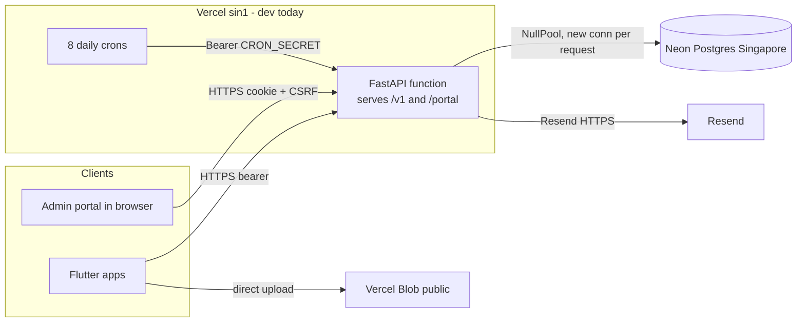

# 01. Current architecture

Version 1.0, 18-Oct-26. Facts below were read from the repository on this date. Line numbers refer to the working tree at commit `5a4135d` plus uncommitted changes. Items marked **Assumption** or **Unknown** were not found in code.

## 1. Components

| Component | What it is | Evidence |
|---|---|---|
| API | FastAPI, about 269 routes, sync handlers on the thread pool, one async handler (`put_local`) | `services/api/app/main.py:40` (`create_app`), `main.py:70` (`app`) |
| Portal | Vite + React 19 SPA, 965 KB build, `base: "/portal/"`, served by the API | `apps/web/vite.config.ts:22`, `services/api/app/webauth/portal.py` |
| Mobile | Flutter (customer, crew, admin quick actions), Dio client, bearer token in secure storage | `apps/mobile/lib/core/network/api_client.dart`, `core/config/app_config.dart:12-31` |
| Database | PostgreSQL 16 in CI; sync SQLAlchemy 2 + psycopg3; 28 Alembic files | `services/api/app/platform/db.py:50-60`, `migrations/versions` |
| Media | Local store, Vercel Blob store, **no S3 store** | `services/api/app/media/store.py:45,104,169` |
| Scheduler | OR-Tools CP-SAT, run inside request threads | `services/api/app/scheduling/solver.py:49,138` |
| Cron jobs | 8 HTTP endpoints, bearer `CRON_SECRET` | `services/api/app/notifications/cron.py`, `vercel.json` |
| Email | Resend over `urllib`; fake sender when no key | `services/api/app/platform/email.py:103,151` |
| Push | Logging stub only. No FCM in API or app | `services/api/app/notifications/push.py:36`, `apps/mobile/lib/features/common/push/push_registration.dart:10-35` |
| PDF | ReportLab invoice, in memory | `services/api/app/billing/pdf.py` |

## 2. Current deployment (dev)

Vercel project, region `sin1`, Neon Postgres (Singapore), Vercel Blob (public). Eight daily crons. Deploy by `.github/workflows/api-deploy.yml` job `deploy-vercel`. A second job `deploy-aws` exists (ECR, ECS update-service) with no migration step and no portal build. No production workflow exists (`docs/build-and-release.md:40`). The documented target in `docs/tech-stack.md:14` is AWS Mumbai: ECS Fargate, RDS, S3, EventBridge Scheduler.

## 3. Observations that drive the decision

| # | Observation | Evidence | Why it matters |
|---|---|---|---|
| O1 | Portal is same-origin with the API. Fetches use relative `/v1` paths. Session cookie is httpOnly, Secure, `SameSite=Strict`, plus a CSRF header | `apps/web/src/api/client.ts:1-4,66-74`, `services/api/app/platform/websession.py:29-31` | Splitting portal and API onto different origins (S3 + CloudFront for the portal, as `tech-stack.md:105` says) needs code changes or one shared domain with path routing |
| O2 | `NullPool`, prepared statements off | `db.py:60` | Good for serverless and poolers. On a long-running container, every request opens a new connection, so RDS Proxy or PgBouncer is advisable. At 100 DAU a direct connection per request is workable |
| O3 | Solver runs in a request thread, `max_seconds=10.0` per day-and-society call | `solver.py:50,138`; callers `scheduling/service.py:686`, `scheduling/administration.py:133` | A weekly plan is up to about 70 s per society; a monthly plan about 300 s per society (calculated, not measured) |
| O4 | Cron is HTTP only. Daily, because of the Hobby plan | `vercel.json`; comment in `cron.py` | No EventBridge definition exists. Every host needs a trigger that sends `Authorization: Bearer $CRON_SECRET`. `CRON_SECRET` is unset on dev, so crons return 503 (`docs/security-backlog.md`) |
| O5 | No S3 `ObjectStore`. Local store keeps files on one node and routes the body through the API | `store.py:45`, `media/router.py:74-117` | Blocks any multi-instance or ephemeral-disk host until S3 or Blob is used |
| O6 | Blob store returns public, unsigned, permanent URLs | `store.py:104`; `docs/security-backlog.md` high finding 3 | Private media is a security requirement (`architecture.md:289`) |
| O7 | Media limits 10 MB photo, 25 MB video, 5 MB document; no server-side image processing | `media/service.py:23` | Direct-to-storage upload is needed on any serverless host |
| O8 | No WebSocket, SSE or streaming. Web polls every 30 s; mobile refreshes on foreground | `apps/web/src/api/queryDefaults.ts:6-8`, `architecture.md:359-360` | Long-lived connection limits are not a current constraint |
| O9 | State is in the database (sessions, lockouts, codes, planner runs with `skip_locked`). Only the 30 s directory cache and the local media store are per-process | `directory/lookup.py:32-40`, `scheduling/automatic.py:29` | Multi-instance is safe once media is fixed |
| O10 | No CORS, no HTTP rate limit, no security headers, health check does not touch the DB | `main.py`, `security-backlog.md` | Gaps to close on any host |
| O11 | Dependencies unpinned, no lockfile (`ortools>=9.10`, `fastapi>=0.115`, and others) | `services/api/pyproject.toml` | Reproducible deploys and bundle-size checks need pins |
| O12 | Dockerfile does not copy `portal/`, `migrations/` or `alembic.ini`; no HEALTHCHECK; one uvicorn worker | `services/api/Dockerfile:8-16` | Image cannot serve the portal or migrate as it stands |
| O13 | Auth is HS256 JWT bound to a DB session; argon2; lockouts in DB | `identity/tokens.py`, `identity/service.py:48,396` | No sticky sessions needed |
| O14 | Hosted detection checks `VERCEL`, `AWS_EXECUTION_ENV`, `ECS_CONTAINER_METADATA_URI_V4` | `platform/config.py:64` | On Vercel with Fluid compute the AWS variables are hidden (see doc 02), but `VERCEL` is present |

## 4. Undocumented assumptions found

1. The portal is assumed same-origin with the API. Docs say S3 + CloudFront.
2. Cron frequency is daily because of the Hobby plan, not by business design. The tech-stack text implies finer jobs (freeze reminder, check-in prompt).
3. `docs/tech-stack.md` says media uses S3 signed URLs. The code has none.
4. The Play "prod" mobile flavor currently points at the dev API (`.github/workflows/mobile-android-release.yml:70-76`).
5. The docs say the scheduler runs in-process on the API service. Current code does run it in request threads.

## 5. Unknowns that limit precision

| Unknown | Effect | How to close |
|---|---|---|
| Number of customers, crew, societies, visits | All DAU and cost figures are modeled | Count rows of `seed/Priveo Masked Master Customer Data V3.xlsx`, confirm launch society count |
| Per-endpoint latency and CPU | Cost model uses assumed 80 ms active CPU | Run the Locust plan in doc 06 |
| OR-Tools wheel and bundle size | Vercel 500 MB limit check | `pip install` into a scratch folder and measure |
| Solver duration for a real society | Timeout and task sizing | Time `solve_day` on seed data |
| Cold-start time with OR-Tools imported | Vercel latency | Measure on a preview deployment |
