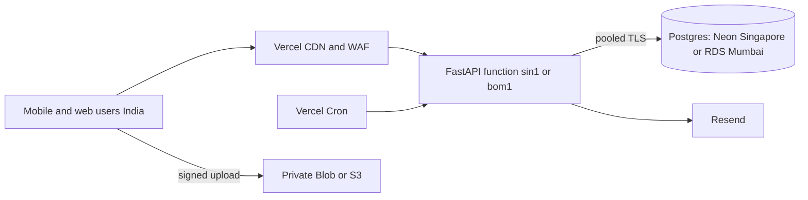
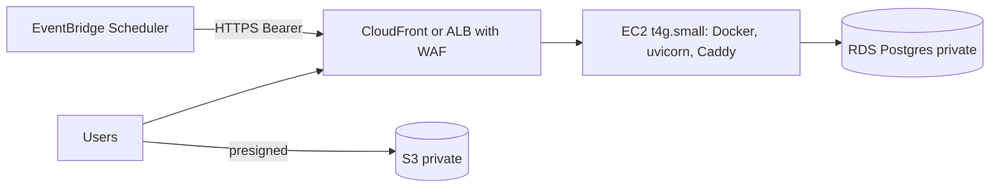
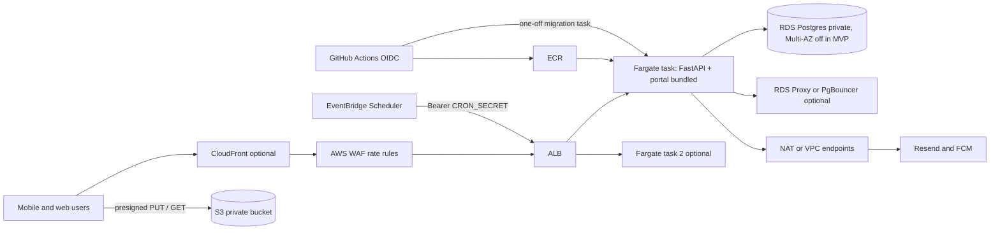

# 04. Hosting alternatives

Version 1.0, 18-Oct-26. Options are screened on the evidence in docs 01 to 03. Prices are in doc 05.

## 1. Screening

| Option | Verdict | Reason |
|---|---|---|
| A. Vercel-first | Viable | Runtime fits. Weak on private database access and Mumbai database choice |
| B. AWS EC2 + Docker | Viable, not preferred | Cheapest compute, but you patch the OS, run TLS, restarts and deploys by hand. Single host is a reliability risk |
| C. ECS Fargate (managed container) | Viable, preferred | Matches the owner's documented design. Private database. Deploy job exists |
| D. Lambda + API Gateway | Rejected | Works technically (container image up to 10 GB), but adds API Gateway, a second packaging path, `NullPool` connection churn and no gain over C at this scale. Not priced |
| D2. Cloud Run (asia-south1) | Rejected | Good fit technically, but adds a second cloud to a stack that already plans S3, SES-like services and AWS IAM. Prices not verified this session |
| D3. Render, Railway | Rejected | Mumbai region not verified; pricing pages did not load in this session. Revisit only if AWS is dropped |
| Cloudflare Workers | Rejected | Python Workers cannot run OR-Tools native wheels in the Worker runtime (not verified; no evidence of support). Not pursued |
| App Runner | Not shortlisted | Region and price not verified. Offers little over Fargate once an ALB, WAF and private RDS are needed |
| E. Hybrid: Vercel for portal, AWS for API | Rejected | Portal cookies are `SameSite=Strict` and fetches are relative (`apps/web/src/api/client.ts:1-4`). Different origins break sign-in. A shared domain with path routing works, but adds a second platform for 965 KB of static files |
| Kubernetes, microservices | Rejected | No requirement |

## 2. Option A: Vercel-first

Two sub-variants because the database decides everything.

**A1. Vercel `sin1` + Neon Singapore + Vercel private Blob.** Cheapest and closest to today's dev setup.

**A2. Vercel `bom1` + RDS Mumbai (public, allow-listed to Static IPs) + S3 or private Blob.** Adds $100 per month and still uses a public database endpoint.

Needs: private media adapter, `CRON_SECRET`, portal copied into the function bundle, pinned dependencies, `maxDuration` on planning routes.

## 3. Option B: EC2

Single point of failure. You own OS patching, disk, restarts and log shipping. Lowest direct cost, highest effort.

## 4. Option C: ECS Fargate (recommended)

Needs: S3 `ObjectStore`, portal and `alembic.ini` in the image, migration task step in `deploy-aws`, EventBridge schedules, WAF rule, DB-checking health route, outbound path (NAT or public IP) for Resend and FCM.

Cost trap: a NAT gateway costs about $33 per month before data. A cheaper variant puts tasks in public subnets with a public IPv4 ($0.005 per hour), locked down by security groups. That trades one owner checkpoint (N1) for about $29 per month.

## 5. Option F: C with the portal on CloudFront (considered, deferred)

Serving the static portal from S3 + CloudFront under the same domain as the API, with path routing (`/portal/*` to S3, `/v1/*` to ALB), keeps cookies same-origin and offloads 965 KB of assets. Saves little at 100 DAU. Defer until traffic justifies it. No code change is needed because paths stay relative.

## 6. Comparison summary

| Attribute | A1 Vercel + Neon SG | A2 Vercel + RDS | B EC2 | C Fargate |
|---|---|---|---|---|
| Database private | No | No | Yes | Yes |
| DB in India | No | Yes | Yes | Yes |
| Cron | Native | Native | EventBridge | EventBridge |
| Scale-out | Automatic | Automatic | Manual | Manual rules |
| Patching | Deps only | Deps only | OS + deps | Image + deps |
| Pipeline today | Works | Works | None | Partly built |
| Exit cost | Low (Dockerfile) | Low | n/a | n/a |
