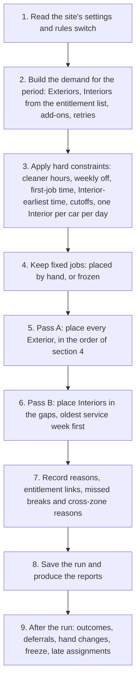

# Priveo car-care scheduler: business workflow

**Status:** Draft for review, 07-Nov-26. Not approved by the owner.

**Sources (read in this order):**

1. `docs/reqs/scheduler-requirements.md`, Draft v0.4 (06-Nov-26). The rules, their status, and the owner decisions of 05-Nov-26 (section 13). All rule IDs (SCHR-) come from here.
2. `docs/reqs/scheduler-gap-analysis.md`, Draft v0.3 (05-Nov-26). The gaps between the rules and the code.
3. `docs/reqs/admin-functional-requirements.md`, `customer-app-functional-requirements.md`, `crew-functional-requirements.md`. The ADM-, ONB-, SKIP-, PAUSE-, SCHED-, CAL-, CRW- and CNC- rows that touch scheduling.
4. `docs/design/scheduler-implementation-and-test-plan.md`. Kill switch and hierarchy wording only.
5. The code in `services/api/app/scheduling/` and the settings registry, checked for the order of steps and the fallbacks. Where the code does something the requirements do not say, section 10 says so.

**Terms used in this file.** "Version 2" means the site's scheduling rules switch is set to 2 (rules v1.2). Every existing site starts on version 1, the old rules. "Version 1" means the old rules.

---

## 1. Purpose and scope

The scheduler decides which cleaner does which car-care visit, and when, for one society (called a site) at a time. It plans the daily outside clean (Exterior), the inside clean (Interior) that each plan gets once per service week, and the Deep Spa add-on. Every car gets its outside clean first, and the inside cleans fill the gaps, while cutoffs, the weekly off day, breaks and zones are respected. This file explains that workflow for a business reader, and the requirements decide the rules. Where the code differs, section 10 says so.

---

## 2. Key terms

| Term | Plain meaning | Source ID |
|---|---|---|
| Site | One housing society served by Priveo. Its cleaners, working slots and settings belong to it. | SCHR-PAR-01, ADM-SCH-02 |
| Car | A customer's vehicle with an active subscription. | ADM-SCH-04 |
| Cleaner (crew member) | A Member or a Manager counts for capacity. A Trainee adds no capacity and follows a Member. | ADM-CAP-02, ADM-CRW-14, SCHR-ZONE-09 |
| Working slot | A start time and end time, on chosen weekdays, when a service may be done. | ADM-SVS-02 |
| Working day | A day the site is open for cleaning. | SCHR-PAR-02 |
| Weekly off | The weekday on which the site does no cleaning for any service. The default is Wednesday. | SCHR-PAR-03, SCHR-PAR-16 |
| Service | Cleaning-External (Exterior), Cleaning-Internal (Interior), or Deep Spa. | ADM-SVS-01 |
| Job | One service for one car on one day, with a length and, where it applies, a cutoff. | ADM-SCH-03 |
| Visit | The jobs for one car on one day: an Exterior, or an Exterior and an Interior. | SCHR-INT-04, ADM-CNC-09 |
| Interior entitlement | The one Interior a plan owes each car for each service week. It is kept as a list of rows, one per owed Interior. | SCHR-PAR-12, SCHR-INT-06 |
| Service week | Monday to Sunday. It is its own setting, separate from the Sunday start of the planning period. | SCHR-PAR-13 |
| Zone | An area of the site. Each car has one zone. | SCHR-ZONE-01 |
| Home zone | The zone a cleaner fills first. Each Member or Manager has one. | SCHR-ZONE-01, SCHR-ZONE-07 |
| Customer cutoff | The time by which the daily clean must be finished. It is firm on weekdays and flexible on weekends. | SCHR-CUT-06, ONB-16 |
| Strict day | A day on which the customer cutoff is a hard deadline. By default Monday, Tuesday, Thursday and Friday. | SCHR-HARD-08, SCHR-CUT-01 |
| Weekend day | Saturday and Sunday by default. On these days the cutoff is flexible. | SCHR-PAR-10, SCHR-WKE-01 |
| Freeze | 8 PM the day before a schedule starts. After it, every change is a late change. | ADM-SCH-25, SCHR-CUT-06 |
| 9 PM rule | The customer's last moment to change a date, at 9 PM the day before. This is not the planner's cutoff. | SCHED-01, SCHR-CUT-06 |
| First-job time | The earliest time a cleaner may start a job. Default 05:30. | SCHR-PAR-04, SCHR-HARD-04 |
| Reporting time | The time a cleaner reports. Default 05:00. It is shown and recorded, but no job starts at it. | SCHR-PAR-04 |
| Interior-earliest time | The earliest start of any Interior. Default 07:00, on every day. | SCHR-PAR-08, SCHR-HARD-05 |
| Early band | The time from the first-job time to the Interior-earliest time (05:30 to 07:00 by default). It is kept for Exteriors and customer onboarding. | SCHR-EXT-08 |
| Break | One continuous 30-minute break per cleaner per working day. Default 09:30 to 10:00. | SCHR-PAR-09, SCHR-BRK-01 |
| Pass A (Exteriors) | The first planning pass of a day. It places every Exterior. | SCHR-HIER-07, SCHR-EXT-03 |
| Pass B (Interiors) | The second planning pass of a day. It places Interiors in the gaps that Pass A leaves. | SCHR-HIER-07, SCHR-INT-07 |
| Fixed job | A job whose place is kept: placed by hand, or in a frozen schedule. | SCHR-HIER-08 |
| Unassigned (Needs scheduling) | A job with no cleaner, and a reason. | ADM-SCH-08, ADM-SCH-28 |
| Deferral | A job that could not be done because the car or the keys were not available. It is planned again. | SCHR-DEF-01, SCHR-DEF-05 |
| Could not complete (Missed) | The crew could not finish the job. The admin decides what happens next. | ADM-CNC-02, ADM-CNC-03 |
| Partially Completed | The Exterior is done and the Interior is not. | ADM-CNC-09 |
| Draft and Frozen | A draft can be re-run and changed. A frozen schedule takes late assignments and removals. Adding or moving work in it needs the secret code. | ADM-SCH-11, ADM-SCH-16, ADM-SCH-17 |
| Rules switch | Per site: 1 is the old rules, 2 is rules v1.2. Every existing site stays on 1 until switched. | Kill switch in the implementation and test plan |
| Owner, Derived, Open | **Owner:** the owner stated the rule. **Derived:** not stated, but needed to make a stated rule work, or taken from existing behaviour. Please check. **Open:** waits for an owner decision. None is Open at v0.4. | Requirements file, "How this document was built" |

---

## 3. The end-to-end workflow

The planner runs once per schedule (a period, a week by default). It builds all the demand for the period first, then plans one day at a time in date order. The day order matters: the entitlement list left by one day is the input of the next (SCHR-HIER-01).

### 3.1 Diagram

### 3.2 Numbered steps

The steps run in this order for each day. Step 2 runs once for the whole period.

1. **Read the settings.** For a site on version 2, the run takes one copy of every scheduler setting and keeps it with the run. A later change to a setting does not change that run. A setting that is missing should stop the run with an alert (the requirement). The code reads a missing rules switch as version 1 (section 10). [SCHR-PAR-01, SCHR-CFG-04, SCHR-CFG-07, SCHR-CFG-08]

2. **Build the demand.** The demand is everything the period needs.
   - a. **Exteriors.** Every active car gets one Exterior on every working day. A skipped or paused date becomes a skipped job, which is not planned. [SCHR-EXT-01, SCHR-INT-21, ADM-SVS-10]
   - b. **Interiors (version 2).** The plan's Interior comes from the entitlement list, not from the customer's day. Each car gets one owed row per service week it touches, including part weeks. A row is planned on a weekday of its own week when one fits. The car's preferred day is used when it fits. Weekdays come before the weekend when the preference does not decide. [SCHR-INT-01, SCHR-INT-05, SCHR-INT-10, SCHR-INT-19, SCHR-INT-20]
   - c. **Waivers.** A service week that is fully paused is waived. A one-day skip changes nothing. [SCHR-INT-21]
   - d. **Add-ons and retries.** Deep Spa bookings and any Interior that the admin sent to the next day are added. [ADM-SVS-10, ADM-SCH-30, ADM-CNC-06]
   - e. **Closed days.** A weekday with no working slot for a service gives no demand for that service. [SCHR-PAR-02, ADM-CAP-08]

3. **Apply the hard constraints.** These are the windows each cleaner and each job may use.
   - a. **Cleaner windows.** Working hours for the weekday. The weekly off closes the day for everyone. The first-job time is the earliest start. A Trainee has no window. Sick and Leave remove the day. A late start moves the start. [SCHR-HARD-01, SCHR-HARD-04, SCHR-HARD-07, SCHR-PAR-04, ADM-CRW-14]
   - b. **Job windows.** The working slots of the job's service. The Interior-earliest time (07:00) limits any Interior. [SCHR-HARD-05, SCHR-INT-03]
   - c. **Cutoff.** On a strict day a job must end by its car's cutoff. On a weekend day the cutoff is soft. [SCHR-CUT-01, SCHR-CUT-02, SCHR-WKE-01]
   - d. **Always.** A job ends inside one of the cleaner's windows. No cleaner has two jobs at once. No car is worked by two cleaners at once. Each job takes its full set length, with no travel minutes added. [SCHR-HARD-02, SCHR-HARD-03, SCHR-HARD-06, SCHR-HARD-12, SCHR-ZONE-05]
   - e. **Interior limits.** At most one Interior per car per day. At most one Interior per car per service week. [SCHR-HARD-10, SCHR-HARD-11]
   - f. **Break.** The break is kept where the plan can keep it. It is not counted as capacity. [SCHR-BRK-01, SCHR-BRK-08]

4. **Keep the fixed jobs.** A job placed by hand, or a job in a frozen schedule, keeps its place. It still uses its cleaner's time in both passes. A job that has started or finished does not move. On a frozen day a job that is still unassigned gets a window that ends at its cutoff. [SCHR-HIER-08, ADM-SCH-14, ADM-SCH-27, SCHR-BRK-10]

5. **Pass A: Exteriors.** The planner places every Exterior of the day in one plan. Coverage comes first: every car gets one if it can. Among plans with the same coverage, the planner then applies these in order:
   1. Zones: fill each cleaner's home zone first. Other zones only use spare capacity. Fewer zone switches.
   2. Break: keep the cleaner's break where possible. In this pass the break is a soft preference.
   3. Weekend lateness: fewer weekend jobs after their cutoff.
   4. Usable early capacity: leave usable free time from 07:00 for the Interiors still to place.
   5. Earlier starts.

   A car that cannot be covered is listed with its reason. The shortfall is given in cars and minutes. [SCHR-EXT-01 to SCHR-EXT-06, SCHR-EXT-10, SCHR-HIER-03, SCHR-HIER-04, SCHR-HIER-05, SCHR-ZONE-01 to SCHR-ZONE-03, SCHR-BRK-03, SCHR-EXT-04]

6. **Pass B: Interiors.** Pass A's placements are fixed. Interiors fill the gaps of 30 minutes or more that start no earlier than 07:00. The planner applies these in order:
   1. As many Interiors as possible are placed.
   2. Zones, as in Pass A.
   3. Oldest service week first. Within a week, the entitlement that has waited longest goes first, then the tighter weekday cutoff.
   4. Weekend lateness.
   5. Earlier starts.

   The break is a hard limit in this pass. An Interior never overlaps a kept break. Exterior first is a planning order only: a free cleaner may start an Interior while another cleaner still does Exteriors. [SCHR-INT-07 to SCHR-INT-12, SCHR-WKE-02, SCHR-WKE-05, SCHR-BRK-02, SCHR-HIER-07, SCHR-INT-08]

7. **Record the day's facts.** Each unassigned job gets a structured reason. Each Interior is linked to its entitlement row and carries its service week. A cleaner whose planned work overlaps their break gets a missed-break flag. A cross-zone job gets its reason. [SCHR-OUT-04, SCHR-INT-11, SCHR-BRK-04, SCHR-ZONE-06]

8. **Outputs.** The run produces these:
   - the daily cleaner view (per cleaner: cars, times, cutoff, break, free slots, exceptions, cross-zone help);
   - the weekly summary (completed against Exteriors, Interiors by original week, weekday and weekend, catch-up, carryover, missed breaks), which can be exported as a file;
   - the exception report (unassigned Exteriors, pending or deferred Interiors, unavailable keys or cars, cross-zone triggers, cutoff infeasibility, missed breaks, and weekend lateness);
   - the run summary (placed, unassigned, late, unassigned Exteriors, deferred Interiors, cross-zone assignments, missed breaks) and the schedule history.

   [SCHR-OUT-01 to SCHR-OUT-07, SCHR-WKE-06]

9. **Events after the run.** The plan changes when work happens.
   - a. **Crew outcomes.** The crew marks a job Completed, Could not complete, Partially Completed or Deferred. A completed Interior is recorded against its own service week, even when it was done in a later week. A Could not complete or Skipped Interior goes back to pending with its week. [SCHR-INT-14, SCHR-INT-15, SCHR-INT-16, ADM-CNC-03]
   - b. **Deferral.** If the reason given is one that defers (set in configuration), the job becomes Deferred. A deferred Interior goes back to pending with its original week. The next run plans it again. [SCHR-DEF-01 to SCHR-DEF-06]
   - c. **Partial completion.** When the Exterior is done and the Interior is not, the visit is Partially Completed. The admin or a Manager decides whether to reschedule the Interior for the next day only. [SCHR-DEF-05, ADM-CNC-09, ADM-CNC-10]
   - d. **Hand changes.** On version 2 the admin may place a job against a rule. The screen warns, and the breach is kept in the exception report. On version 1 the same placement is refused. A re-run keeps hand changes. [SCHR-HIER-08, SCHR-CUT-05, ADM-SCH-13, ADM-SCH-14]
   - e. **Customer changes after freeze.** A skip or pause removes the visit from the frozen schedule without unfreezing. A cutoff change after freeze is only a request to the admin. [ADM-SCH-21, ADM-SCH-22, CAL-07]
   - f. **Freeze.** A draft is frozen automatically at 8 PM the day before its first day. After that, a visit with no cleaner is placed late, using the earliest time before its cutoff, and the admin is alerted. Removing work needs no code. Adding or moving work needs the secret code. [ADM-SCH-25, ADM-SCH-27, ADM-SCH-29, ADM-SCH-17]
   - g. **Settings changes.** A change applies from the next plan that is not frozen. It never changes a frozen schedule or a started job. [SCHR-PAR-14, SCHR-CFG-07]
   - h. **Automatic planning.** It is off until a planning time is set. A run that does not finish is tried again after 30 minutes. A failed run is tried again after 5 minutes and raises an alert. [Section 1 configuration table, automatic planning row]

---

## 4. Hierarchy of rules

### 4.1 Levels

The requirements file gives the order the planner follows (SCHR-HIER-01 to SCHR-HIER-08).

| Level | What it is | Rule IDs | Can a lower level override it? |
|---|---|---|---|
| 0. Inputs | Settings, cleaners and hours, cars and their cutoffs, the entitlement list, zones, breaks, durations | SCHR-HIER-01, SCHR-PAR | Not applicable |
| 1. Hard constraints | Limits the planner never breaks. A job that cannot be placed within them is left unassigned and reported | SCHR-HIER-02, SCHR-HARD-01 to SCHR-HARD-13 | No. Only a person can override, by hand, with a warning (version 2) |
| 2. Exterior coverage | One Exterior for every car on every working day, before any Interior | SCHR-EXT-01, SCHR-EXT-03, SCHR-EXT-04 | Only by a hard constraint |
| 3. Ordered objectives | Pass A objectives, then Pass B objectives, each in order | SCHR-HIER-03, SCHR-HIER-04, SCHR-HIER-05, SCHR-HIER-06 | An objective only improves a plan that keeps every higher objective at its best |
| 4. Outputs | Daily view, weekly summary, exception report, run summary | SCHR-OUT-01 to SCHR-OUT-07 | Not applicable |

### 4.2 Conflicts and how they resolve

| Conflict | What wins | Source ID |
|---|---|---|
| Exterior coverage against a hard limit | The hard limit wins. The Exterior is left unassigned and reported | SCHR-HIER-02, SCHR-EXT-04 |
| Exterior coverage against the break | Coverage wins. The break is dropped and flagged as missed | SCHR-BRK-03, SCHR-BRK-04 |
| Weekday cutoff against the break | The cutoff wins. The break is dropped and flagged | SCHR-BRK-03 |
| Weekday cutoff against an Interior | The cutoff wins. The Interior is deferred and stays owed. It never displaces an Exterior | SCHR-CUT-03 |
| Break against an Interior | The break wins. The Interior is deferred | SCHR-BRK-02 |
| Home zone against a cutoff or coverage | Coverage and weekday cutoffs win. A cross-zone job never pushes a home-zone job past its cutoff | SCHR-ZONE-04 |
| Home zone against a free slot | The home zone is filled first. A cleaner does not cross zones only to make a free slot | SCHR-ZONE-04, SCHR-ZONE-03 |
| Early free capacity against coverage or a cutoff | Coverage and cutoffs win. Free capacity is never made by breaking them | SCHR-EXT-06 |
| Early free capacity against an eligible Interior | The Interior takes the free slot. A slot is never kept idle on purpose | SCHR-EXT-07 |
| Older service week against a newer one | The older week is placed first | SCHR-INT-12, SCHR-INT-13 |
| Weekend cutoff against the break | The break wins. The Interior runs after the break and is flagged late | SCHR-HIER-05 |
| Admin hand placement against any rule | The admin may place the job. The screen warns and the breach is flagged | SCHR-HIER-08, SCHR-CUT-05 |

### 4.3 Seeded objective order

The objectives are applied one at a time, highest first. Each stage keeps the best value of the stages above it. The seeded names are shown only so that the configuration can be traced.

| Position | Pass | Plain name | What the objective does, in one sentence | Seeded name (for tracing) | Source ID |
|---|---|---|---|---|---|
| 1 | A and B | Work placed | Place as many minutes of work as possible. | placed | SCHR-EXT-04, SCHR-HIER-04 |
| 2 | A and B | Zones | Fill each cleaner's home zone first, use other zones only in spare capacity, and keep switches between zones to a minimum. | zone | SCHR-ZONE-01 to SCHR-ZONE-03, SCHR-EXT-10 |
| 3 | A only | Break kept | Keep each cleaner's break where a plan allows it. | break | SCHR-BRK-01, SCHR-BRK-03 |
| 3 | B only | (none) | In Pass B the break is a hard limit, not an objective. | (not an objective in Pass B) | SCHR-BRK-02 |
| 3 | B only | Oldest service week first | Place the oldest owed Interior first, then the one that has waited longest, then the one with the tighter weekday cutoff. | fifo | SCHR-INT-12, SCHR-WKE-05 |
| 4 | A and B | Weekend lateness | Make as few weekend jobs as possible finish after their cutoff. | late | SCHR-WKE-01, SCHR-HIER-05 |
| 5 | A only | Usable early capacity | Leave as much usable free time from 07:00 as possible, with less credit for time later in the day. | early_capacity | SCHR-EXT-05, SCHR-EXT-06 |
| 6 | A and B | Earlier start | Prefer earlier start times when all else is equal. | early | SCHR-HIER-06 |

The requirements file's own list in section 3 orders some of these differently. See section 10.

### 4.4 Hard constraints that nothing can break

| ID | Limit in plain words |
|---|---|
| SCHR-HARD-01 | Only cleaners available that day are used: hours, Sick, Leave, Late start, and role. |
| SCHR-HARD-02 | A job ends inside one of the cleaner's windows. The shift end is never passed. |
| SCHR-HARD-03 | No cleaner has two overlapping jobs. |
| SCHR-HARD-04 | No job starts before the first-job time (05:30 by default). |
| SCHR-HARD-05 | No Interior starts before the Interior-earliest time (07:00 by default). |
| SCHR-HARD-06 | Each job takes its set length. No travel minutes are added. |
| SCHR-HARD-07 | No Exterior or Interior is planned on a weekly off day. |
| SCHR-HARD-08 | On a strict day no job ends after the car's cutoff. |
| SCHR-HARD-09 | Each active car needs one Exterior each working day. A shortfall is reported, not hidden. |
| SCHR-HARD-10 | At most one Interior per car per service week. |
| SCHR-HARD-11 | At most one Interior per car per day. |
| SCHR-HARD-12 | No car is worked by two cleaners at the same time. |
| SCHR-HARD-13 | A job with no cleaner window long enough for it is reported as unassigned. |

---

## 5. Dependencies

Each row says what a step or rule needs before it can run. "Version 2 only" means the rule does nothing at version 1.

| Rule or step | Depends on a setting | Depends on the entitlement list | Depends on an earlier step | Version 2 only? | Source ID |
|---|---|---|---|---|---|
| Exterior every working day | Working slots; weekly off | None | Step 2 (demand) | No | SCHR-EXT-01 |
| Exterior coverage first | None | None | Steps 2 and 3 | Yes | SCHR-EXT-03 |
| Interior due by entitlement | Interior entitlement per week; service week start | A pending row for the week | Step 2 (list built for the period) | Yes | SCHR-INT-01, SCHR-PAR-12 |
| Interior day preference | Customer's interior care day, or a pattern's Interior days | The chosen row | Step 2 (day chosen) | Yes | SCHR-INT-05, SCHR-INT-26 |
| Weekly off | Weekly off weekday (working slots) | None | Step 3a | Partly (the demand filter is in both; the closed-day window rule is version 2) | SCHR-PAR-02, SCHR-HARD-07 |
| First-job time | Site first-job time; cleaner override | None | Step 3a | Yes | SCHR-PAR-04, SCHR-PAR-05 |
| Interior-earliest time | Interior-earliest setting | None | Step 3b | Yes | SCHR-PAR-08, SCHR-HARD-05 |
| Strict-day cutoff | Strict weekday setting; weekend days; cutoff per car and date | None | Step 3c | Yes | SCHR-CUT-01, SCHR-PAR-11 |
| Weekend cutoff flexible | Flexible weekend setting; weekend days | None | Steps 5 and 6 (lateness stage) | Yes | SCHR-WKE-01, SCHR-PAR-10 |
| Break | Break settings: site, cleaner, date range; break on or off | None | Step 3f; fixed jobs (step 4) | Yes | SCHR-PAR-09, SCHR-BRK-06 |
| Break as a hard limit | Break | None | Pass A placements (step 5) | Yes | SCHR-BRK-02 |
| Zones | Home zone per cleaner; zone per car; cross-zone setting | None | Step 5 before step 6 | Yes | SCHR-ZONE-01, SCHR-ZONE-11 |
| Usable early capacity | Interior-earliest time | Pending Interiors and their cutoffs | Pass A only | Yes | SCHR-EXT-05 |
| Oldest service week first | None | Service week of each row; age of the row | Pass A placements fixed (step 6) | Yes | SCHR-INT-12 |
| Deferral | The reason's deferral mark | Row goes back to pending | Crew outcome (step 9a) | Yes | SCHR-DEF-03, SCHR-DEF-05 |
| Missed-break flag | Break | None | Solve (step 6) | Yes | SCHR-BRK-04 |
| Cross-zone reason | Zones | None | Solve (steps 5 and 6) | Yes | SCHR-ZONE-06 |
| Shortfall figures | None | None | Pass A result (step 5) | Yes | SCHR-EXT-04, SCHR-HARD-09 |
| Objective order and weights | Objective order and weights | None | Settings copy (step 1) | Yes | SCHR-PAR-15 |
| Hand-placement warning | None | None | Fixed jobs (step 4) | Yes (version 1 refuses the placement) | SCHR-HIER-08 |
| Capacity: break and early band | Break; Interior-earliest time | None | Cleaner windows (step 3a) | Yes | SCHR-BRK-08, SCHR-EXT-09 |
| Late assignment after freeze | Cutoff | None | Freeze (step 9f) | No (the cutoff window applies at both versions) | ADM-SCH-27 |

---

## 6. Rules table

Every SCHR- rule is listed once, in ID order.

"Version 2 only?" answers the question in the brief. **Yes** means the rule does nothing at version 1. **No** means it applies at both versions, as an existing rule or a data default. **Partly** means part of it is at both versions and part only at version 2.

"Where decided" gives the step in section 3.2. "n/a" means the rule is a screen, a wording, a test or a data-change rule, not a planner step.

| ID | Plain-English rule | Status | Version 2 only? | Where decided (step) |
|---|---|---|---|---|
| SCHR-PAR-01 | Each site can hold its own value for each scheduler setting. A site without one uses the global value, then the built-in default. | Derived | Yes | 1 |
| SCHR-PAR-02 | Working days are Monday, Tuesday, Thursday, Friday, Saturday and Sunday. Wednesday is the weekly off, set through the site's working slots. A weekday with no slot is a day off. | Owner | Partly (slot filter in both; closed-day window rule in version 2) | 2, 3 |
| SCHR-PAR-03 | The weekly off is a site setting, default Wednesday. It closes Exterior, Interior and Deep Spa. Existing sites change only when the admin saves the change or the owner approves a data update. | Owner | No (a setting and data default) | 1, 3 |
| SCHR-PAR-04 | Cleaners report at 05:00 and the first Exterior starts at 05:30 by default. Both are site settings with a per-cleaner override. Reporting time is shown only. Earliest job start is the later of first-job time and the cleaner's window start. | Owner | Yes | 1, 3 |
| SCHR-PAR-05 | A cleaner with no override follows the site value, including later changes. Clearing an override returns the cleaner to the site value. | Derived | Yes | 1 |
| SCHR-PAR-06 | Job length is 30 minutes for Exterior and 30 minutes for Interior. A visit with both is 60 minutes of work. The admin may edit it. Existing 20-minute jobs keep their length until planned again. | Owner | Partly (the length applies at both; refresh on re-run is version 2) | 1, 9 |
| SCHR-PAR-07 | Deep Spa keeps its 120-minute planning length. | Derived | No | 2 |
| SCHR-PAR-08 | The earliest Interior start is 07:00 on every working day, weekday and weekend. It is set per site. | Owner | Yes | 3 |
| SCHR-PAR-09 | The break for all cleaners is 09:30 to 10:00 by default. There is a site default, a cleaner override and a date-range override. The most specific rule wins. | Owner | Yes | 1, 3, 5, 6 |
| SCHR-PAR-10 | The weekend is Saturday and Sunday. It is a setting, so the cutoff rules do not depend on fixed weekday numbers. | Derived | Yes | 1 |
| SCHR-PAR-11 | The customer cutoff has two settings: strict on weekdays, and flexible on weekends. Both are on by default. | Owner | Yes | 1 |
| SCHR-PAR-12 | Each plan gives one Interior for each service week (setting default 1). | Owner | Yes | 2 |
| SCHR-PAR-13 | A service week runs Monday to Sunday. Its start day is its own setting, separate from the planning period's start. | Owner | Yes | 2 |
| SCHR-PAR-14 | The admin changes these settings in the portal. Each change is audited. A change applies the next time a day is planned. A frozen day is not replanned by a settings change. | Derived | Partly (the frozen-day rule applies at both; the per-run copy is version 2) | 1, 9 |
| SCHR-PAR-15 | The order and weights of the objectives are configuration. They are seeded in the order of section 4.3 and can be edited with a confirmation. | Owner | Yes | 1, 5, 6 |
| SCHR-PAR-16 | The weekly off applies to Exterior, Interior and Deep Spa alike. | Owner | Partly (demand filter in both; closed-day window rule in version 2) | 2, 3 |
| SCHR-CFG-01 | No rule, value or threshold is hard-coded in the scheduler. Each one is read from admin configuration. | Owner | Partly (new reads are version 2; some constants remain in both, section 9) | 1 |
| SCHR-CFG-02 | Every value is editable in the portal. A value uses an existing place where one fits; a new place only where none fits. | Owner | No | n/a |
| SCHR-CFG-03 | Defaults are seeded by migration or the seed tool. Code constants are not defaults. Only allowed ranges stay in code. | Owner | No | n/a |
| SCHR-CFG-04 | The planner reads every value through the settings layer. A missing value stops the run with a clear error and an alert, not a hidden default. | Owner and Derived | Partly (the settings layer refuses a missing value at version 2; a missing switch is read as version 1) | 1 |
| SCHR-CFG-05 | Each value is checked on save: type, range and consistency, such as break start before break end. A refused value says what to enter. | Owner and Derived | No | n/a |
| SCHR-CFG-06 | Each change is audited with the admin, the time, the old and new value and the site. | Owner | No | n/a |
| SCHR-CFG-07 | A change applies from the next plan that is not frozen. It never changes a frozen schedule, a started job, or a past day or report. | Owner | Partly (the per-run copy is version 2) | 1, 9 |
| SCHR-CFG-08 | Each run records the values it used, so a plan can be explained after a value changes. | Derived | Yes | 1, 8 |
| SCHR-CFG-09 | The constants listed in the gap analysis move to configuration and are removed from code. A test fails the build if one returns. | Owner and Derived | No (build and test rule) | n/a |
| SCHR-CFG-10 | New admin screens only where no current place fits: a scheduling rules section, a break dialog, and a home-zone field on the crew screen. Global values are keys on the Schedule settings tab. | Derived | No | n/a |
| SCHR-HIER-01 | The planner runs in this order for one site and one day: inputs, hard constraints, Pass A, Pass B, outputs. Days run in date order, so the entitlement list from one day feeds the next. | Derived | Partly (date order in both; passes and list in version 2) | 2 to 8 |
| SCHR-HIER-02 | Hard constraints are never broken by any objective. A job that cannot be placed without breaking one is left unassigned and reported. | Owner | Partly (availability and overlap in both; weekly off and strict cutoff in version 2) | 3, 5, 6, 7 |
| SCHR-HIER-03 | The objectives of Pass A and Pass B are applied in the order of section 4.3. An objective can change the plan only among plans that keep every higher objective at its best. | Derived | Yes | 5, 6 |
| SCHR-HIER-04 | The priority order is: complete mandatory Exteriors; keep zone ownership; prefer usable early capacity in Pass A; protect the break ahead of Interiors; maximise weekday Interiors; on weekends Exteriors first, then Interiors oldest first; prefer weekend cutoffs. | Owner | Yes | 5, 6 |
| SCHR-HIER-05 | In Pass A, weekend lateness is minimised above early capacity. On a weekend the break wins over the cutoff: the Interior runs after the break and is flagged late. Exterior still comes first. | Owner and Derived | Yes | 5, 6 |
| SCHR-HIER-06 | Tie-breaks in order: fewer cross-zone assignments; fewer zone switches in a cleaner's day; earlier start; a stable order by vehicle creation date and ID; then the fixed random seed. | Derived | Yes | 5, 6 |
| SCHR-HIER-07 | Pass A and Pass B are two separate plans. Pass B takes Pass A's placements as fixed and fills the gaps. Exterior first is a planning order, not a barrier. | Owner | Yes | 5, 6 |
| SCHR-HIER-08 | Hand-placed and frozen jobs keep their place and use time in both passes. The admin may place a job against any rule; the screen warns and each breach is flagged. The planner itself never breaks a hard constraint. | Owner | Partly (at version 1 a placement against a rule is refused; the warning and flag are version 2) | 4, 9 |
| SCHR-HARD-01 | Only cleaners available that day are used: working hours, Sick, Leave, Late start and role. | Owner | No | 3 |
| SCHR-HARD-02 | A cleaner's shift end is never passed. A job ends inside one of the cleaner's windows. | Owner | No | 3 |
| SCHR-HARD-03 | A cleaner is never given two overlapping jobs. | Owner | No | 5, 6 |
| SCHR-HARD-04 | No job starts before the cleaner's first-job time (05:30 by default). Reporting at 05:00 is not a start time. | Owner | Yes | 3 |
| SCHR-HARD-05 | No Interior starts before the Interior-earliest time (07:00 by default), on any day. | Owner | Yes | 3 |
| SCHR-HARD-06 | Every Exterior and every Interior takes exactly its set length (30 minutes by default). No travel minutes are added between cars or zones. | Owner | No | 3 |
| SCHR-HARD-07 | No Exterior or Interior is planned on a weekly off day. | Owner | Partly (demand filter in both; closed-day window rule in version 2) | 2, 3 |
| SCHR-HARD-08 | On a strict day (Monday, Tuesday, Thursday, Friday by default), no Exterior and no Interior ends after the car's cutoff. | Owner | Yes | 3, 5, 6 |
| SCHR-HARD-09 | Every active car needs one Exterior on every working day. If that is not possible, the shortfall is reported and not hidden. | Owner | Partly (the daily demand is in both; the shortfall figures are version 2) | 2, 7, 8 |
| SCHR-HARD-10 | At most one Interior is planned or completed against the same service week of a car. | Owner | Yes | 2, 6 |
| SCHR-HARD-11 | At most one Interior is planned for a car on a day. Two in one calendar week only on separate days, each for a different service week. | Owner | Yes | 6 |
| SCHR-HARD-12 | One car is never worked on by two cleaners at the same time. | Derived | No | 6 |
| SCHR-HARD-13 | A job whose cleaner has no window long enough for it is reported as unassigned, with the reason. | Derived | No | 7 |
| SCHR-EXT-01 | Every active car has one Exterior on each working day. | Owner | Partly (the daily demand is in both; coverage first is version 2) | 2, 5 |
| SCHR-EXT-02 | Each Exterior takes a fixed 30-minute slot, which includes movement between cars and zones. | Owner | No | 3 |
| SCHR-EXT-03 | All Exteriors of the day are allocated before any Interior, including on weekends. | Owner | Yes | 5 |
| SCHR-EXT-04 | Exterior has the highest service priority. If full coverage is impossible, the planner places as many as it can, and the output names each unassigned car, the reason, and the shortfall in cars and minutes. | Owner | Yes | 5, 7, 8 |
| SCHR-EXT-05 | Among plans with the same Exteriors, the planner prefers the one with the most usable early free time. Usable means free time from the Interior-earliest time that a pending Interior could use before its cutoff on a weekday. Free time late in the shift counts less. | Owner and Derived | Yes | 5 |
| SCHR-EXT-06 | Early free time is never made by breaking a cutoff, by leaving Exterior coverage short, or by clearly adding zone changes. | Owner | Yes | 5 |
| SCHR-EXT-07 | A free slot is never kept idle on purpose. An eligible Interior takes a suitable free slot. | Owner | Yes | 6 |
| SCHR-EXT-08 | Between the first-job time and the Interior-earliest time (05:30 to 07:00 by default) is for Exteriors or onboarding. From 07:00 a free slot can also take an Interior, subject to keys, cutoff and capacity. | Owner | Yes | 3, 5 |
| SCHR-EXT-09 | Free capacity in the 05:30 to 07:00 band that stays free is shown as available for onboarding. The planner does not hold it back or reserve it. | Derived | Yes | 8 |
| SCHR-EXT-10 | Among equally good plans, the Exterior pass minimises zone changes. | Owner | Yes | 5 |
| SCHR-EXT-11 | A Weekly or Cycle pattern can give a car fewer than six Exteriors a week. The entitlement replaces the Custom interior rotation. Pattern Interior days feed the preference only. How Exterior-only days are handled is Derived: the pattern is kept. | Owner and Derived | Partly (patterns in both; Interior days as a preference in version 2) | 2 |
| SCHR-EXT-12 | An Exterior that was not done is not carried forward. The next working day's Exterior covers it. | Derived | No | 9 |
| SCHR-INT-01 | An Interior is planned for a car only when the car has a pending Interior for a service week up to and including the week of the day. The weekday planned need not match the customer's interior care day. | Owner and Derived | Yes | 2 |
| SCHR-INT-02 | Each Interior takes exactly 30 minutes, including movement between cars or zones. | Owner | No | 3 |
| SCHR-INT-03 | No Interior starts before 07:00 on any day, including weekends, because keys may not be reachable earlier. | Owner | Yes | 3 |
| SCHR-INT-04 | A visit with an Exterior and an Interior takes 60 minutes of work. The two jobs may follow each other or be apart, and may be done by different cleaners. | Owner | No | 5, 6 |
| SCHR-INT-05 | The customer's interior care day is a preference only. It may break a tie between equal plans. Exceptional requests are handled by hand. | Owner and Derived | Yes | 2 |
| SCHR-INT-06 | The default is one Interior for each service week. A second Interior is never planned against the same service week. | Owner | Yes | 2, 6 |
| SCHR-INT-07 | Pass B starts only after all Exteriors of the day are allocated. It looks at gaps of 30 minutes or more that start no earlier than 07:00. | Owner | Yes | 6 |
| SCHR-INT-08 | Exterior first is a planning order, not an execution barrier. A free cleaner may take an Interior while others still do Exteriors. | Owner | Yes | 6 |
| SCHR-INT-09 | Pass B respects weekday cutoffs, kept breaks and the existing Exterior assignments. | Owner | Yes | 6 |
| SCHR-INT-10 | The planner places as many weekday Interiors as it can. What cannot be placed on weekdays is offered to Saturday and Sunday, after those days' Exteriors are assigned. | Owner | Yes | 2, 6 |
| SCHR-INT-11 | Every Interior carries an explicit service week, stored as its first date. It keeps that week until it is actually done. | Owner | Yes | 2, 7 |
| SCHR-INT-12 | Pass B orders eligible entitlements by service week, oldest first. Within a week, the one that has waited longest goes first, then the tighter weekday cutoff, then the stable order. | Owner and Derived | Yes | 6 |
| SCHR-INT-13 | An Interior not done by the last day of its week carries into the next week, with higher priority than that week's new Interior. | Owner | Yes | 2, 6 |
| SCHR-INT-14 | When an overdue Interior is done in the next week, the completion is recorded against its original week. | Owner | Yes | 9 |
| SCHR-INT-15 | The next week's entitlement is not marked complete because an overdue Interior was done. | Owner | Yes | 9 |
| SCHR-INT-16 | An overdue Interior keeps its original service week until it is done. Older pending weeks are processed first. | Owner | Yes | 2, 9 |
| SCHR-INT-17 | Reports show, for each Interior, its original service week, the number of overdue days, and the completion date. | Owner | Yes | 8 |
| SCHR-INT-18 | More than one Interior may be done for a car in the same calendar week (a catch-up week), only on separate days, each for a different service week, when capacity exists. | Owner | Yes | 2, 6, 9 |
| SCHR-INT-19 | A new entitlement row is created for each active subscription whose plan includes Interior care, for each service week from its first service date. Creating them again makes no second row. | Derived | Yes | 2 |
| SCHR-INT-20 | Every service week a subscription touches owes one Interior, including part weeks at the start or end. A plan change keeps the week's entitlement if the new plan includes Interior care. | Owner and Derived | Yes | 2 |
| SCHR-INT-21 | An operational miss (car, keys, capacity, skipped by operations) is owed and carries forward. A fully paused week is waived. A one-day customer skip leaves the entitlement pending until the week ends. | Owner | Yes | 2, 9 |
| SCHR-INT-22 | An Interior bought as an extra, or a Deep Spa, does not use up the weekly entitlement. | Derived | Yes | 2 |
| SCHR-INT-23 | A plan without Interior care has no entitlement and gets no Interior. | Derived | Yes | 2 |
| SCHR-INT-24 | An Interior placed by hand is counted against the oldest pending week of the car, unless the admin picks another week. | Derived | Yes | 7, 9 |
| SCHR-INT-25 | The entitlement replaces the Custom interior care day rotation. A Custom subscription is a normal case, and its notes are for information only. | Owner | Yes | 2 |
| SCHR-INT-26 | A Weekly or Cycle pattern that names Interior days feeds the car's preferred days, as a tie-break. It does not override the entitlement. | Derived | Yes | 2 |
| SCHR-CUT-01 | On Monday, Tuesday, Thursday and Friday the customer cutoff is a hard finish deadline for Exterior and Interior. | Owner | Yes | 3, 5, 6 |
| SCHR-CUT-02 | A job is never scheduled to finish after its car's cutoff on those days. | Owner | Yes | 3, 5, 6 |
| SCHR-CUT-03 | An Interior that cannot fit before the cutoff is deferred and stays pending. This never costs an Exterior its place. | Owner | Yes | 6, 7 |
| SCHR-CUT-04 | An Exterior that cannot fit before the weekday cutoff is left unassigned and reported with its reason and cutoff time. It is not placed late. | Owner | Yes | 5, 7 |
| SCHR-CUT-05 | When the admin places a job by hand after a weekday cutoff, the screen warns, the job is marked Late, and the breach is listed in the exception report. The admin may go ahead. | Owner | Yes | 4, 9 |
| SCHR-CUT-06 | The three cutoffs are named in screens and reports: Customer cutoff (the planner's deadline), Freeze (8 PM) and 9 PM rule. | Owner | No (naming) | n/a |
| SCHR-CUT-07 | The customer may choose any cutoff in 30-minute steps. A cutoff earlier than the first-job time plus the job length cannot be met on a strict day, so the car is left unassigned and reported. The app does not warn. | Derived | Yes | 5, 7 |
| SCHR-CUT-08 | The late-assignment rule after a freeze (the earliest time before the cutoff) stays, and it must agree with the hard weekday cutoff. | Derived | Partly (the freeze window is in both; the agreement with the weekday rule is version 2) | 9 |
| SCHR-WKE-01 | On Saturday and Sunday the cutoff is flexible for Exterior and Interior. The planner prefers to meet it when the car is available. | Owner | Partly (before version 2 the cutoff is soft on every day) | 5, 6 |
| SCHR-WKE-02 | The planner finishes all weekend Exteriors first, then gives the remaining capacity to Interiors. | Owner | Yes | 5, 6 |
| SCHR-WKE-03 | A weekend Exterior or Interior may end after the normal cutoff only if the car is physically available. It must still end inside the cleaner's shift. | Owner | Partly (the shift rule is in both; the weekend lateness is version 2) | 3, 5, 6 |
| SCHR-WKE-04 | The planner does not know whether a car is there at planning time, and assumes it is. A car that is not there is found at execution and handled by deferral. | Derived | No | 5 |
| SCHR-WKE-05 | Eligible outstanding Interiors are allocated on Saturday and Sunday after the weekend Exteriors, oldest service week first. | Owner | Yes | 6 |
| SCHR-WKE-06 | Weekend lateness against a cutoff is reported in the exception report. | Owner | Yes | 8 |
| SCHR-ZONE-01 | Each site has several zones, and each car has one zone. Each cleaner has one home zone, set by the admin. The planner fills the home zone first. | Owner | Yes | 5 |
| SCHR-ZONE-02 | The planner minimises the number of zone switches in a cleaner's day. | Owner | Yes | 5, 6 |
| SCHR-ZONE-03 | After the home-zone jobs are placed, a cleaner may take jobs from other zones into spare capacity. This holds for Exterior and Interior jobs. | Owner | Yes | 5, 6 |
| SCHR-ZONE-04 | Before a cross-zone assignment, the planner checks the cutoff, the cleaner's spare capacity and the weekly Interior. A cleaner does not cross zones only to make a preferred free slot, and a cross-zone job never pushes a home-zone job past its cutoff. | Owner and Derived | Yes | 5, 6 |
| SCHR-ZONE-05 | Movement across zones is part of the fixed 30-minute slot. No extra travel minutes are added. | Owner | No | 3 |
| SCHR-ZONE-06 | The reason for each cross-zone assignment is recorded on the job. The reasons are: home-zone cleaner absent; home zone full; spare capacity used; needed to meet a cutoff or the weekly Interior. | Owner and Derived | Yes | 7 |
| SCHR-ZONE-07 | The admin sets one home zone for each cleaner. Several cleaners may share a home zone. A zone with no cleaner is served entirely as cross-zone work. | Owner and Derived | Yes | 1, 5 |
| SCHR-ZONE-08 | A car with no zone is served by any cleaner of the site. It never counts as cross-zone. | Derived | Yes | 5 |
| SCHR-ZONE-09 | Only Members and Managers have a home zone. A Trainee follows the paired Member's jobs and home zone. | Derived | Yes | 1, 5 |
| SCHR-ZONE-10 | A zone switch is two consecutive jobs in a cleaner's day that are in different zones. A cross-zone assignment is a job in a zone other than the cleaner's home zone. | Derived | Yes | 5 |
| SCHR-ZONE-11 | A site where no cleaner has a home zone plans as before: no zone preference and no cross-zone records. | Derived | Yes | 1, 5 |
| SCHR-BRK-01 | Each cleaner tries to have one continuous 30-minute break, from 09:30 to 10:00, on each working day. | Owner | Yes | 5, 6 |
| SCHR-BRK-02 | If the break conflicts with an Interior, the break wins and the Interior is deferred. | Owner | Yes | 6 |
| SCHR-BRK-03 | Mandatory Exterior coverage and hard weekday cutoffs win over the break when there is no other feasible plan. | Owner | Yes | 5 |
| SCHR-BRK-04 | Every missed break is flagged in the output, with the cleaner, the date and the reason. | Owner | Yes | 7 |
| SCHR-BRK-05 | The admin can change the break for a date range (new times, or no break), and picks Today, Tomorrow or Date range on the screen. | Owner | Partly (the break rules are stored for both; the planner uses them in version 2) | 1, n/a |
| SCHR-BRK-06 | The most specific break wins: date and cleaner; then date; then cleaner; then site default. | Owner | Yes | 1, 3, 5, 6 |
| SCHR-BRK-07 | A cleaner whose window on that day does not cover the break time (a late start after 10:00, or a shift that ends before 09:30) has no break and no missed-break flag. | Derived | Yes | 3 |
| SCHR-BRK-08 | The break is not counted as capacity. A day's capacity is the cleaner's windows minus the break. | Derived | Yes | 8 |
| SCHR-BRK-09 | The break shows in the cleaner's day and on the board as a block that cannot take a job. | Derived | Yes | 8 |
| SCHR-BRK-10 | A change to a break for a date that is already frozen applies only to jobs that have not started, and is audited. | Derived | No (the break store applies at both) | 9 |
| SCHR-OUT-01 | The daily cleaner view shows, for each cleaner: car, zone, type, start and end, the car's cutoff, the break, free slots, key or car exceptions, and cross-zone help with its reason. | Owner | Partly (break and free slots are version 2) | 8 |
| SCHR-OUT-02 | The weekly summary shows: completed against mandatory Exteriors; Interiors by original service week and by completion date; weekday and weekend completions; catch-up services; carryover; missed breaks. | Owner | Yes | 8 |
| SCHR-OUT-03 | The exception report shows: unassigned mandatory Exteriors; pending or deferred Interiors; unavailable keys or cars; cross-zone triggers; shift or cutoff infeasibility; missed breaks. | Owner | Partly (the report exists in both; weekend lateness is version 2) | 8 |
| SCHR-OUT-04 | Every unassigned job carries a reason from a fixed list: no cleaner; shift too short; weekday cutoff; weekly off; capacity short; break kept; Interior before 07:00; entitlement already used. | Derived | Yes | 7 |
| SCHR-OUT-05 | The reports are shown on the schedule page for a chosen day or week. They are worked out from jobs, the entitlement list and the recorded reasons. No separate copy of the numbers is stored. | Derived | No | 8 |
| SCHR-OUT-06 | The weekly summary can be exported as a file. | Derived | No | 8 |
| SCHR-OUT-07 | The run summary (placed, unscheduled, late) is extended with unassigned Exteriors, deferred Interiors, cross-zone assignments and missed breaks, and the run is recorded in the history. | Derived | Yes | 8 |
| SCHR-DEF-01 | At execution, if the car or the keys are not available, the service is marked deferred with a reason. A job not done is never marked completed. | Owner | Yes | 9 |
| SCHR-DEF-02 | A deferred service is tried again in the next feasible slot. | Owner | Yes | 2, 9 |
| SCHR-DEF-03 | A deferred Interior goes back to pending on its entitlement, with its original service week, and is planned again with the priority of its week. | Derived | Yes | 2, 9 |
| SCHR-DEF-04 | The deferral reasons come from configuration (the could-not-complete reasons list), which the owner will extend. | Owner | Partly (the reason list is in both; the deferral mark is version 2) | 9 |
| SCHR-DEF-05 | Both, by case. If the key or the car is not available, the job takes the Deferred state and the planner plans it again. On a partial completion, the admin or a Manager decides, and the missed Interior is rescheduled for the next day only. | Owner | Yes | 9 |
| SCHR-DEF-06 | A pending Interior does not expire. It stays until it is done. | Owner | Yes | 9 |

---

## 7. Exceptions, overrides and fallbacks

"Version 2 only" is not repeated here. Most rows in section 6 that mention version 2 apply to the cases below.

| Exception | What happens instead | Source ID |
|---|---|---|
| Admin places a job by hand against a rule (cleaner not working, outside hours, outside slots, overlap) | Version 2: the screen warns, the admin may confirm, and the breach is kept in the exception report. Version 1: refused. | SCHR-HIER-08 |
| Admin places a job by hand after a weekday cutoff | Warned, marked Late, and listed in the exception report. The admin may go ahead. | SCHR-CUT-05 |
| Admin places a job by hand across the break | Not checked. The break is not part of the hand-placement warnings (a gap, section 9). | SCHR-BRK-04, SCHR-HIER-08 |
| Frozen schedule: adding or moving work | Needs the secret code to unfreeze. Removing work does not. | ADM-SCH-17, ADM-SCH-29 |
| Frozen schedule: the planner runs again | Only unassigned jobs are placed (late assignment). Placed jobs do not move. | SCHR-CFG-07, ADM-SCH-27 |
| Frozen day: an unassigned job is placed late | Its window ends at its cutoff, so it must end before the cutoff, even on a weekend. | ADM-SCH-27 (code behaviour) |
| Draft is re-run | Hand-made placements are kept. Other jobs are planned again. | ADM-SCH-14 |
| Job has started or finished | It does not move, including when a break changes. | SCHR-BRK-10 |
| Customer skips a date | No visit that day. The week's Interior stays owed until the week ends. | SCHR-INT-21, SKIP-03 |
| Customer pauses a whole service week | The week's Interior is waived. | SCHR-INT-21 |
| Customer pauses part of a service week | That week still owes its Interior. | PAUSE-02 |
| Customer skip or pause after freeze | The visit is removed from the frozen schedule automatically, with no unfreeze. | ADM-SCH-21, CRW-SCH-08 |
| Customer changes the cutoff after freeze | Saved as a request to the admin. The visit does not move. | ADM-SCH-22, CAL-07 |
| Operations skips an Exterior | The plan is not extended. The next working day's Exterior covers it. | ADM-CNC-03, SCHR-EXT-12 |
| Operations skips an Interior | It stays owed in the entitlement list and is planned on a later day. | ADM-CNC-03, SCHR-INT-21 |
| Weekly off day | No Exterior, Interior or Deep Spa. No cleaner has a window that day. | SCHR-PAR-03, SCHR-HARD-07, SCHR-PAR-16 |
| Weekend day, cutoff flexible | A job may end after its cutoff. It is flagged late and reported. | SCHR-WKE-01, SCHR-WKE-06 |
| Weekend: the break against the cutoff | The break wins. The Interior runs after the break and is flagged late. Exterior still comes first. | SCHR-HIER-05 |
| Weekend Exterior or Interior after the cutoff | Allowed only if the car is physically available. The planner assumes it is. The job must still end inside the shift. | SCHR-WKE-03, SCHR-WKE-04 |
| Weekday cutoff, Exterior cannot fit | Left unassigned with its reason and cutoff time. It is never placed late. | SCHR-CUT-04 |
| Weekday cutoff, Interior cannot fit | Deferred and kept owed. It never displaces an Exterior. | SCHR-CUT-03 |
| Cutoff earlier than first-job time plus job length, on a strict day | The car is left unassigned and reported. The app does not warn the customer. | SCHR-CUT-07, ONB-16 |
| Break against an Interior | The break wins. The Interior is moved or deferred. | SCHR-BRK-02 |
| Break against Exterior coverage | Coverage wins. The break is dropped and flagged as missed. | SCHR-BRK-03, SCHR-BRK-04 |
| Break against a weekday cutoff | The cutoff wins. The break is dropped and flagged. | SCHR-BRK-03 |
| Cleaner's window does not cover the break (late start after 10:00, or shift ends before 09:30) | No break and no missed-break flag. | SCHR-BRK-07 |
| Break changed for one date or one cleaner | The most specific rule applies. A rule with no break switches the break off for that rule. | SCHR-BRK-05, SCHR-BRK-06 |
| Break changed for a frozen date | Applies only to jobs that have not started. Audited. | SCHR-BRK-10 |
| Cleaner on sick or leave | Not available that day. Their jobs go back to the pool. | SCHR-HARD-01, ADM-CRW-12 |
| Cleaner late start | Window starts later. The later of the late start and the first-job time applies. | SCHR-HARD-01, SCHR-PAR-04 |
| Cleaner away on a day with planned jobs | Their jobs go back to the pool and the run plans them again. If none fits in a frozen schedule, they go to Needs scheduling. | ADM-CRW-12, ADM-SCH-28 |
| Trainee | Zero capacity. Never assigned directly. Follows the paired Member's jobs and home zone. | SCHR-ZONE-09, ADM-CRW-14 |
| Cleaner's own reporting or first-job time | Overrides the site value for that cleaner only. Clearing it returns the site value. | SCHR-PAR-05 |
| Interior before 07:00 | Not allowed on any day, weekends included. | SCHR-INT-03, SCHR-HARD-05 |
| Exterior in the early band (05:30 to 07:00) | Allowed. The band is kept for Exteriors and onboarding. | SCHR-EXT-08 |
| Free time in the early band | Kept free and shown as available for onboarding. Not reserved. | SCHR-EXT-09 |
| Customer's interior care day | A preference only. The planner uses another weekday that fits. | SCHR-INT-05, ONB-18 |
| Custom interior care day | No preferred weekday. The entitlement sets the timing. | SCHR-INT-25, ADM-SUB-10 |
| Weekly or Cycle pattern | Can give fewer than six Exteriors a week. Its Interior days are a preference only. | SCHR-EXT-11, SCHR-INT-26 |
| Interior bought as an extra, or Deep Spa | Does not use the weekly entitlement. | SCHR-INT-22 |
| Plan without Interior care | No entitlement and no Interior. | SCHR-INT-23 |
| Interior placed by hand | Counted against the oldest pending week, unless the admin picks another. | SCHR-INT-24 |
| Plan change | The week's entitlement is kept if the new plan includes Interior care. | SCHR-INT-20 |
| Catch-up | Two Interiors in one calendar week are allowed, on separate days, each for a different service week. | SCHR-INT-18, SCHR-HARD-11 |
| Car already has an Interior that day, or the week is already filled | No second Interior. Reason: entitlement already used. | SCHR-HARD-10, SCHR-HARD-11, SCHR-OUT-04 |
| Overdue Interior (from an earlier week) | Keeps its original week, goes first, and is credited to its own week. | SCHR-INT-13, SCHR-INT-14, SCHR-INT-16 |
| Interior deferred for car or keys | Back to pending with its original week. Planned again with the priority of that week. | SCHR-DEF-03, SCHR-DEF-05 |
| Reason that defers | Only a reason marked as deferring gives Deferred. No reason is marked by default. Which reasons defer is open (section 8). | SCHR-DEF-04, SCHR-DEF-01 |
| Partial completion (Exterior done, Interior not) | Visit is Partially Completed. The admin or a Manager decides on a next-day reschedule. | SCHR-DEF-05, ADM-CNC-09, ADM-CNC-10 |
| Could not complete on an Exterior | The next working day's Exterior covers it. No extra job. | ADM-CNC-03, SCHR-EXT-12 |
| Deferred Exterior | Required to be tried again (SCHR-DEF-02). The planner does not plan it again on the same day (code behaviour, section 10). | SCHR-DEF-02, SCHR-EXT-12 |
| Home-zone cleaner absent, or home zone full | The job goes to another zone's cleaner, with its reason recorded. | SCHR-ZONE-03, SCHR-ZONE-06 |
| Cross-zone help switched off for the site | A cleaner does not take jobs from a zone that has a home cleaner. A zone with no home cleaner is still served (the code does this; the requirement says only "never serves another zone"). | Section 1 configuration table (cross-zone setting row); SCHR-ZONE-07 |
| Cross-zone job would push a home-zone job past its cutoff | Not allowed. | SCHR-ZONE-04 |
| Car has no zone | Any cleaner. Never counts as cross-zone. | SCHR-ZONE-08 |
| No cleaner on the site has a home zone | Plans as before. No zone preference and no cross-zone records. | SCHR-ZONE-11 |
| Zone with no cleaner | Served entirely as cross-zone work. | SCHR-ZONE-07 |
| Early free time against coverage or a cutoff | Coverage and cutoffs win. | SCHR-EXT-06 |
| Early free time against an eligible Interior | The Interior takes the free slot. | SCHR-EXT-07 |
| Older service week against a newer one | The older week is placed first. The newer one is placed only in what is left. | SCHR-INT-12, SCHR-HIER-04 |
| Exterior coverage short (no cleaner, shift too short, capacity) | Places as many as it can. Names each unassigned car, its reason, and the shortfall in cars and minutes. | SCHR-EXT-04, SCHR-HARD-09, SCHR-HARD-13 |
| Job with no cleaner window long enough for it | Unassigned, with its reason. | SCHR-HARD-13 |
| Solver finds no plan for the day | Jobs are unassigned with the reason "no plan". | SCHR-CFG-01 (solver limits are configuration) |
| Solver runs out of time in a stage | The stage before keeps its plan. If the first stage finds none, the day has no plan. Each pass has its own time limit. | SCHR-CFG-01 |
| A setting is missing on a site at version 2 | The run stops with an error, because the settings layer refuses a missing value. The requirement also asks for an alert; I did not confirm one is raised. A missing switch is read as version 1 (section 10). | SCHR-CFG-04 |
| Setting changed during a run | The run keeps the copy it took at the start. | SCHR-CFG-07, SCHR-PAR-14 |
| Automatic planning | Off until a time is set. A run that does not finish is retried after 30 minutes. A failed run is retried after 5 minutes and raises an alert. | Section 1 configuration table (automatic planning row) |
| Deep Spa add-on | Planned as its own job, on the requested date, with its own length. Its cutoff is the customer's finish-by time. A request with no finish-by time has no cutoff in the planner (code, section 10). | ADM-SCH-30, SCHR-PAR-07 |
| Deep Spa on a weekly off day | Not planned that day. | SCHR-PAR-16 |
| Customer cutoff can be any 30-minute time | The app does not limit the choice or warn. The planner does not assume it can be met. | ONB-16, SCHR-CUT-07 |
| Manager skips a job | Only if the Manager skip switch is on (default off). Admin always can. | CRW-MGR-02, ADM-CNC-03 |
| Manager reschedules a missed Interior | Allowed by default. The switch can turn it off. | ADM-CNC-10, CRW-MGR-07 |
| Manager reassigns a job | Allowed to another crew member of the society who is working that day. No secret code is needed. | CRW-MGR-03 |
| Admin "draft improvements" | A preview only. Nothing changes without the admin's choice. | ADM-SCH-15 |
| Freeze time | 8 PM the day before the schedule's first day. The customer's change deadline is 9 PM the day before. | ADM-SCH-25, SCHED-01 |

---

## 8. Open questions and derived decisions

The requirements file has no rule marked Open at v0.4. Counts from its table: 85 Owner, 13 Owner and Derived, 35 Derived, 0 Open. The Derived and Owner-and-Derived rows are the ones to check. Filter section 6 by status to list them.

The owner has not confirmed these points:

1. **Which reasons defer.** Only a reason marked as deferring leads to a Deferred job (SCHR-DEF-04). No reason is marked by default. The owner must say which reasons defer, for example whether "Car is locked" does. The crew app wording for a deferred job is also Open (CRW-CNC-05).
2. **Weekend Exterior against the break.** Section 3 of the requirements puts weekend cutoffs ahead of the break in Pass A. The owner's decision of 05-Nov-26 (item 9) covers the Interior case only. Confirm the Exterior case.
3. **Entitlement for weeks before the planned period.** The gap analysis asks for approval before any backfill (G09). Interior owed for part weeks is Owner and Derived (SCHR-INT-20). Confirm whether a service week that ended before the first planned period is owed.
4. **Live data updates.** Changing the default durations to 30 minutes, closing Wednesday on existing sites, and the handling of frozen schedules and customer interior days on Wednesday need the owner's approval (gap analysis section 7, ADM-SVS-05, ADM-SVS-09).
5. **Capacity with 30-minute jobs.** The gap analysis figures (about 8 to 9 cars per cleaner under a six-day week) are derived arithmetic, not measured. The owner should see them before the durations change.
6. **Reporting time wording.** The sheet's note on reporting time is cut off in the document extraction. SCHR-PAR-04 and SCHR-PAR-05 read it as "each crew member". Check the sheet.
7. **Late assignment on a frozen weekend day.** The code cuts the window at the cutoff. SCHR-WKE-01 says the weekend cutoff is flexible. Decide which applies after a freeze.
8. **Unassigned Interior and its row.** SCHR-CUT-03 says the Interior "stays pending". The code keeps its row Planned on its original day (section 10). Decide the intended state and whether it moves to another day.
9. **Deferred Exterior.** SCHR-DEF-02 says a deferred service is tried again. The code does not plan a deferred Exterior again the same day. Decide.
10. **Cross-zone help off.** The configuration table says a cleaner never serves another zone when the setting is off. The code still serves zones that have no home cleaner (SCHR-ZONE-07, Derived). Confirm.
11. **Automatic planning.** It is coded and off by default, and the requirements do not state it as a rule. Confirm whether it stays.

---

## 9. Known gaps as of now

These are gaps between the requirements and the code, or places where the code cannot do what the rule says.

1. **Whole-day fallback in the solver.** When a job has no allowed windows, the solver assumes the whole day (00:00 to 24:00). Live planning always passes the working slots, so the live planner never reaches this fallback. Only direct calls and tests reach it. The gap analysis lists the default for removal (section 3a), and SCHR-CFG-01 forbids hard-coded values.

2. **Break against FIFO never compete.** In Pass A the break is an objective, but the oldest-week ordering has no terms there. In Pass B the break is a hard limit and is not an objective. No single solve weighs the two against each other. So the order between them in SCHR-HIER-04 is never tested.

3. **Pass B order.** The requirements put oldest service week first in Pass B (SCHR-INT-12). The code's seeded order puts zones before it, so zones decide first among plans that place the same work. The requirements' order is not kept in the code.

4. **Pass A order.** The requirements list the weekend cutoff and usable early capacity before the break (SCHR-HIER-04, section 3). The code's seeded order puts the break before both. See section 10.

5. **Weekday Interiors first.** The requirements want the most weekday Interiors (SCHR-INT-10). The code chooses a weekday for each row before solving, and does not solve for it. An Interior that cannot be placed on its chosen day keeps that day. The same run does not offer it to Saturday or Sunday.

6. **Unplaced Interior keeps its row Planned.** The row stays Planned on its original day, and the job is shown again there on each run. The planner does not move it to another day.

7. **Reason codes not produced.** Some reason codes exist but the solver never produces them: weekly off, break kept, Interior before 07:00, home zone full. A job that misses its break gets the generic capacity reason. Several codes have no wording yet (SCHR-OUT-04).

8. **Deferral mark not set.** The API accepts the deferral mark on a reason, but no reason is marked by default. This checkout's portal has no control for the mark. Deferral therefore cannot happen until the mark is set in the database or a control is added.

9. **Hand placement does not check the break.** Warnings cover the hours, the slots, overlaps and the weekday cutoff. The break is not checked (SCHR-HIER-08, SCHR-BRK-04).

10. **Entitlement cancel is not called.** The function that cancels open entitlements when a subscription ends exists, but nothing calls it. The "Cancelled" state is never set.

11. **Admin "draft improvements" uses the old solve.** The suggestions preview calls the single-pass solve at both versions. It does not use the two passes, the entitlement list, the zones or the break. Its suggestions can differ from what a run would do.

12. **Fixed cost numbers in code.** Cost constants for cross-zone assignments, zone counts and overlaps are written in the zone rule. A value cap and a no-cutoff value are written in the FIFO rule. These are not in the gap analysis's removal list and are not configuration (SCHR-CFG-01).

13. **Early-capacity range.** The requirements count only weekday cutoffs (SCHR-EXT-05). The code uses the latest cutoff of any pending Interior, weekend included.

14. **Two solver time limits per day.** Each pass has its own time limit, so a day with both passes can use two limits. The gap analysis flags the time to check against the hosting limit (section 7).

---

## 10. Implementation notes

These are facts from the code. Where a line below is not in the requirements, it says so.

**Order of steps and triggers**

- The run builds the demand for the whole period first, then solves day by day in visit-date order (`service.py`, `run_schedule`).
- At version 1, one solve runs per day. At version 2, two solves run per day: Pass A, then Pass B with Pass A's placements fixed (`passes.py`).
- Version 2 is checked per site. The planner's new hooks run only when the site is on version 2 (`hooks.py`, "kill switch").
- The hooks run in this order after a day is solved: reasons (order 50), entitlement link (60), missed-break flag (60), cross-zone reason (70). The entitlement list is updated when a job's status changes, in the order of the ledger handler (40) and the deferral handler (45) (`post_solve/`, `hook_handlers/`).
- A draft re-run clears the cleaner from each job that is not hand-placed and not frozen. It then plans them again (`run_schedule`). This is ADM-SCH-14 behaviour.

**Demand and windows**

- A customer skip or pause produces a skipped job, not a planned one (`build_demand`).
- At version 2, the plan's own Interior items are removed from the demand and rebuilt from the entitlement list (`demand_providers/entitlement.py`). A row is chosen for each day, weekdays first, and the car's preferred day is used when it fits. Without a preferred day, the first feasible weekday is used.
- The weekly off rule closes the whole site for a day only when no service has a working slot on it (`window_rules/weekly_off.py`). The requirement says the day is closed for each service. These differ only when one service has a slot that day and another does not.
- The first-job floor clips each window of a cleaner to start no earlier than the floor, and drops windows that end before it (`window_rules/first_job.py`).

**Solver**

- Stage order in the code, for both passes: placed work, zones, break, oldest-week-first, lateness, early capacity, earlier start. The stages with no terms in a pass are skipped. So Pass A runs: placed, zones, break, lateness, early capacity, earlier start. Pass B runs: placed, zones, oldest-week-first, lateness, earlier start (`solver/rules/objective_order.py`, `solver/rules/*.py`).
- The stage order is set by the configured order. The default is the seeded order in section 4.3 (`settings_registry.py`).
- Each stage keeps the best value of the stages above it. Where a stage runs out of time, the plan of the previous stage is kept (`objective_order.py`).
- A starting plan is built greedily before the solve. It only speeds the solve up; it never changes what is allowed.
- The seeded values are a 5-minute grid, a 10-second limit per pass, a random seed of 7 and one worker (`settings_registry.py`). The requirements do not state these numbers. They are configuration.
- At version 2 the cutoff on a strict day is a hard limit (`solver/rules/job_cutoff.py`). On a weekend day it is a penalty.
- The break is a soft preference in Pass A and a hard limit in Pass B (`solver/rules/break_block.py`).

**Unassigned and late jobs**

- A job the solver leaves out gets a reason code. A job placed after its cutoff is flagged late (`solver/core.py`, `post_solve/reasons.py`).
- The requirements' reason list has eight items. The code has twelve codes, and several have no wording (section 9, item 7).

**Settings and their defaults**

- A missing rules switch is read as version 1 (`hooks.py`, `_version`). The requirement (SCHR-CFG-04) asks the run to stop instead.
- Other settings stop the run when missing (`directory/site_settings.py`, `SettingMissing`).
- The seeded default for the service cutoff setting is 09:00 (`settings_registry.py`). The requirements do not state it. I did not trace where the setting is read; the planner reads each subscription's own cutoff.

**Reports**

- Only the exception report checks the version, and only for the weekend-day part (`routes/reports_exceptions.py`). The daily view and the weekly summary did not show a version check in the code I read.

**Pass A order against the requirements**

- The requirements' Pass A list (section 3) orders: zones, weekend cutoffs, usable early capacity, break, zone switches, earlier start. The code's seeded order is: zones, break, weekend lateness, usable early capacity, earlier start. The break comes earlier in the code than in the requirements' list. This matters for Exteriors on weekends and for early free time.

**Deferred Exteriors**

- The code plans deferred Interiors again (through the entitlement list). It does not plan a deferred Exterior again on the same day. The next working day's Exterior covers it, which matches SCHR-EXT-12 but not SCHR-DEF-02.

**Deep Spa cutoff**

- A Deep Spa request has no finish-by time in the planner, so it has no cutoff. A Deep Spa booking carries the customer's finish-by time (`build_demand`, with the code note that the request's finish-by is not yet stored). ADM-SCH-30 expects the finish-by time to be used.

**Stale documentation in the code**

- The entitlement module says nothing in the planner reads the entitlement list. That is out of date: the demand module reads it at version 2.
- The break module says nothing plans around a break yet. That is out of date: the break rule is part of the solve at version 2.
- The hand-placement module says the break has no store. That is out of date: the break rules are stored, but hand placement does not check them.
- The gap analysis says the daily view, weekly summary, exception report and export are missing (G24). They exist in `routes/reports_*.py`. The gap analysis is dated 05-Nov-26.
- The gap analysis says the first-job floor applies to the first window of the day (G02). The code applies it to all windows, with the same result in practice.

**Ledger creation window**

- Entitlement rows are created from the first planned day of the period, not from the customer's first service date (`entitlements.ensure`, called with `since` set to the period start). A service week that ended before the first planned period therefore gets no row. This is a choice in code that the requirements do not state (section 8, item 3).

**Two tests have to be checked.** The code facts above were read in the worktree as it is checked out, not run. Tests that exercise these paths were not run for this file.
