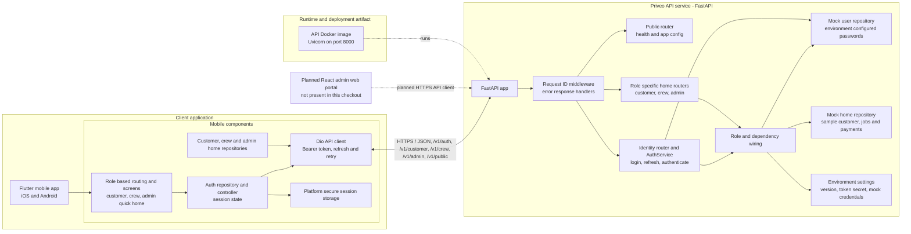

# Priveo system component diagram

This diagram reflects the application code currently in the repository (Phase 0). Solid components and connections are implemented. The dashed web portal is described in the product architecture, but there is no `apps/admin-web` code in this checkout.

## Component responsibilities

| Component | Current responsibility |
|---|---|
| Flutter mobile app | One app with role-selected customer, crew, or admin quick-action home. |
| Mobile API client | Sends JSON requests, attaches bearer access tokens, and attempts one refresh and retry after a 401. |
| Mobile session storage | Stores the signed-in session in platform secure storage. |
| FastAPI app | Registers public, auth, customer-home, crew-home, and admin-home routes. |
| Identity | Checks configured mock accounts, issues stateless signed access and refresh tokens, and authenticates role-protected requests. |
| Home | Returns role-specific home data through repository interfaces. The current implementation is sample data. |
| Platform | Provides environment configuration, request IDs, error envelopes, and shared dependency wiring. |
| API container | Packages and runs the FastAPI app with Uvicorn. |

## Current scope and limitations

- The mobile client calls the API directly; a gateway or load balancer is not represented as implemented code.
- The backend uses mock in-memory repositories. There is no PostgreSQL, S3, email, push, payment, scheduler, or background-job integration in the current application code.
- The web portal is a planned client only. Its dashed connection represents the intended integration, not a working application.
- The API exposes `/v1/auth/login`, `/v1/auth/refresh`, `/v1/auth/logout`, `/v1/public/health`, `/v1/public/config`, and role-protected `/v1/{customer,crew,admin}/home` endpoints.
- The broader modular-monolith, AWS, PostgreSQL, media, notification, and scheduling design is documented in [`architecture.md`](architecture.md), but is not yet represented by these runtime components.
