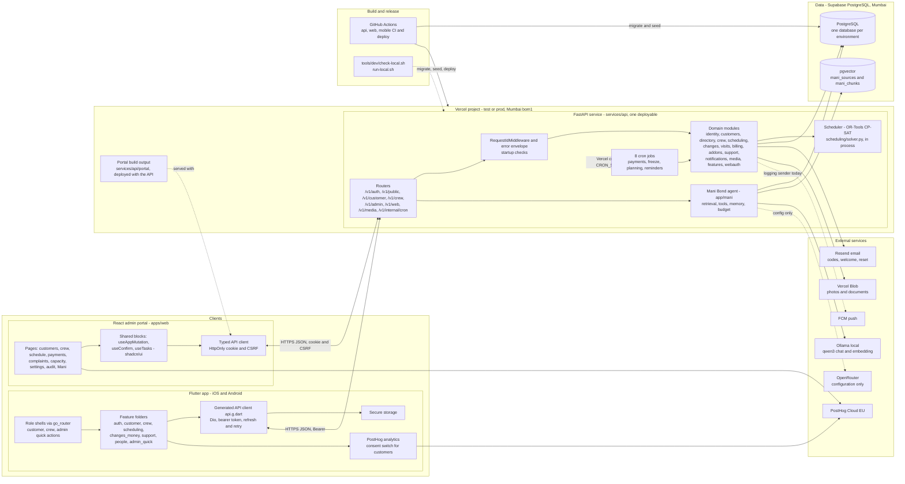

# Priveo system component diagram

**Updated 31-Oct-2026** from the code on branch `feat/mani-portal-wiring` (migration head 0042). It replaces the Phase 0 diagram, which showed mock repositories and no database. Hosting is the interim setup of 29-Oct-2026 (Vercel and Supabase). The AWS target is in [`architecture.md`](architecture.md).

Solid lines are built in the repository. Dashed lines are configured or planned but not live. The legend at the end says which is which.

## Component responsibilities

| Component | Responsibility |
|---|---|
| Flutter app | One app for customer, crew and the admin quick actions. The role on the login picks the shell. Models and API calls are generated from `packages/api-contract/openapi.json`. Tokens sit in secure storage. |
| React admin portal | Every admin function. Calls the `admin` routes with an HttpOnly cookie and CSRF, a 60-minute inactivity limit. Built into `services/api/portal` and deployed with the API. |
| FastAPI service | One modular monolith. Routers check the caller and call services, services hold the rules. Errors use one envelope (`code`, `message`, `fields`, `request_id`). On start it refuses to run with a missing `TOKEN_SECRET`, a bad `ENVIRONMENT` or dev-only settings in prod. |
| Domain modules | `identity` (logins, blocks, sessions), `customers`, `directory`, `crew`, `scheduling` (the only writer of scheduled visits), `changes` (skip, pause, 9 PM rule), `visits`, `billing` (UPI statuses, Over due, Inactive), `addons`, `support`, `notifications`, `media`, `features` (flags), `webauth`. |
| Scheduler | OR-Tools CP-SAT in the same service. `solve(inputs)` is a pure function. The result is a Draft schedule, frozen at 8 PM the day before. The automatic planner is coded and off by default. |
| Cron jobs | Eight routes under `/v1/internal/cron/`, started by Vercel cron and checked with `CRON_SECRET`: crew society moves, automatic planning, freeze due, payments generate, payments overdue, renewal reminders, check-in notify, complaints overdue. The Mani retention job uses the same route. |
| Mani Bond | Admin-only agent at `/v1/admin/mani`. Hybrid search (vector and words) over the indexed docs and code, ten read-only live data tools, memory, a spending budget and 90-day retention. Local backend is Ollama; OpenRouter is configuration only. |
| PostgreSQL | One Supabase database per environment (test and prod). Alembic migrations written by hand run in the deploy step. The `mani_chunks` table holds `vector(1024)` embeddings. |
| Media | Photos and documents go to Vercel Blob through the API when `BLOB_READ_WRITE_TOKEN` is set, otherwise to a local dev store. |
| Email and push | Resend sends codes and the welcome email; without a key a logging sender is used. Push is a logging sender until FCM is set up. |
| Analytics | PostHog Cloud EU in the app and the portal. Session replay is off in release builds. |
| Delivery | GitHub Actions: `api-ci`, `api-deploy` (test on every merge to `main`; production on a `v*` tag or manual run after approval), `web-ci`, `web-e2e`, `mobile-ci`, goldens, integration, Android release. `tools/dev/check-local.sh` runs the same checks on a Mac. |

## Legend: what is live

| Status | Components |
|---|---|
| Built and running | FastAPI service and modules, PostgreSQL on Supabase (test), portal, Flutter app, scheduler, cron jobs on Vercel, PostHog |
| Built, not yet live | Resend sending (key given, sending-domain verification left), Mani on test or prod (local only for now) |
| Logging stand-in | Push (FCM not connected), media on a local store when no Blob token |
| Planned | AWS Mumbai with a private RDS (ECS Fargate, S3, EventBridge), OpenRouter backend, a gateway or WAF in front of the API |

## Differences from the AWS target

`architecture.md` §2 draws CloudFront, an ALB, ECS, RDS, S3, EventBridge, FCM and Resend. Today the Vercel project replaces the load balancer and ECS, Vercel cron replaces EventBridge, Vercel Blob stands in for S3, and Supabase replaces RDS. The database is reached over TLS and credentials, not from a private subnet, so checkpoints N3 and N5 in `architecture.md` §7.1 are not met yet.
