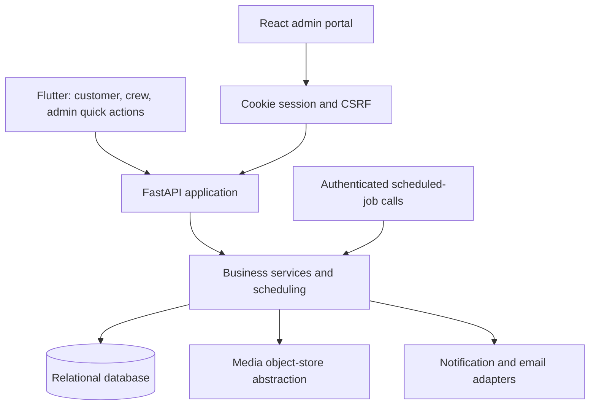

# Architecture

Priveo's **architecture** combines a Flutter mobile application, a React administrator portal and a shared FastAPI backend. Business behavior is organized into modules within one application rather than separate domain microservices.[^1][^2]

## Component relationships

This diagram summarizes repository components, not a verified production topology. PostgreSQL is the selected application database; isolated SQLite is also used for tests and local fixtures. Private RDS, S3 and EventBridge are part of the selected AWS launch direction, with integration work still documented.[^1][^3][^4]

## Backend boundaries

The FastAPI composition root registers identity, customer administration, directory, crew, scheduling, customer reads, visits, media, changes, billing, add-ons, support, notifications and web authentication. This is substantially broader than the historical Phase 0 component diagram.[^2]

The architectural design separates transport parsing and role checks from business services, storage models and schemas. The implementation should be consulted for actual module names and boundaries: the older architecture document includes proposed layers and modules that do not map one-for-one to current directories.[^1][^2]

Scheduling uses a solver independent of database access, with application services loading inputs and persisting outcomes. Customer-read projections assemble presentation views. Time-dependent rules are enforced server-side using IST rather than trusting the phone clock.[^1][^5]

## Repository map

| Path | Responsibility |
|---|---|
| `apps/mobile/` | Flutter clients and role experiences |
| `apps/web/` | React administrator portal |
| `services/api/` | FastAPI service, migrations, scripts and backend tests |
| `packages/api-contract/` | Exported OpenAPI contract |
| `docs/reqs/` | Functional requirements and owner decisions |
| `docs/brand/` | Shared design tokens and logos |
| `tools/` | Fixtures, coverage, development and deployment tooling |
| `.github/workflows/` | CI, integration and release automation |

The portal path is `apps/web`, not the `apps/admin-web` placeholder in early design material.[^6]

## Integration boundaries

Resend is selected for email and FCM for push. Media storage has local and Vercel Blob implementations with private S3 still identified as launch work. Scheduled jobs call existing business services through an authenticated internal interface. Deployment must configure actual providers and invocation, not merely expose endpoints.[^3][^7]

Mobile queueing protects crew evidence during poor connectivity. Customers and administrators otherwise follow an online-first model. An at-once multi-client refresh transport remains distinct from persisted state and provider notification delivery.[^1][^3]

## See also

- [API and data model](API_and_data_model.md)
- [Deployment and hosting](Deployment_and_hosting.md)
- [Development](Development.md)

## References

[^1]: [Architecture draft](../docs/architecture.md), principles and component design.
[^2]: [Application composition root](../services/api/app/main.py).
[^3]: [Implementation handoff](../docs/codex-handoff-plan.md), integration and refresh work.
[^4]: [Owner decisions, 19 October](../docs/reqs/owner-decisions-2026-10-19.md), hosting choice; [test report](../docs/testing/test-report-2026-10-20.md).
[^5]: [Solver](../services/api/app/scheduling/solver.py); [change rules](../services/api/app/changes/rules.py).
[^6]: [Mobile manifest](../apps/mobile/pubspec.yaml); [web package](../apps/web/package.json); [API project](../services/api/pyproject.toml).
[^7]: [Object stores](../services/api/app/media/store.py); [cron router](../services/api/app/notifications/cron.py).

---

[Main page](README.md) | [Glossary](Glossary.md) | [Editorial guidelines](Editorial_guidelines.md)

*Evidence reviewed: 20 October 2026. Requirements, implementation and verification may have different status.*
